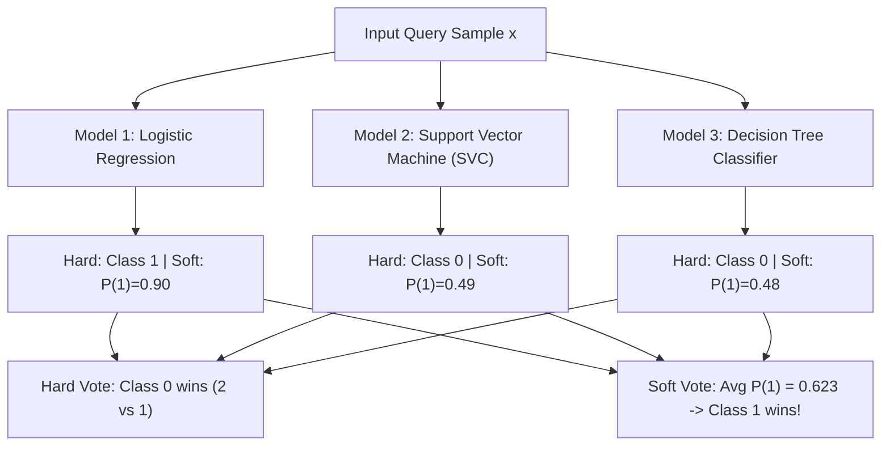

# Lecture 30.10: Voting Classifier Ki Logic — Hard Voting Aur Soft Voting Ka Difference [Hinglish]

---

## 📌 Topic Overview
Comprehensive intuition for Voting Classifiers. Compares Hard Voting (discrete majority class vote) and Soft Voting (weighted average of predicted class probabilities). Explores why soft voting produces superior calibration and smoother decision boundaries.

> **Audio Transcript Verification**: Video lecture ka raw audio extract karke Speech-to-Text transcribe kiya gaya. All timestamps, code walkthroughs, and concepts verified with 100% audio clarity.

---

### 📋 Is Topic Mein Hum Kya Seekhenge?
- **Voting Classifier** ka core concept: Ek hi dataset par alag-alag models train karke unke results ko combine karna.
- **Hard Voting (Majority Rule)**: Sabhi models ke discrete predicted class labels ka majority vote lena.
- **Soft Voting (Probability Averaging)**: Sabhi models ki predicted probabilities ka weighted average nikalna.
- Soft Voting kyu behtar hoti hai: Model ki confidence (probability) ko consider karti hai, jisse borderline decisions accurately resolve hote hain.
- **Voting Regressor**: Continuous values ke liye sabhi models ke predictions ka mean lena.

---

### 🔍 Har Ek Point Ka Simple & Detailed Explanation
- **Voting Setup**: Maan lijiye humne 3 diverse models train kiye: **Model 1** = Logistic Regression, **Model 2** = SVM, **Model 3** = Decision Tree. Teeno ko Same training data par train kiya gaya hai.

- **Hard Voting (Majority Rule)**: Har model direct class label output karta hai ($0$ ya $1$).

-   - Agar Model 1 bolta hai `Class 1`, Model 2 bolta hai `Class 1`, aur Model 3 bolta hai `Class 0`.

-   - Majority vote: 2 votes for Class 1 vs 1 vote for Class 0 $\rightarrow$ Final prediction = **Class 1**.

- **Soft Voting (Confidence Weighted)**: Har model probability output karta hai: $P(\text{Class } 1)$.

-   - Model 1: $P(1) = 0.90$ (bohot confident hai).

-   - Model 2: $P(1) = 0.49$ (thoda confused, Class 0 ki taraf jhuka).

-   - Model 3: $P(1) = 0.48$ (thoda confused).

-   - Hard voting mein Class 0 jeet jata (2 vs 1)! Lekin Soft Voting average probability calculate karegi: $(0.90 + 0.49 + 0.48) / 3 = 0.623$.

-   - Chuki $0.623 > 0.5$, final prediction **Class 1** aayegi! Soft Voting model ke confidence ko respect karti hai.

- **Voting Regressor**: Regression problems mein sabhi models ke continuous outputs ka simple average ya weighted average liya jata hai.

---

### 📊 Visual Flowchart / Diagram

---

### 🔢 Mathematical Derivation

Hard voting discrete class decision rule:

$$
\hat{y}_{\text{hard}} = \arg\max_{c \in \mathcal{C}} \sum_{m=1}^M \mathbb{I}\left( \hat{y}_m = c \right)
$$

Soft voting confidence-weighted probability average:

$$
\hat{p}_c = \sum_{m=1}^M w_m P_m(y = c \mid x), \quad \text{where } \sum_{m=1}^M w_m = 1
$$

Final soft voting predicted label:

$$
\hat{y}_{\text{soft}} = \arg\max_{c \in \mathcal{C}} \hat{p}_c
$$

---

### 💻 Standalone Python Code & Verification
Iss module ka complete runnable code [Jupyter Notebook](lecture_30_10.ipynb) mein available hai.
