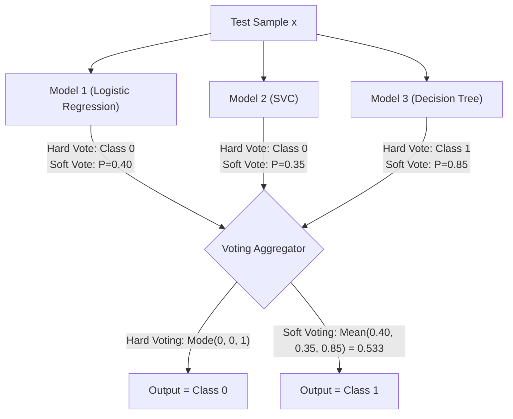

# Lecture 30.10: Voting Classifier Ki Logic — Hard Voting vs Soft Voting Ka Deep Funda [Hinglish]

[](#)
[](lecture_30_10.ipynb)
[](README.md)
[](notes.pdf)
[](notes_hinglish.pdf)

---

## 📌 Topic Overview
Conceptual and algorithmic mechanics of Voting Classifiers and Voting Regressors. Contrasts Hard Voting (majority plurality rule based on discrete class labels) with Soft Voting (argmax over average predicted class probabilities). Explains why Soft Voting consistently outperforms Hard Voting by incorporating model prediction confidences.

---

### 📋 Is Topic Mein Hum Kya Seekhenge?
- Voting Architecture: Democracy (Janta ki Raay) ka principle machine learning mein.
- Hard Voting (Majority Plurality): Discrete class labels ka mode nikalna.
- Soft Voting (Probability Averaging): Confidence probabilities ka weighted average nikalna.
- Soft Voting hamesha Hard Voting se behtar kyu hoti hai (High-confidence vs Low-confidence votes).
- Voting Regressor: Multiple regression models ke outputs ka simple average nikalna.

---

### 🔍 Har Ek Point Ka Simple & Detailed Explanation
**Democracy in Machine Learning**: Voting ensemble bilkul chunav (election) ki tarah kaam karta hai. Har base model ek voter hai jo apna vote deta hai, aur final faisla majority rule se hota hai.

**Hard Voting (Label Counting)**:

- Har model discrete label deta hai ($0$ ya $1$).
- Blackboard example:
  - Model 1 (Logistic Regression): Predicts Class 0
  - Model 2 (SVC): Predicts Class 0
  - Model 3 (Decision Tree): Predicts Class 1
- Votes: Class 0 ke 2 votes, Class 1 ka 1 vote $\implies$ Winner: **Class 0**!

**Soft Voting (Probability Averaging)**:

- Models seedhe label nahi dete, balki class hone ki probability (confidence) batate hain.
- Example:
  - Model 1: $P(Class 1) = 0.90$ (Bohot sure hai!)
  - Model 2: $P(Class 1) = 0.48$ (Borderline confued, 0.52 for Class 0)
  - Model 3: $P(Class 1) = 0.45$ (Borderline confused, 0.55 for Class 0)
- **Hard Voting mein**: Class 0 jeet jata (2 vs 1)!
- **Soft Voting mein**: Average $P(Class 1) = (0.90 + 0.48 + 0.45) / 3 = 0.61 \ge 0.5 \implies$ Winner: **Class 1**!
- Soft voting jeet gayi kyunki Model 1 ka high confidence (0.90) borderline models ki galti ko correct kar deta hai!

**Requirement for Soft Voting**: Sabhi base models calibrated probabilities dene ke kabil hone chahiye (e.g. `SVC(probability=True)`).

---

### 📊 Visual Flowchart / Diagram



---

### 🛠️ Mathematical Formulations
For hard voting across $K$ base classifiers with discrete predictions $h_k(\mathbf{x}) \in \{0, 1\}$:

$$
\hat{y}_{\text{hard}} = \text{mode}\{h_1(\mathbf{x}), h_2(\mathbf{x}), \dots, h_K(\mathbf{x})\} = \arg\max_{c} \sum_{k=1}^K \mathbb{I}(h_k(\mathbf{x}) = c)
$$

For soft voting with predicted class probabilities $P_k(y = c | \mathbf{x})$:

$$
\hat{y}_{\text{soft}} = \arg\max_{c} \frac{1}{K} \sum_{k=1}^K P_k(y = c | \mathbf{x})
$$

---

### 💻 Python Code Implementation

```python
import numpy as np

def demonstrate_hard_vs_soft_voting():
    """
    Demonstrates the concrete scenario where Soft Voting outperforms Hard Voting
    by incorporating model prediction confidence probabilities.
    """
    # Probabilities of Class 1 from 3 heterogeneous models
    # Model 1 is highly confident; Models 2 & 3 are marginal (barely below 0.5)
    model_probabilities = np.array([0.90, 0.48, 0.45])
    
    # 1. Hard Voting: threshold each at 0.5
    hard_votes = (model_probabilities >= 0.5).astype(int)
    counts = np.bincount(hard_votes, minlength=2)
    hard_prediction = int(np.argmax(counts))
    
    # 2. Soft Voting: mean probability
    mean_probability = float(np.mean(model_probabilities))
    soft_prediction = int(mean_probability >= 0.5)
    
    return {
        "individual_probabilities": model_probabilities.tolist(),
        "hard_votes": hard_votes.tolist(),
        "hard_prediction": hard_prediction,
        "mean_probability": mean_probability,
        "soft_prediction": soft_prediction
    }

# ----------------- Driver Execution & Testing -----------------
if __name__ == "__main__":
    res = demonstrate_hard_vs_soft_voting()
    print("=" * 60)
    print("--- HARD VS SOFT VOTING MECHANICS COMPARISON ---")
    print(f"Model Probabilities P(y=1) : {res['individual_probabilities']}")
    print(f"Discrete Hard Votes         : {res['hard_votes']} (Class 0: 2, Class 1: 1)")
    print(f"-> Hard Voting Prediction   : Class {res['hard_prediction']}")
    print(f"Average Ensemble Probability: {res['mean_probability']:.4f}")
    print(f"-> Soft Voting Prediction   : Class {res['soft_prediction']}")
    print("=" * 60)
```

---

### 📌 Summary Points & Key Takeaways
1. **Model Diversity**: Alag-alag algorithm families ko combine karne se error correlation kam hoti hai.
2. **K-Fold OOF Split**: Stacking mein data leakage rokne ke liye out-of-fold predictions par meta-learner train hota hai.
3. **Soft Voting Advantage**: High-confidence probabilities borderline models ki galtiyon ko dominate karke accurate prediction deti hain.
