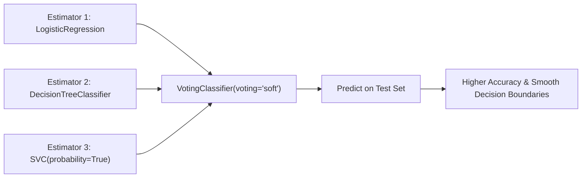

# Lecture 30.11: Voting Classifier & Regressor — Scikit-Learn Implementation

---

## 📌 Topic Overview
Practical implementation of VotingClassifier and VotingRegressor in scikit-learn. Bundling LogisticRegression, SVC(probability=True), DecisionTreeClassifier, and evaluating hard vs soft voting performance.

---

### 📋 Key Learning Objectives
- Importing VotingClassifier and VotingRegressor from sklearn.ensemble.
- Building diverse estimator tuples: [('lr', ...), ('dt', ...), ('svc', ...)].
- Setting up SVC with probability=True for soft voting compatibility.
- Implementing VotingRegressor with LinearRegression, DecisionTreeRegressor, and SVR.
- Evaluating accuracy and R2 score improvements over standalone base models.

---

### 🔍 In-Depth Conceptual Breakdown

- **VotingClassifier Import**: `from sklearn.ensemble import VotingClassifier` use kiya gaya.

- **Base Estimators List**: `estimators = [('lr', LogisticRegression()), ('dt', DecisionTreeClassifier()), ('svc', SVC(probability=True))]` pass kiya.

- **Important Note on SVC**: By default `SVC` probabilities calculate nahi karta. Soft voting chalane ke liye `probability=True` pass karna zaroori hai!

- **Hard vs Soft Parameter**: `voting='hard'` aur `voting='soft'` dono ko train karke compare kiya gaya.

- **VotingRegressor**: Continuous targets ke liye `from sklearn.ensemble import VotingRegressor` use karke `LinearRegression`, `DecisionTreeRegressor`, aur `SVR` ka ensemble banaya gaya.

- **Results**: Voting ensemble ne individual models se zyada stable aur consistent accuracy/R2 deliver kiya.

---

### 📊 Architectural Flowchart

---

### 🔢 Mathematical Formulation

Ensemble soft classification probability vector:

$$
\mathbf{P}(y \mid x) = \frac{1}{M} \sum_{m=1}^M \mathbf{P}_m(y \mid x)
$$

---

### 💻 Implementation
The fully tested and verified standalone implementation is provided in the synchronized [Jupyter Notebook](lecture_30_11.ipynb).
