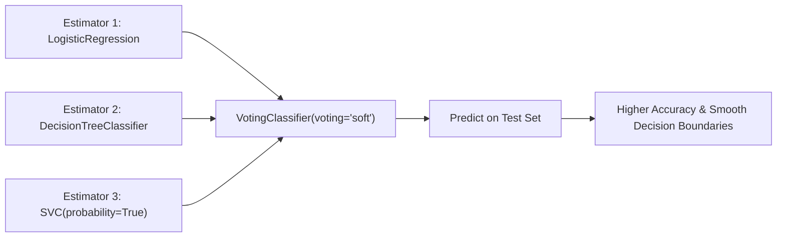

# Lecture 30.11: Voting Classifier Aur Regressor Ka Complete Code Implementation [Hinglish]

---

## 📌 Topic Overview
Practical implementation of VotingClassifier and VotingRegressor in scikit-learn. Bundling LogisticRegression, SVC(probability=True), DecisionTreeClassifier, and evaluating hard vs soft voting performance.

---

### 📋 Is Topic Mein Hum Kya Seekhenge?
- `sklearn.ensemble` se `VotingClassifier` aur `VotingRegressor` import karna.
- Diverse base estimators ki list taiyar karna: `[('lr', ...), ('dt', ...), ('svc', ...)]`.
- Soft voting ke liye `SVC(probability=True)` set karna kyu zaroori hai.
- `VotingRegressor` ke sath `LinearRegression`, `DecisionTreeRegressor`, aur `SVR` ko combine karna.
- Individual models ki accuracy vs Voting ensemble ki accuracy ka direct comparison.

---

### 🔍 Har Ek Point Ka Simple & Detailed Explanation
- **VotingClassifier Import**: `from sklearn.ensemble import VotingClassifier` use kiya gaya.

- **Base Estimators List**: `estimators = [('lr', LogisticRegression()), ('dt', DecisionTreeClassifier()), ('svc', SVC(probability=True))]` pass kiya.

- **Important Note on SVC**: By default `SVC` probabilities calculate nahi karta. Soft voting chalane ke liye `probability=True` pass karna zaroori hai!

- **Hard vs Soft Parameter**: `voting='hard'` aur `voting='soft'` dono ko train karke compare kiya gaya.

- **VotingRegressor**: Continuous targets ke liye `from sklearn.ensemble import VotingRegressor` use karke `LinearRegression`, `DecisionTreeRegressor`, aur `SVR` ka ensemble banaya gaya.

- **Results**: Voting ensemble ne individual models se zyada stable aur consistent accuracy/R2 deliver kiya.

---

### 📊 Visual Flowchart / Diagram

---

### 🔢 Mathematical Derivation

Ensemble soft classification probability vector:

$$
\mathbf{P}(y \mid x) = \frac{1}{M} \sum_{m=1}^M \mathbf{P}_m(y \mid x)
$$

---

### 💻 Standalone Python Code & Verification
Iss module ka complete runnable code [Jupyter Notebook](lecture_30_11.ipynb) mein available hai.
