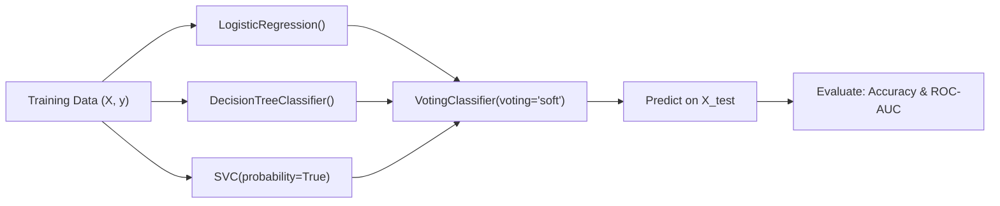

# Lecture 30.11: Voting Classifier Ka Python Code — Scikit-Learn Implementation [Hinglish]

[](#)
[](lecture_30_11.ipynb)
[](README.md)
[](notes.pdf)
[](notes_hinglish.pdf)

---

## 📌 Topic Overview
Production implementation of VotingClassifier and VotingRegressor in Scikit-Learn. Combines heterogeneous learners (Logistic Regression, Decision Trees, Support Vector Machines) with both hard and soft voting configurations. Evaluates metric improvements over standalone base models.

---

### 📋 Is Topic Mein Hum Kya Seekhenge?
- Scikit-Learn se `VotingClassifier` aur `VotingRegressor` import karna.
- Heterogeneous Base Estimators ki list banana: `estimators=[('lr', lr), ('dt', dt), ('svc', svc)]`.
- `voting='hard'` vs `voting='soft'` parameter pass karna.
- `SVC` ko soft voting mein use karne ke liye `probability=True` lagana kyu zaroori hai.
- `VotingRegressor` se continuous regression outputs ka average lena.

---

### 🔍 Har Ek Point Ka Simple & Detailed Explanation
**Scikit-Learn Import**: `from sklearn.ensemble import VotingClassifier, VotingRegressor`.

**Base Estimators List**: Tuples ki list pass karni hoti hai jahan har tuple mein `('model_name', model_object)` hota hai.

**SVC Probability Mandate**: Support Vector Classifier (`SVC`) default roop se probabilities calculate nahi karta. Agar aap `voting='soft'` use kar rahe hain, toh strictly `SVC(probability=True)` likhna padega, warna Scikit-Learn error throw karega!

**Weighting Parameter**: Agar koi model zyada reliable hai, toh aap `weights=[2, 1, 1]` dekar uske vote ki importance badha sakte hain.

---

### 📊 Visual Flowchart / Diagram



---

### 🛠️ Mathematical Formulations
Weighted Soft Voting prediction across base estimators with weights $w_k$:

$$
\hat{y} = \arg\max_c \frac{\sum_{k=1}^K w_k P_k(y = c | \mathbf{x})}{\sum_{k=1}^K w_k}
$$

---

### 💻 Python Code Implementation

```python
import numpy as np
from sklearn.datasets import make_classification
from sklearn.model_selection import train_test_split
from sklearn.linear_model import LogisticRegression
from sklearn.tree import DecisionTreeClassifier
from sklearn.svm import SVC
from sklearn.ensemble import VotingClassifier
from sklearn.metrics import accuracy_score

def train_heterogeneous_voting_classifier(random_state=42):
    """
    Builds, trains, and compares standalone models against Hard and Soft VotingClassifiers.
    """
    X, y = make_classification(
        n_samples=600, n_features=8, n_informative=5, random_state=random_state
    )
    X_train, X_test, y_train, y_test = train_test_split(
        X, y, test_size=0.25, random_state=random_state, stratify=y
    )
    
    # 1. Base Estimators
    clf_lr = LogisticRegression(random_state=random_state)
    clf_dt = DecisionTreeClassifier(max_depth=4, random_state=random_state)
    clf_svc = SVC(probability=True, random_state=random_state)
    
    # Train standalone base models
    clf_lr.fit(X_train, y_train)
    clf_dt.fit(X_train, y_train)
    clf_svc.fit(X_train, y_train)
    
    acc_lr = accuracy_score(y_test, clf_lr.predict(X_test))
    acc_dt = accuracy_score(y_test, clf_dt.predict(X_test))
    acc_svc = accuracy_score(y_test, clf_svc.predict(X_test))
    
    # 2. Hard Voting Ensemble
    voting_hard = VotingClassifier(
        estimators=[('lr', clf_lr), ('dt', clf_dt), ('svc', clf_svc)],
        voting='hard'
    )
    voting_hard.fit(X_train, y_train)
    acc_hard = accuracy_score(y_test, voting_hard.predict(X_test))
    
    # 3. Soft Voting Ensemble
    voting_soft = VotingClassifier(
        estimators=[('lr', clf_lr), ('dt', clf_dt), ('svc', clf_svc)],
        voting='soft'
    )
    voting_soft.fit(X_train, y_train)
    acc_soft = accuracy_score(y_test, voting_soft.predict(X_test))
    
    results = {
        "LogisticRegression": acc_lr,
        "DecisionTree": acc_dt,
        "SVC": acc_svc,
        "Voting_Hard": acc_hard,
        "Voting_Soft": acc_soft
    }
    return results

# ----------------- Driver Execution & Testing -----------------
if __name__ == "__main__":
    benchmark = train_heterogeneous_voting_classifier()
    print("=" * 60)
    print("--- HETEROGENEOUS VOTING CLASSIFIER BENCHMARK ---")
    for model_name, acc in benchmark.items():
        print(f"  {model_name:22s} Test Accuracy: {acc * 100:.2f}%")
    print("=" * 60)
```

---

### 📌 Summary Points & Key Takeaways
1. **Model Diversity**: Alag-alag algorithm families ko combine karne se error correlation kam hoti hai.
2. **K-Fold OOF Split**: Stacking mein data leakage rokne ke liye out-of-fold predictions par meta-learner train hota hai.
3. **Soft Voting Advantage**: High-confidence probabilities borderline models ki galtiyon ko dominate karke accurate prediction deti hain.
