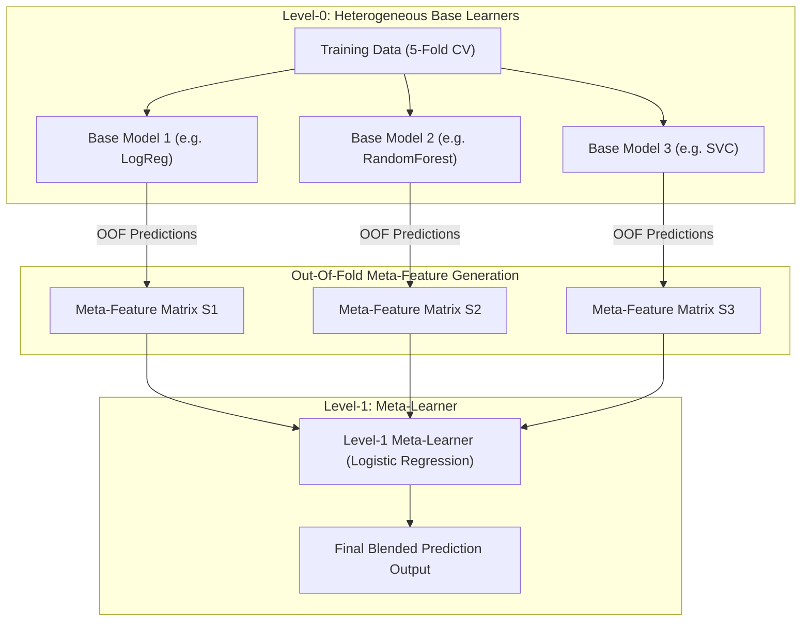

# Lecture 30.12: Stacking (Stacked Generalization) — Logic & Multi-Tier Architecture

[](#)
[](lecture_30_12.ipynb)
[](README_HINGLISH.md)
[](notes.pdf)
[](notes_hinglish.pdf)

---

## 📌 Topic Overview
Deep theoretical foundation of Stacking (Stacked Generalization by David Wolpert, 1992). Explains the two-tier hierarchy: Level-0 heterogeneous base models and Level-1 Meta-Learner. Dissects the catastrophic overfitting trap of naive stacking and formulates K-Fold Out-Of-Fold (OOF) cross-validation to construct leakage-free meta-features.

---

### 🗺️ Visual Architecture Diagram



---

### 🛠️ Mathematical Mechanics & Theoretical Foundations
Given $K$-fold partition $\{\mathcal{D}_1, \dots, \mathcal{D}_K\}$, for each fold $k$, base learner $m$ is trained on $\mathcal{D} \setminus \mathcal{D}_k$ and evaluates out-of-fold predictions on $\mathcal{D}_k$:

$$
s_{im} = \hat{f}_m^{(-k)}(\mathbf{x}_i), \quad \forall i \in \mathcal{D}_k
$$

The meta-feature row vector for sample $i$ is $\mathbf{s}_i = [s_{i1}, s_{i2}, \dots, s_{iM}]^T$.
The Level-1 Meta-Learner $g(\cdot)$ minimizes empirical risk on the meta-dataset:

$$
\min_{\mathbf{\beta}} \sum_{i=1}^N \mathcal{L}\left( y_i, g(\mathbf{s}_i; \mathbf{\beta}) \right)
$$

---

### 💻 Python Production Implementation

```python
import numpy as np
from sklearn.model_selection import KFold
from sklearn.base import clone

def generate_out_of_fold_meta_features(base_models, X, y, cv=5):
    """
    Generates leakage-free Out-Of-Fold (OOF) meta-features for Stacking.
    
    Parameters:
    -----------
    base_models : list of tuples ('name', estimator)
        Level-0 base estimators.
    X : ndarray of shape (N, d)
        Training feature matrix.
    y : ndarray of shape (N,)
        Target vector.
    cv : int, default=5
        Number of cross-validation folds.
        
    Returns:
    --------
    meta_features : ndarray of shape (N, len(base_models))
        Constructed OOF prediction matrix for the Level-1 Meta-Learner.
    """
    N = len(X)
    num_models = len(base_models)
    meta_features = np.zeros((N, num_models))
    
    kf = KFold(n_splits=cv, shuffle=True, random_state=42)
    
    for m_idx, (name, model) in enumerate(base_models):
        for train_idx, val_idx in kf.split(X, y):
            X_tr, X_val = X[train_idx], X[val_idx]
            y_tr, y_val = y[train_idx], y[val_idx]
            
            # Fit clone on K-1 folds
            cloned_model = clone(model)
            cloned_model.fit(X_tr, y_tr)
            
            # Predict out-of-fold on holdout fold
            if hasattr(cloned_model, "predict_proba"):
                meta_features[val_idx, m_idx] = cloned_model.predict_proba(X_val)[:, 1]
            else:
                meta_features[val_idx, m_idx] = cloned_model.predict(X_val)
                
    return meta_features

# ----------------- Driver Execution & Testing -----------------
if __name__ == "__main__":
    from sklearn.linear_model import LogisticRegression
    from sklearn.tree import DecisionTreeClassifier
    from sklearn.neighbors import KNeighborsClassifier
    
    X_synth = np.random.randn(100, 4)
    y_synth = (X_synth[:, 0] + X_synth[:, 1] > 0).astype(int)
    
    models = [
        ('lr', LogisticRegression()),
        ('dt', DecisionTreeClassifier(max_depth=3)),
        ('knn', KNeighborsClassifier(n_neighbors=5))
    ]
    
    oof_matrix = generate_out_of_fold_meta_features(models, X_synth, y_synth, cv=5)
    print("=" * 60)
    print("--- OUT-OF-FOLD (OOF) META-FEATURE MATRIX SHAPE ---")
    print(f"Generated Meta-Features Shape : {oof_matrix.shape} (N samples, M models)")
    print(f"First 3 Rows (Model Predictions):\n{oof_matrix[:3].round(3)}")
    print("=" * 60)
```

---

### 🔑 Critical Architectural Takeaways
1. **Multi-Family Generalization**: Combining diverse inductive biases (linear, tree-based, margin-based, metric-based) cancels out individual model blindspots.
2. **Leakage Protection via OOF**: Cross-validated out-of-fold predictions ensure the Level-1 meta-model optimizes strictly on unseen generalization behaviors.
3. **Calibrated Confidence Weights**: Soft voting and meta-learning outperform simple hard voting by incorporating prediction probability confidences.
