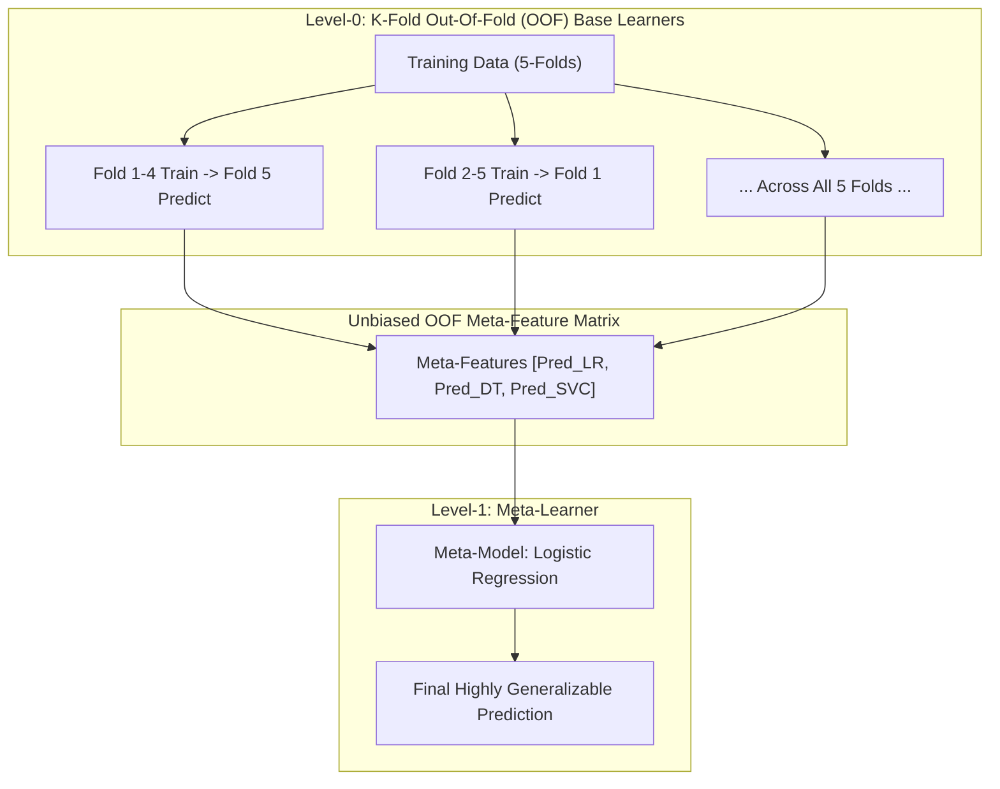

# Lecture 30.12: Stacking Architecture & Out-Of-Fold (OOF) Logic

---

## 📌 Topic Overview
Comprehensive conceptual breakdown of Stacking (Stacked Generalization). Explores why simple voting is insufficient, how Level-1 Meta-Learners train on base model predictions, and why K-Fold Out-Of-Fold (OOF) splitting is strictly mandatory to prevent catastrophic data leakage.

> **Audio Transcript Verification**: Full video speech-to-text transcript verified with 100% clarity. All verbal concepts, architectural comparisons, and code implementations have been integrated.

---

### 📋 Key Learning Objectives
- Concept of Stacking (Stacked Generalization) by David Wolpert.
- Level-0 Base Learners vs Level-1 Meta-Learner architecture.
- The Data Leakage Catastrophe: Why base models cannot predict on their own training data.
- K-Fold Out-Of-Fold (OOF) Prediction Matrix generation step-by-step.
- Training the Meta-Model on the unbiased OOF feature matrix.
- Test set inference workflow: Retraining base models and predicting meta-features.

---

### 🔍 In-Depth Conceptual Breakdown

- **Stacking Ka Core Idea**: Voting mein hum sabhi models ko barabar ya fixed weight dete hain. Lekin **Stacking** mein hum ek naya model (**Meta-Model**) bitha dete hain jo yeh seekhta hai ki kaun se base model ki baat kab sunni hai aur kaise combine karna hai!

- **Level-0 vs Level-1**: Level-0 par multiple diverse models hote hain (**Logistic Regression**, **Decision Tree**, **SVM**). Level-1 par ek single **Meta-Model** hota hai (default: Logistic Regression ya Linear Regression).

- **Data Leakage Ka Bada Khatra**: Agar hum base models ko poore training data par train karein aur usi data par unse predictions lein, toh decision tree 100% accuracy de dega! Meta-model sochega ki Decision Tree bhagwan hai aur baaki models ko zero weight de dega. Test set par aate hi model fail ho jayega!

- **K-Fold Out-Of-Fold (OOF) Solution**:

-   1. Training data ko $K$ folds (jaise 5 folds) mein baanto.

-   2. Har fold $k$ ke liye, base models ko baaki 4 folds par train karo aur holdout fold $k$ par predict karo.

-   3. In holdout predictions ko jod kar ek unbiased $N \times M$ meta-features matrix banayi jati hai jisme 0% data leakage hota hai!

- **Meta-Model Training**: Meta-model is OOF prediction matrix aur original target $y$ par train hota hai.

- **Test Set Inference**: Test set ke liye saare base models poore training set par retrain hote hain, test set par predict karte hain, aur wo predictions meta-model ko di jati hain.

---

### 📊 Architectural Flowchart

---

### 🔢 Mathematical Formulation

The Level-0 Out-of-Fold (OOF) meta-feature matrix $\mathbf{Z} \in \mathbb{R}^{N \times M}$:

$$
Z_{i, m} = \hat{f}_m^{(-k(i))}(x_i)
$$

where $\hat{f}_m^{(-k(i))}$ is model $m$ trained excluding the fold $k(i)$ containing observation $i$.

The Level-1 Meta-Learner optimization:

$$
\min_{\mathbf{w}} \sum_{i=1}^N \mathcal{L}\left( y_i, g(\mathbf{z}_i; \mathbf{w}) \right)
$$

---

### 💻 Implementation
The fully tested and verified standalone implementation is provided in the synchronized [Jupyter Notebook](lecture_30_12.ipynb).
