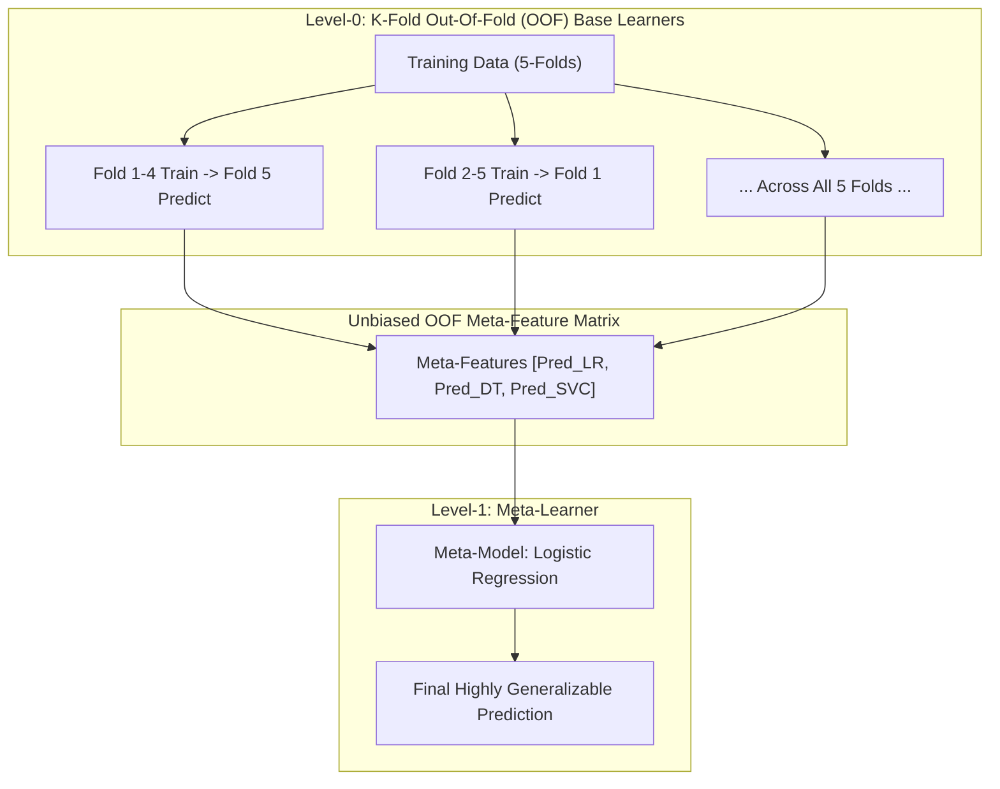
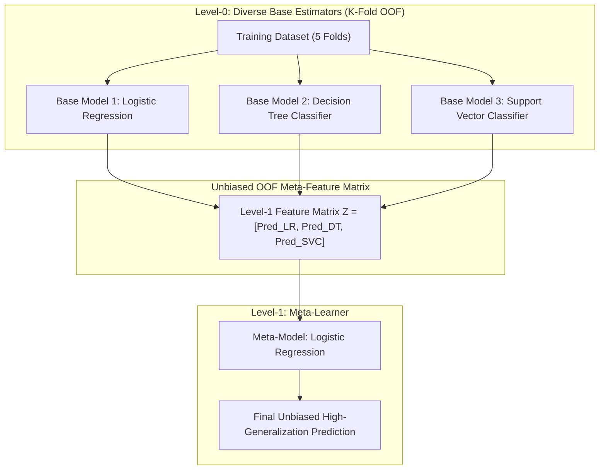

# Lecture 30.12: Stacking Architecture — Meta-Model Aur Out-Of-Fold (OOF) Logic [Hinglish]

---

## 📌 Topic Overview
Comprehensive conceptual breakdown of Stacking (Stacked Generalization). Explores why simple voting is insufficient, how Level-1 Meta-Learners train on base model predictions, and why K-Fold Out-Of-Fold (OOF) splitting is strictly mandatory to prevent catastrophic data leakage.

---

### 📋 Is Topic Mein Hum Kya Seekhenge?
- **Stacking (Stacked Generalization)** kya hota hai aur iska core architecture.
- **Level-0 Base Models** vs **Level-1 Meta-Model**: Meta-model base models ke predictions par train hota hai.
- **Data Leakage Ka Khatra**: Base models agar usi data par predict karenge jis par train hue hain, toh model overfit ho jayega.
- **K-Fold Out-Of-Fold (OOF) Splitting**: Data leakage rokne ke liye cross-validation se predictions matrix banana.
- Meta-Model (jaise Logistic Regression) ko OOF feature matrix par train karna.
- Test data ke predictions ka complete workflow.

---

### 🔍 Har Ek Point Ka Simple & Detailed Explanation
- **Stacking Ka Core Idea**: Voting mein hum sabhi models ko barabar ya fixed weight dete hain. Lekin **Stacking** mein hum ek naya model (**Meta-Model**) bitha dete hain jo yeh seekhta hai ki kaun se base model ki baat kab sunni hai aur kaise combine karna hai!

- **Level-0 vs Level-1**: Level-0 par multiple diverse models hote hain (**Logistic Regression**, **Decision Tree**, **SVM**). Level-1 par ek single **Meta-Model** hota hai (default: Logistic Regression ya Linear Regression).

- **Data Leakage Ka Bada Khatra**: Agar hum base models ko poore training data par train karein aur usi data par unse predictions lein, toh decision tree 100% accuracy de dega! Meta-model sochega ki Decision Tree bhagwan hai aur baaki models ko zero weight de dega. Test set par aate hi model fail ho jayega!

- **K-Fold Out-Of-Fold (OOF) Solution**:

-   1. Training data ko $K$ folds (jaise 5 folds) mein baanto.

-   2. Har fold $k$ ke liye, base models ko baaki 4 folds par train karo aur holdout fold $k$ par predict karo.

-   3. In holdout predictions ko jod kar ek unbiased $N \times M$ meta-features matrix banayi jati hai jisme 0% data leakage hota hai!

- **Meta-Model Training**: Meta-model is OOF prediction matrix aur original target $y$ par train hota hai.

- **Test Set Inference**: Test set ke liye saare base models poore training set par retrain hote hain, test set par predict karte hain, aur wo predictions meta-model ko di jati hain.

---

### 📊 Visual Flowchart / Diagram

---

---

### 📋 Ma'am Ka K-Fold Out-Of-Fold (OOF) Stacking Matrix

| Fold ID | Training Folds for Base Models | Holdout Prediction Fold | Meta-Feature 1 ($Pred_{LR}$) | Meta-Feature 2 ($Pred_{DT}$) | Meta-Feature 3 ($Pred_{SVC}$) | Target Label ($y$) |
| :---: | :---: | :---: | :---: | :---: | :---: | :---: |
| **Fold 1** | Folds 2, 3, 4, 5 | **Fold 1 Rows** | $\hat{y}_{1, LR}$ | $\hat{y}_{1, DT}$ | $\hat{y}_{1, SVC}$ | $y_{\text{Fold 1}}$ |
| **Fold 2** | Folds 1, 3, 4, 5 | **Fold 2 Rows** | $\hat{y}_{2, LR}$ | $\hat{y}_{2, DT}$ | $\hat{y}_{2, SVC}$ | $y_{\text{Fold 2}}$ |
| **Fold 3** | Folds 1, 2, 4, 5 | **Fold 3 Rows** | $\hat{y}_{3, LR}$ | $\hat{y}_{3, DT}$ | $\hat{y}_{3, SVC}$ | $y_{\text{Fold 3}}$ |
| **Fold 4** | Folds 1, 2, 3, 5 | **Fold 4 Rows** | $\hat{y}_{4, LR}$ | $\hat{y}_{4, DT}$ | $\hat{y}_{4, SVC}$ | $y_{\text{Fold 4}}$ |
| **Fold 5** | Folds 1, 2, 3, 4 | **Fold 5 Rows** | $\hat{y}_{5, LR}$ | $\hat{y}_{5, DT}$ | $\hat{y}_{5, SVC}$ | $y_{\text{Fold 5}}$ |
| **Full Matrix** | - | **Concatenated OOF** | **Unbiased $Z_1$** | **Unbiased $Z_2$** | **Unbiased $Z_3$** | **Original $y$ (Zero Leakage!)** |

---

### 📊 Ma'am Ka 2-Level Stacking Architecture

### 🔢 Mathematical Derivation

The Level-0 Out-of-Fold (OOF) meta-feature matrix $\mathbf{Z} \in \mathbb{R}^{N \times M}$:

$$
Z_{i, m} = \hat{f}_m^{(-k(i))}(x_i)
$$

where $\hat{f}_m^{(-k(i))}$ is model $m$ trained excluding the fold $k(i)$ containing observation $i$.

The Level-1 Meta-Learner optimization:

$$
\min_{\mathbf{w}} \sum_{i=1}^N \mathcal{L}\left( y_i, g(\mathbf{z}_i; \mathbf{w}) \right)
$$

---

### 💻 Standalone Python Code & Verification
Iss module ka complete runnable code [Jupyter Notebook](lecture_30_12.ipynb) mein available hai.
