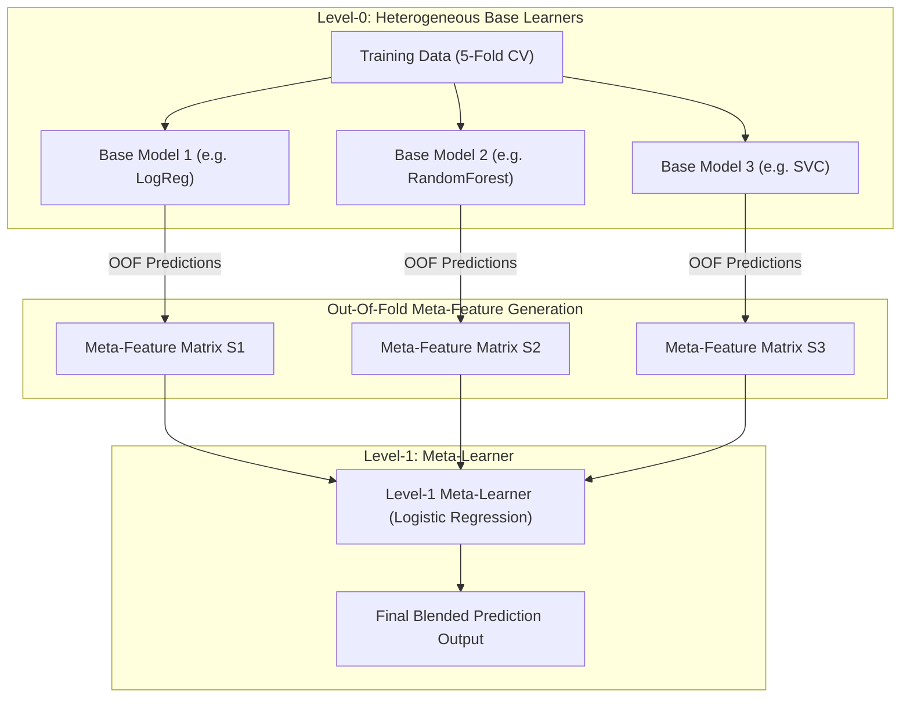

# Lecture 30.12: Stacking Ki Logic — Meta-Learner Aur K-Fold OOF Architecture [Hinglish]

[](#)
[](lecture_30_12.ipynb)
[](README.md)
[](notes.pdf)
[](notes_hinglish.pdf)

---

## 📌 Topic Overview
Deep theoretical foundation of Stacking (Stacked Generalization by David Wolpert, 1992). Explains the two-tier hierarchy: Level-0 heterogeneous base models and Level-1 Meta-Learner. Dissects the catastrophic overfitting trap of naive stacking and formulates K-Fold Out-Of-Fold (OOF) cross-validation to construct leakage-free meta-features.

---

### 📋 Is Topic Mein Hum Kya Seekhenge?
- Stacking (Stacked Generalization) kya hota hai: Meta-Learning ka concept.
- Level-0 Base Learners vs Level-1 Meta-Learner (Blender).
- Naive Stacking Ka Overfitting Trap: Train predictions seedhe meta-model ko kyu nahi de sakte.
- K-Fold Out-Of-Fold (OOF) Split: Zero data leakage ke sath meta-features generate karne ka golden rule.
- Test time par base models aur meta-model ka inference workflow.

---

### 🔍 Har Ek Point Ka Simple & Detailed Explanation
**Stacking Kya Hai?**: Voting mein hum sabhi models ke predictions ka simple mode ya average lete hain. Lekin Stacking ek step aage jata hai — yeh ek naya Machine Learning model (**Meta-Learner**) train karta hai jo yeh seekhta hai ki *kis base model par kab trust karna chahiye!*

**Two-Tier Architecture**:

- **Level-0 (Base Learners)**: Diverse models (e.g. Model 1: Logistic Regression, Model 2: Decision Tree, Model 3: SVM).
- **Level-1 (Meta-Learner)**: Ek simple linear model (jaise Logistic Regression) jo base models ke predictions ($P_1, P_2, P_3$) ko input feature maan kar final prediction karta hai.

**The Overfitting Trap (Khatarnaak Galti)**: Agar aap base models ko poore training data par train karoge aur unhi ke predictions meta-model ko de doge, toh base models ne data rat rakha hoga (overfit). Meta-model unke overfit confidence ko dekh kar poori tarah tabah ho jayega!

**Solution: K-Fold Out-Of-Fold (OOF) Cross-Validation**:

#### 6. 1. Training data ko $K$ folds (e.g. $K=5$) mein baanto.
2. 4 folds par base model train karo aur 5th holdout fold par predict karo.
3. Aise har fold ke liye predictions generate karo.
4. In out-of-fold predictions se meta-training matrix banta hai jisme ZERO data leakage hoti hai!

**Test Set Inference**: Test set par predictions lene ke liye, base models ko poore training data par retrain kiya jata hai aur unke outputs meta-model mein pass kiye jaate hain.

---

### 📊 Visual Flowchart / Diagram



---

### 🛠️ Mathematical Formulations
Given $K$-fold partition $\{\mathcal{D}_1, \dots, \mathcal{D}_K\}$, for each fold $k$, base learner $m$ is trained on $\mathcal{D} \setminus \mathcal{D}_k$ and evaluates out-of-fold predictions on $\mathcal{D}_k$:

$$
s_{im} = \hat{f}_m^{(-k)}(\mathbf{x}_i), \quad \forall i \in \mathcal{D}_k
$$

The meta-feature row vector for sample $i$ is $\mathbf{s}_i = [s_{i1}, s_{i2}, \dots, s_{iM}]^T$.
The Level-1 Meta-Learner $g(\cdot)$ minimizes empirical risk on the meta-dataset:

$$
\min_{\mathbf{\beta}} \sum_{i=1}^N \mathcal{L}\left( y_i, g(\mathbf{s}_i; \mathbf{\beta}) \right)
$$

---

### 💻 Python Code Implementation

```python
import numpy as np
from sklearn.model_selection import KFold
from sklearn.base import clone

def generate_out_of_fold_meta_features(base_models, X, y, cv=5):
    """
    Generates leakage-free Out-Of-Fold (OOF) meta-features for Stacking.
    
    Parameters:
    -----------
    base_models : list of tuples ('name', estimator)
        Level-0 base estimators.
    X : ndarray of shape (N, d)
        Training feature matrix.
    y : ndarray of shape (N,)
        Target vector.
    cv : int, default=5
        Number of cross-validation folds.
        
    Returns:
    --------
    meta_features : ndarray of shape (N, len(base_models))
        Constructed OOF prediction matrix for the Level-1 Meta-Learner.
    """
    N = len(X)
    num_models = len(base_models)
    meta_features = np.zeros((N, num_models))
    
    kf = KFold(n_splits=cv, shuffle=True, random_state=42)
    
    for m_idx, (name, model) in enumerate(base_models):
        for train_idx, val_idx in kf.split(X, y):
            X_tr, X_val = X[train_idx], X[val_idx]
            y_tr, y_val = y[train_idx], y[val_idx]
            
            # Fit clone on K-1 folds
            cloned_model = clone(model)
            cloned_model.fit(X_tr, y_tr)
            
            # Predict out-of-fold on holdout fold
            if hasattr(cloned_model, "predict_proba"):
                meta_features[val_idx, m_idx] = cloned_model.predict_proba(X_val)[:, 1]
            else:
                meta_features[val_idx, m_idx] = cloned_model.predict(X_val)
                
    return meta_features

# ----------------- Driver Execution & Testing -----------------
if __name__ == "__main__":
    from sklearn.linear_model import LogisticRegression
    from sklearn.tree import DecisionTreeClassifier
    from sklearn.neighbors import KNeighborsClassifier
    
    X_synth = np.random.randn(100, 4)
    y_synth = (X_synth[:, 0] + X_synth[:, 1] > 0).astype(int)
    
    models = [
        ('lr', LogisticRegression()),
        ('dt', DecisionTreeClassifier(max_depth=3)),
        ('knn', KNeighborsClassifier(n_neighbors=5))
    ]
    
    oof_matrix = generate_out_of_fold_meta_features(models, X_synth, y_synth, cv=5)
    print("=" * 60)
    print("--- OUT-OF-FOLD (OOF) META-FEATURE MATRIX SHAPE ---")
    print(f"Generated Meta-Features Shape : {oof_matrix.shape} (N samples, M models)")
    print(f"First 3 Rows (Model Predictions):\n{oof_matrix[:3].round(3)}")
    print("=" * 60)
```

---

### 📌 Summary Points & Key Takeaways
1. **Model Diversity**: Alag-alag algorithm families ko combine karne se error correlation kam hoti hai.
2. **K-Fold OOF Split**: Stacking mein data leakage rokne ke liye out-of-fold predictions par meta-learner train hota hai.
3. **Soft Voting Advantage**: High-confidence probabilities borderline models ki galtiyon ko dominate karke accurate prediction deti hain.
