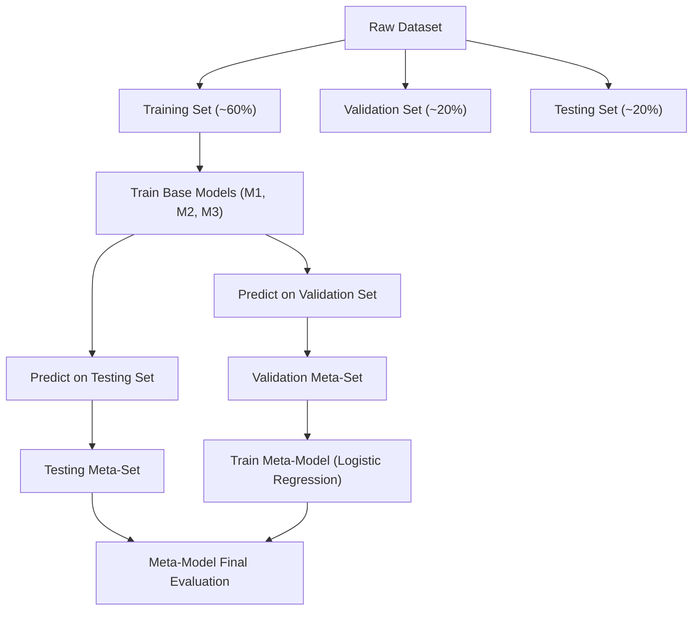
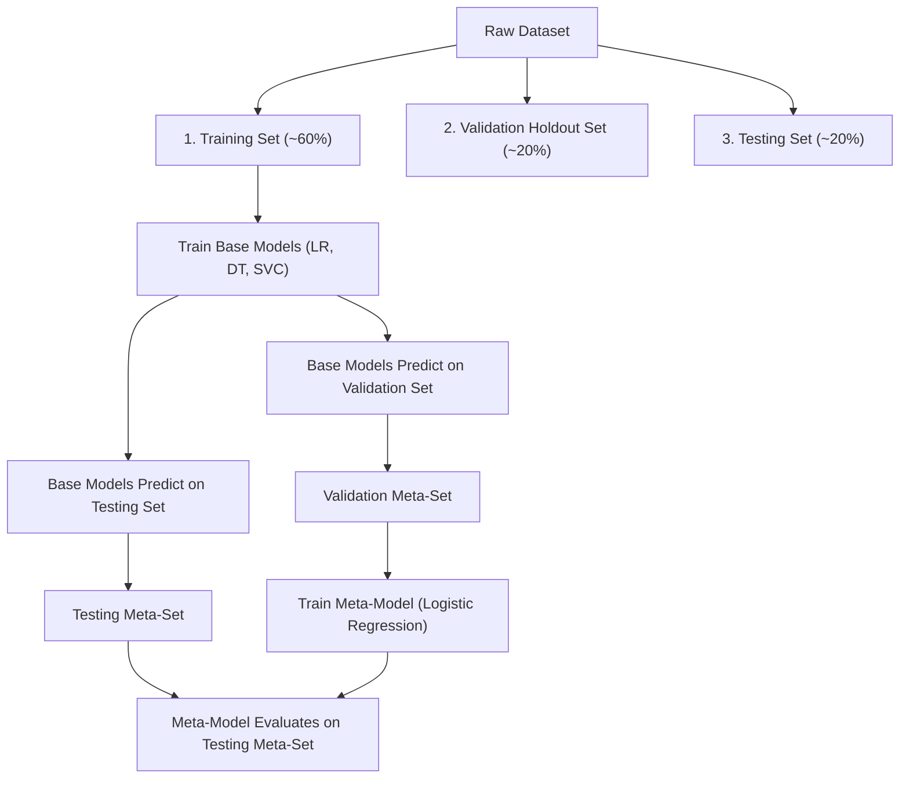

# Lecture 30.13: Blending vs Stacking — Fast Validation Holdout

---

## 📌 Topic Overview
Comprehensive architectural comparison between Blending and Stacking. Blending simplifies meta-learning by replacing K-Fold cross-validation with a clean 3-way holdout split (Training, Validation Meta-Set, and Testing Meta-Set).

---

### 📋 Key Learning Objectives
- What Blending is and how it differs fundamentally from K-Fold Stacking.
- The 3-Way Dataset Split: Training (~60%), Validation (~20%), and Testing (~20%).
- Generating the Validation Meta-Set for Level-1 meta-model training.
- Generating the Testing Meta-Set for unbiased final evaluation.
- Trade-off analysis: Computational speed vs sample efficiency.

---

### 🔍 In-Depth Conceptual Breakdown

- **Blending Ka Concept**: Stacking mein K-Fold cross-validation chalane mein kaafi samay aur computation lagti hai. **Blending** Stacking ka ek fast aur simple alternative hai jo bina K-Fold ke meta-learning karta hai.

- **3-Way Split (Teen Hisson Mein Batna)**:

-   1. **Training Data** (~60%): Is data par saare Level-0 base models (Model 1, Model 2, Model 3) train hote hain.

-   2. **Validation Data** (~20%): Base models is validation set par predictions nikalte hain. In predictions se banta hai **Validation Meta-Set**. Meta-Model is validation meta-set par train hota hai!

-   3. **Testing Data** (~20%): Base models testing set par predictions nikalte hain $\rightarrow$ banta hai **Testing Meta-Set**. Meta-Model is testing meta-set par final prediction karta hai.

- **Stacking vs Blending Comparison**:

-   - **Stacking**: K-Fold OOF use karta hai. Base models poore data par train hote hain (100% data efficiency), lekin $K$ times training ki wajah se slow hota hai.

-   - **Blending**: Simple holdout split use karta hai. Super fast hai, compute light hai, lekin base models sirf 60% data dekh paate hain.

-   - **Kaggle vs Industry**: Kaggle par Stacking prefer hoti hai (maximum accuracy), jabki industry pipelines mein jahan daily retrain hona ho, Blending fast hoti hai.

---

### 📊 Architectural Flowchart

---

---

### 📋 Ma'am's Classroom 3-Way Blending Split Matrix

| Data Partition | Typical Split Size | Purpose in Blending Pipeline | Models Utilizing This Partition |
| :---: | :---: | :---: | :---: |
| **Training Set** | ~60% of Dataset | Train Level-0 Base Estimators from scratch | Base Models (Model 1, Model 2, Model 3) |
| **Validation Set** | ~20% of Dataset | Base models predict on this $\rightarrow$ forms **Validation Meta-Set** | Meta-Model (Level-1 Logistic Regression) Trains Here |
| **Testing Set** | ~20% of Dataset | Base models predict on this $\rightarrow$ forms **Testing Meta-Set** | Meta-Model Evaluates Final Accuracy Here |

---

### 📊 Ma'am's Blending Workflow Architecture

### 🔢 Mathematical Formulation

Data partitioning formulation:

$$
\mathcal{D} = \mathcal{D}_{\text{train}} \cup \mathcal{D}_{\text{val}} \cup \mathcal{D}_{\text{test}}, \quad \text{where } |\mathcal{D}_{\text{train}}| \approx 0.6N, \; |\mathcal{D}_{\text{val}}| \approx 0.2N, \; |\mathcal{D}_{\text{test}}| \approx 0.2N
$$

Validation meta-feature generation for base models $m \in \{1, \dots, M\}$:

$$
z_i^{\text{val}} = \left[ \hat{f}_1(x_i), \hat{f}_2(x_i), \dots, \hat{f}_M(x_i) \right], \quad \forall x_i \in \mathcal{D}_{\text{val}}
$$

---

### 💻 Implementation
The fully tested and verified standalone implementation is provided in the synchronized [Jupyter Notebook](lecture_30_13.ipynb).
