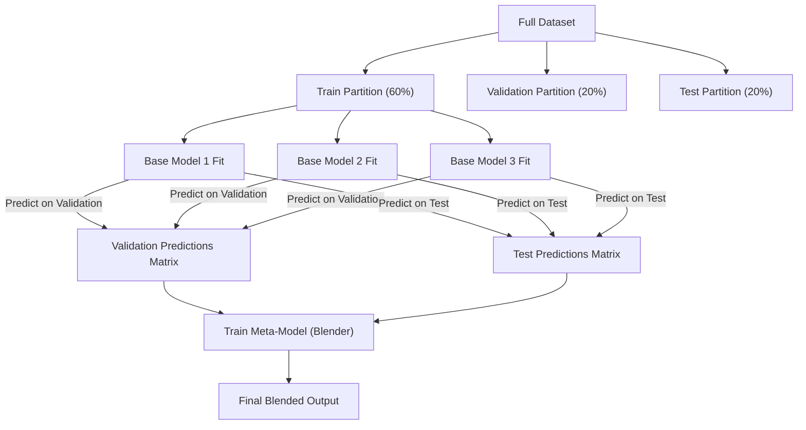

# Lecture 30.13: What is Blending? — Blending vs Stacking Architecture Comparison

[](#)
[](lecture_30_13.ipynb)
[](README_HINGLISH.md)
[](notes.pdf)
[](notes_hinglish.pdf)

---

## 📌 Topic Overview
Comprehensive architectural analysis of Blending as a fast, holdout-based alternative to Stacking. Dissects the 3-way partition (Train, Validation, Test), Level-0 base model training strictly on the training partition, Meta-Learner training strictly on validation predictions, and contrasts computation cost against data efficiency.

---

### 🗺️ Visual Architecture Diagram



---

### 🛠️ Mathematical Mechanics & Theoretical Foundations
In Blending with dataset partition $\mathcal{D} = \mathcal{D}_{\text{train}} \cup \mathcal{D}_{\text{val}} \cup \mathcal{D}_{\text{test}}$:

$$
\text{Level-0 Fitting}: \quad \hat{f}_m = \arg\min_{f} \sum_{i \in \mathcal{D}_{\text{train}}} L(y_i, f(\mathbf{x}_i))
$$

$$
\text{Meta-Dataset}: \quad \mathcal{M}_{\text{val}} = \left\{ \left( [\hat{f}_1(\mathbf{x}_i), \dots, \hat{f}_M(\mathbf{x}_i)], y_i \right) : i \in \mathcal{D}_{\text{val}} \right\}
$$

$$
\text{Level-1 Meta-Fitting}: \quad \hat{g} = \arg\min_g \sum_{i \in \mathcal{D}_{\text{val}}} L\left( y_i, g(\hat{f}_1(\mathbf{x}_i), \dots, \hat{f}_M(\mathbf{x}_i)) \right)
$$

---

### 💻 Python Production Implementation

```python
import numpy as np
from sklearn.datasets import make_classification
from sklearn.model_selection import train_test_split
from sklearn.linear_model import LogisticRegression
from sklearn.ensemble import RandomForestClassifier
from sklearn.neighbors import KNeighborsClassifier
from sklearn.metrics import accuracy_score

def execute_blending_ensemble():
    """
    Step-by-step implementation of Blending using Train, Validation, and Test splits.
    """
    # 1. Dataset generation
    X, y = make_classification(n_samples=800, n_features=6, random_state=42)
    
    # 60% Train, 20% Val, 20% Test
    X_train_full, X_test, y_train_full, y_test = train_test_split(
        X, y, test_size=0.20, random_state=42, stratify=y
    )
    X_train, X_val, y_train, y_val = train_test_split(
        X_train_full, y_train_full, test_size=0.25, random_state=42, stratify=y_train_full
    )
    
    # 2. Train Level-0 Base Models on X_train (60%)
    m1 = LogisticRegression(random_state=42).fit(X_train, y_train)
    m2 = RandomForestClassifier(n_estimators=50, random_state=42).fit(X_train, y_train)
    m3 = KNeighborsClassifier(n_neighbors=5).fit(X_train, y_train)
    
    # 3. Predict on Validation (20%) to create Meta-Training data
    val_meta = np.column_stack([
        m1.predict_proba(X_val)[:, 1],
        m2.predict_proba(X_val)[:, 1],
        m3.predict_proba(X_val)[:, 1]
    ])
    
    # 4. Train Level-1 Meta-Model on Validation Predictions
    meta_model = LogisticRegression(random_state=42)
    meta_model.fit(val_meta, y_val)
    
    # 5. Predict on Test set
    test_meta = np.column_stack([
        m1.predict_proba(X_test)[:, 1],
        m2.predict_proba(X_test)[:, 1],
        m3.predict_proba(X_test)[:, 1]
    ])
    final_preds = meta_model.predict(test_meta)
    
    acc = accuracy_score(y_test, final_preds)
    return acc

# ----------------- Driver Execution & Testing -----------------
if __name__ == "__main__":
    blended_acc = execute_blending_ensemble()
    print("=" * 60)
    print("--- BLENDING ENSEMBLE EXECUTION RESULTS ---")
    print(f"Final Test Accuracy via Blending : {blended_acc * 100:.2f}%")
    print("=" * 60)
```

---

### 🔑 Critical Architectural Takeaways
1. **Multi-Family Generalization**: Combining diverse inductive biases (linear, tree-based, margin-based, metric-based) cancels out individual model blindspots.
2. **Leakage Protection via OOF**: Cross-validated out-of-fold predictions ensure the Level-1 meta-model optimizes strictly on unseen generalization behaviors.
3. **Calibrated Confidence Weights**: Soft voting and meta-learning outperform simple hard voting by incorporating prediction probability confidences.
