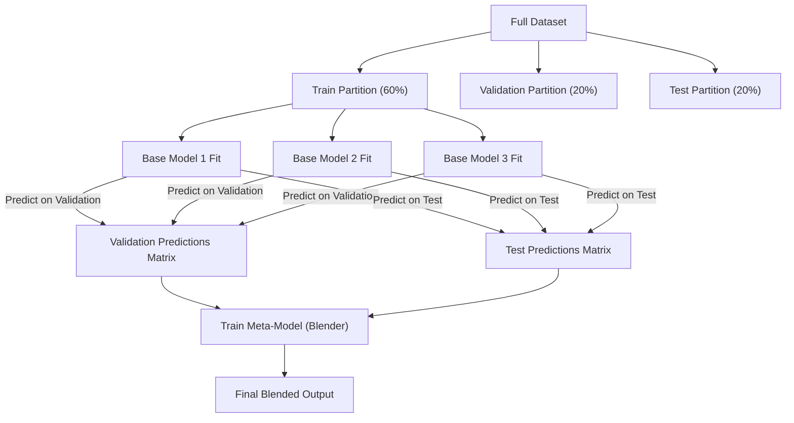

# Lecture 30.13: Blending Kya Hai? — Blending vs Stacking Ka Complete Comparison [Hinglish]

[](#)
[](lecture_30_13.ipynb)
[](README.md)
[](notes.pdf)
[](notes_hinglish.pdf)

---

## 📌 Topic Overview
Comprehensive architectural analysis of Blending as a fast, holdout-based alternative to Stacking. Dissects the 3-way partition (Train, Validation, Test), Level-0 base model training strictly on the training partition, Meta-Learner training strictly on validation predictions, and contrasts computation cost against data efficiency.

---

### 📋 Is Topic Mein Hum Kya Seekhenge?
- Blending kya hota hai aur Stacking ka simplified alternative kyu hai.
- 3-Way Data Partition: Train (60%), Validation (20%), aur Test (20%).
- Blending Workflow: Base models Train par fit hote hain aur Validation par predict karte hain.
- Meta-Learner Validation predictions par train hota hai.
- Stacking vs Blending: Speed, complexity aur data efficiency ka complete trade-off.

---

### 🔍 Har Ek Point Ka Simple & Detailed Explanation
**Blending Ka Concept**: Blending bhi Stacking ki tarah meta-model use karta hai, lekin K-Fold cross-validation ke bajay ek **Single Holdout Validation Set** use karta hai.

**Data Partitioning (3 Hisse)**:

- **Train Set (60%)**: Is par saare Level-0 base models (Model 1, Model 2, Model 3) train hote hain.
- **Validation Set (20%)**: Base models is set par predictions nikaalte hain. Yeh predictions meta-model ka training data banti hain!
- **Test Set (20%)**: Final evaluation ke liye unseen test data.

**Blending vs Stacking Ka Table**:

#### 5. | Parameter | Stacking | Blending |
| :--- | :--- | :--- |
| **Data Partitioning** | K-Fold Cross Validation (e.g. 5 folds) | Single Static Holdout (Train/Val/Test) |
| **Training Time** | Slow: Har model K baar train hota hai | Fast: Har model sirf 1 baar train hota hai |
| **Data Efficiency** | High: 100% data base aur meta models ko milta hai | Lower: Validation data base model training se waste ho jata hai |
| **Overfitting Risk** | Extremely Low (OOF averaging) | Thoda sensitive (agar validation split chota ho) |

**Industrial Recommendation**: Jab dataset bohot bada ho (e.g. 10 lakh rows) aur K-Fold train karne ka time na ho, tab Blending use hoti hai!

---

### 📊 Visual Flowchart / Diagram



---

### 🛠️ Mathematical Formulations
In Blending with dataset partition $\mathcal{D} = \mathcal{D}_{\text{train}} \cup \mathcal{D}_{\text{val}} \cup \mathcal{D}_{\text{test}}$:

$$
\text{Level-0 Fitting}: \quad \hat{f}_m = \arg\min_{f} \sum_{i \in \mathcal{D}_{\text{train}}} L(y_i, f(\mathbf{x}_i))
$$

$$
\text{Meta-Dataset}: \quad \mathcal{M}_{\text{val}} = \left\{ \left( [\hat{f}_1(\mathbf{x}_i), \dots, \hat{f}_M(\mathbf{x}_i)], y_i \right) : i \in \mathcal{D}_{\text{val}} \right\}
$$

$$
\text{Level-1 Meta-Fitting}: \quad \hat{g} = \arg\min_g \sum_{i \in \mathcal{D}_{\text{val}}} L\left( y_i, g(\hat{f}_1(\mathbf{x}_i), \dots, \hat{f}_M(\mathbf{x}_i)) \right)
$$

---

### 💻 Python Code Implementation

```python
import numpy as np
from sklearn.datasets import make_classification
from sklearn.model_selection import train_test_split
from sklearn.linear_model import LogisticRegression
from sklearn.ensemble import RandomForestClassifier
from sklearn.neighbors import KNeighborsClassifier
from sklearn.metrics import accuracy_score

def execute_blending_ensemble():
    """
    Step-by-step implementation of Blending using Train, Validation, and Test splits.
    """
    # 1. Dataset generation
    X, y = make_classification(n_samples=800, n_features=6, random_state=42)
    
    # 60% Train, 20% Val, 20% Test
    X_train_full, X_test, y_train_full, y_test = train_test_split(
        X, y, test_size=0.20, random_state=42, stratify=y
    )
    X_train, X_val, y_train, y_val = train_test_split(
        X_train_full, y_train_full, test_size=0.25, random_state=42, stratify=y_train_full
    )
    
    # 2. Train Level-0 Base Models on X_train (60%)
    m1 = LogisticRegression(random_state=42).fit(X_train, y_train)
    m2 = RandomForestClassifier(n_estimators=50, random_state=42).fit(X_train, y_train)
    m3 = KNeighborsClassifier(n_neighbors=5).fit(X_train, y_train)
    
    # 3. Predict on Validation (20%) to create Meta-Training data
    val_meta = np.column_stack([
        m1.predict_proba(X_val)[:, 1],
        m2.predict_proba(X_val)[:, 1],
        m3.predict_proba(X_val)[:, 1]
    ])
    
    # 4. Train Level-1 Meta-Model on Validation Predictions
    meta_model = LogisticRegression(random_state=42)
    meta_model.fit(val_meta, y_val)
    
    # 5. Predict on Test set
    test_meta = np.column_stack([
        m1.predict_proba(X_test)[:, 1],
        m2.predict_proba(X_test)[:, 1],
        m3.predict_proba(X_test)[:, 1]
    ])
    final_preds = meta_model.predict(test_meta)
    
    acc = accuracy_score(y_test, final_preds)
    return acc

# ----------------- Driver Execution & Testing -----------------
if __name__ == "__main__":
    blended_acc = execute_blending_ensemble()
    print("=" * 60)
    print("--- BLENDING ENSEMBLE EXECUTION RESULTS ---")
    print(f"Final Test Accuracy via Blending : {blended_acc * 100:.2f}%")
    print("=" * 60)
```

---

### 📌 Summary Points & Key Takeaways
1. **Model Diversity**: Alag-alag algorithm families ko combine karne se error correlation kam hoti hai.
2. **K-Fold OOF Split**: Stacking mein data leakage rokne ke liye out-of-fold predictions par meta-learner train hota hai.
3. **Soft Voting Advantage**: High-confidence probabilities borderline models ki galtiyon ko dominate karke accurate prediction deti hain.
