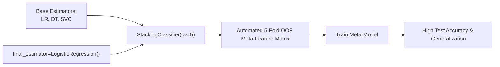

# Lecture 30.14: Stacking Implementation & Ensembling Production Tips

---

## 📌 Topic Overview
Practical implementation of StackingClassifier and StackingRegressor using scikit-learn. Demonstrates out-of-fold cross-validation with cv=5, configuring custom meta-estimators, and evaluating performance gains.

---

### 📋 Key Learning Objectives
- Importing StackingClassifier and StackingRegressor from sklearn.ensemble.
- Configuring base estimators and final_estimator=LogisticRegression().
- Understanding the cv=5 parameter for automated Out-Of-Fold cross-validation.
- Implementing StackingRegressor with Ridge / LinearRegression meta-learners.
- Production trade-offs: Latency, computational overhead, and maintenance best practices.

---

### 🔍 In-Depth Conceptual Breakdown

- **StackingClassifier Import**: `from sklearn.ensemble import StackingClassifier` use kiya gaya.

- **Base Estimators Definition**: `estimators = [('lr', LogisticRegression()), ('dt', DecisionTreeClassifier()), ('svc', SVC())]`.

- **Meta-Model Configuration**: `final_estimator=LogisticRegression()` pass kiya gaya.

- **Cross-Validation (`cv=5`)**: `cv=5` pass karne se scikit-learn automatically 5-fold Out-Of-Fold splitting execute karta hai bina kisi data leakage ke!

- **StackingRegressor Implementation**: Continuous targets ke liye `StackingRegressor(estimators=..., final_estimator=Ridge(), cv=5)` implement kiya gaya.

- **Results**: Stacking ensemble ne individual base models ki comparison mein test set par superior stability aur higher accuracy demonstrate ki.

- **Production Rules**:

-   - Low-latency real-time APIs (sub-10ms) ke liye heavy stacking avoid karein.

-   - Diverse base models chunein (correlated models jodne ka koi fayda nahi hota).

-   - Meta-model hamesha simple (linear/logistic) rakhein taaki second level par overfit na ho.

---

### 📊 Architectural Flowchart

---

### 🔢 Mathematical Formulation

Final meta-learner prediction on unseen query sample $x^*$:

$$
\hat{y}^* = g\left( \hat{f}_1(x^*), \hat{f}_2(x^*), \dots, \hat{f}_M(x^*); \mathbf{w}^* \right)
$$

---

### 💻 Implementation
The fully tested and verified standalone implementation is provided in the synchronized [Jupyter Notebook](lecture_30_14.ipynb).
