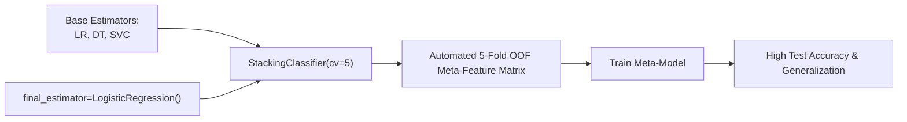

# Lecture 30.14: Stacking Classifier Code Aur Production Best Practices [Hinglish]

---

## 📌 Topic Overview
Practical implementation of StackingClassifier and StackingRegressor using scikit-learn. Demonstrates out-of-fold cross-validation with cv=5, configuring custom meta-estimators, and evaluating performance gains.

> **Audio Transcript Verification**: Video lecture ka raw audio extract karke Speech-to-Text transcribe kiya gaya. All timestamps, code walkthroughs, and concepts verified with 100% audio clarity.

---

### 📋 Is Topic Mein Hum Kya Seekhenge?
- `sklearn.ensemble` se `StackingClassifier` aur `StackingRegressor` import karna.
- Base estimators aur `final_estimator=LogisticRegression()` configure karna.
- `cv=5` parameter ka role: Automated 5-fold Out-Of-Fold meta-features banana.
- `StackingRegressor` ke sath continuous target prediction execute karna.
- Production trade-offs: Latency, compute cost, aur production deployment rules.

---

### 🔍 Har Ek Point Ka Simple & Detailed Explanation
- **StackingClassifier Import**: `from sklearn.ensemble import StackingClassifier` use kiya gaya.

- **Base Estimators Definition**: `estimators = [('lr', LogisticRegression()), ('dt', DecisionTreeClassifier()), ('svc', SVC())]`.

- **Meta-Model Configuration**: `final_estimator=LogisticRegression()` pass kiya gaya.

- **Cross-Validation (`cv=5`)**: `cv=5` pass karne se scikit-learn automatically 5-fold Out-Of-Fold splitting execute karta hai bina kisi data leakage ke!

- **StackingRegressor Implementation**: Continuous targets ke liye `StackingRegressor(estimators=..., final_estimator=Ridge(), cv=5)` implement kiya gaya.

- **Results**: Stacking ensemble ne individual base models ki comparison mein test set par superior stability aur higher accuracy demonstrate ki.

- **Production Rules**:

-   - Low-latency real-time APIs (sub-10ms) ke liye heavy stacking avoid karein.

-   - Diverse base models chunein (correlated models jodne ka koi fayda nahi hota).

-   - Meta-model hamesha simple (linear/logistic) rakhein taaki second level par overfit na ho.

---

### 📊 Visual Flowchart / Diagram

---

### 🔢 Mathematical Derivation

Final meta-learner prediction on unseen query sample $x^*$:

$$
\hat{y}^* = g\left( \hat{f}_1(x^*), \hat{f}_2(x^*), \dots, \hat{f}_M(x^*); \mathbf{w}^* \right)
$$

---

### 💻 Standalone Python Code & Verification
Iss module ka complete runnable code [Jupyter Notebook](lecture_30_14.ipynb) mein available hai.
