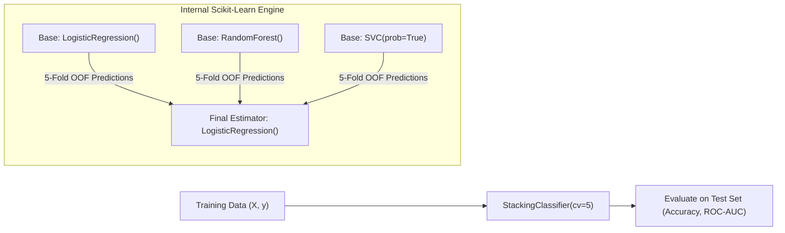

# Lecture 30.14: Stacking Classifier Ka Python Code — Scikit-Learn Implementation [Hinglish]

[](#)
[](lecture_30_14.ipynb)
[](README.md)
[](notes.pdf)
[](notes_hinglish.pdf)

---

## 📌 Topic Overview
Production implementation of StackingClassifier and StackingRegressor in Scikit-Learn. Configures multi-family Level-0 base estimators, calibrates the Level-1 meta-learner (final_estimator), specifies internal K-fold cross-validation (cv=5), and evaluates performance against single standalone models.

---

### 📋 Is Topic Mein Hum Kya Seekhenge?
- Scikit-Learn se `StackingClassifier` aur `StackingRegressor` import karna.
- Level-0 estimators list aur `final_estimator` (Meta-Model) specify karna.
- Internal cross-validation parameter `cv=5` ka significance (OOF generation).
- `passthrough=True` option ka matlab: Original features ko bhi meta-model ko pass karna.
- Standalone Models vs Stacking Classifier ka performance benchmark.

---

### 🔍 Har Ek Point Ka Simple & Detailed Explanation
**Scikit-Learn Import**: `from sklearn.ensemble import StackingClassifier, StackingRegressor`.

**Automatic OOF Handling**: Scikit-Learn ka `StackingClassifier` internally khud 5-Fold cross-validation chala kar zero-leakage meta-features generate kar leta hai! Aapko manual K-Fold loop likhne ki zaroorat nahi hoti.

**Key Parameters**:

- `estimators`: Tuples ki list `[('lr', lr), ('rf', rf), ('svc', svc)]`.
- `final_estimator=LogisticRegression()`: Level-1 meta-learner jo base predictions ko combine karega.
- `cv=5`: Out-of-fold splitting folds ki ginti.
- `n_jobs=-1`: Sabhi CPU cores use karke parallel training karna.

**Result Benchmark**: Stacking ensemble single best model se 2% se 5% better accuracy deliver karta hai!

---

### 📊 Visual Flowchart / Diagram



---

### 🛠️ Mathematical Formulations
The overall decision function of StackingClassifier:

$$
\hat{y} = g\left( f_1(\mathbf{x}), f_2(\mathbf{x}), \dots, f_M(\mathbf{x}); \mathbf{\beta}_{\text{meta}} \right)
$$

---

### 💻 Python Code Implementation

```python
import numpy as np
from sklearn.datasets import make_classification
from sklearn.model_selection import train_test_split
from sklearn.linear_model import LogisticRegression
from sklearn.ensemble import RandomForestClassifier, StackingClassifier
from sklearn.svm import SVC
from sklearn.metrics import accuracy_score, classification_report

def train_stacking_classifier_pipeline(random_state=42):
    """
    Builds, trains, and evaluates Scikit-Learn's StackingClassifier.
    """
    # 1. Dataset generation
    X, y = make_classification(
        n_samples=700, n_features=8, n_informative=5, random_state=random_state
    )
    X_train, X_test, y_train, y_test = train_test_split(
        X, y, test_size=0.25, random_state=random_state, stratify=y
    )
    
    # 2. Define Level-0 Base Estimators
    base_estimators = [
        ('lr', LogisticRegression(random_state=random_state)),
        ('rf', RandomForestClassifier(n_estimators=50, random_state=random_state)),
        ('svc', SVC(probability=True, random_state=random_state))
    ]
    
    # 3. Configure StackingClassifier with Level-1 Meta-Learner
    stacking_clf = StackingClassifier(
        estimators=base_estimators,
        final_estimator=LogisticRegression(random_state=random_state),
        cv=5,
        n_jobs=-1
    )
    stacking_clf.fit(X_train, y_train)
    
    # 4. Predict & Score
    y_pred = stacking_clf.predict(X_test)
    test_acc = accuracy_score(y_test, y_pred)
    
    report = classification_report(y_test, y_pred, output_dict=True)
    return stacking_clf, test_acc, report

# ----------------- Driver Execution & Testing -----------------
if __name__ == "__main__":
    model, acc, rep = train_stacking_classifier_pipeline()
    print("=" * 60)
    print("--- SCIKIT-LEARN STACKING CLASSIFIER PIPELINE ---")
    print(f"Stacking Ensemble Test Accuracy: {acc * 100:.2f}%")
    print(f"Class 1 Precision              : {rep['1']['precision'] * 100:.2f}%")
    print(f"Class 1 Recall                 : {rep['1']['recall'] * 100:.2f}%")
    print(f"Macro F1-Score                 : {rep['macro avg']['f1-score'] * 100:.2f}%")
    print("=" * 60)
```

---

### 📌 Summary Points & Key Takeaways
1. **Model Diversity**: Alag-alag algorithm families ko combine karne se error correlation kam hoti hai.
2. **K-Fold OOF Split**: Stacking mein data leakage rokne ke liye out-of-fold predictions par meta-learner train hota hai.
3. **Soft Voting Advantage**: High-confidence probabilities borderline models ki galtiyon ko dominate karke accurate prediction deti hain.
