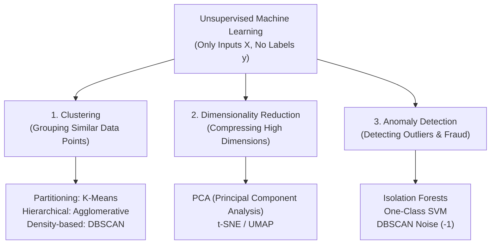

# Lecture 31.01: Introduction to Unsupervised Machine Learning

---

## 📌 Topic Overview
Comprehensive introduction to Unsupervised Machine Learning. Unlike supervised learning, unsupervised learning operates on unlabeled feature sets to discover latent structures, clusters, dimensional reductions, and anomalies.

---

### 📋 Key Learning Objectives
- Fundamental contrast: Supervised Learning (X, y) vs Unsupervised Learning (X only).
- The 3 Primary Branches: Clustering, Dimensionality Reduction, and Anomaly Detection.
- Real-World Bank ATM Case Study: Customer spending segmentation (Balance vs Cash Withdrawals).
- Industry Applications: Market basket analysis, fraud detection, and recommendation engines.

---

### 🔍 In-Depth Conceptual Breakdown

- **Supervised vs Unsupervised Learning**: Supervised learning mein hamare pass inputs $X$ ke sath target output labels $y$ hote the (jaise Spam/Ham ya House Price). Lekin **Unsupervised Learning** mein koi target label $y$ nahi hota! Model ko sirf input features $X$ diye jaate hain aur use khud data ke andar ke hidden patterns aur groupings dhoondhne hote hain.

- **Pehli Main Branch: Clustering**: Unlabeled data points ko unki similarities ke basis par alag-alag groups (clusters) mein divide karna. Jaise customer segmentation ya document topic classification.

- **Doosri Main Branch: Dimensionality Reduction**: Jab dataset mein bohot saare features (jaise 100+ columns) hote hain, toh unhe 2D ya 3D mein compress karna bina zaroori information khoe (jaise **PCA**, **t-SNE**).

- **Teesri Main Branch: Anomaly Detection**: Normal patterns se alag hatkar aane wale unusual ya fraudulent data points ko pehchanna (jaise Credit Card Fraud ya Server Defect detection).

- **Classroom Bank ATM Example**: Ma'am ne board par bank customer transactions ka example diya jisme do features the: `Feature 1 = Daily Balance` aur `Feature 2 = Cash Withdrawals`. Bank apne customers ko 2 clusters mein segment karta hai: high balance/low withdrawals wale users ko investment offers bhejna, aur low balance/high withdrawals wale users ko personal loan offers bhejna!

- **Pure Theory Lecture**: Is lecture mein ma'am ne conceptual foundations samjhaye hain, isliye is module mein koi code nahi hai.

---

### 📋 Supervised vs Unsupervised Learning Comparison Matrix

| Feature / Dimension | Supervised Machine Learning | Unsupervised Machine Learning |
| :--- | :--- | :--- |
| **Training Data** | Features $X$ + Ground Truth Labels $y$ | Only Features $X$ (Unlabeled Data) |
| **Objective** | Predict label $y$ for unseen sample $x^*$ | Discover hidden patterns, clusters, manifolds |
| **Evaluation** | Ground truth metrics (Accuracy, MSE, ROC-AUC) | Internal geometric metrics (Inertia, Silhouette) |
| **Primary Tasks** | Classification, Regression | Clustering, Dim-Reduction, Anomaly Detection |
| **Feedback Mechanism**| Error feedback via actual label $(y - \hat{y})$ | No external feedback (Self-guided discovery) |

---

### 📊 Unsupervised Machine Learning Taxonomy

---

### 🔢 Mathematical Formulation

Data representation in unsupervised learning:

$$
\mathcal{D} = \{ \mathbf{x}_1, \mathbf{x}_2, \dots, \mathbf{x}_N \}, \quad \text{where } \mathbf{x}_i \in \mathbb{R}^D
$$

Objective of clustering into $K$ disjoint partitions $\{S_1, S_2, \dots, S_K\}$:

$$
\bigcup_{k=1}^K S_k = \mathcal{D}, \quad S_j \cap S_k = \emptyset \quad (\forall j \neq k)
$$

---

### 📌 Note on Code
This is a pure conceptual, mathematical, and blackboard theory lecture. In accordance with course guidelines, no synthetic code is appended.
