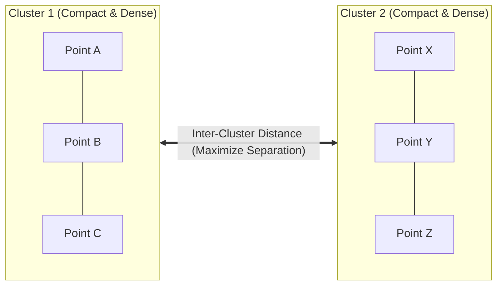

# Lecture 31.02: What is Clustering — Intuition & Foundations

---

## 📌 Topic Overview
Detailed exploration of clustering principles. Explains intra-cluster similarity maximization, inter-cluster separation minimization, geometric distance metrics, and the three major algorithmic families.

---

### 📋 Key Learning Objectives
- Formal definition of Clustering: Grouping unlabeled items by statistical similarity.
- The Dual Geometric Goals: Maximizing Intra-cluster density vs Maximizing Inter-cluster separation.
- Distance Metrics: Euclidean distance, Manhattan distance, and Cosine similarity.
- Overview of Clustering Paradigms: Partition-based, Hierarchical, and Density-based.

---

### 🔍 In-Depth Conceptual Breakdown

- **Clustering Kya Hai?**: Clustering ek aisi technique hai jo unlabeled data points ko automatically unke natural groups mein divide kar deti hai.

- **Intra-cluster Similarity (Andar ki doori kam)**: Ek hi cluster ke andar jo points aate hain, wo aapas mein bohot close aur similar hone chahiye.

- **Inter-cluster Separation (Do clusters ke beech ki doori zyada)**: Do alag-alag clusters ke beech ka distance maximum hona chahiye taaki boundaries clearly distinct hon.

- **Euclidean Distance**: Do points $p = (x_1, y_1)$ aur $q = (x_2, y_2)$ ke beech straight line distance: $d(p, q) = \sqrt{(x_1 - x_2)^2 + (y_1 - y_2)^2}$.

- **2D Visualizations**: Real life mein data multidimensional hota hai, lekin concept ko visually samajhne ke liye hum 2D scatter plot par clusters dekhte hain.

- **Pure Theory Lecture**: Is lecture mein ma'am ne intuition clear ki hai, koi code nahi hai.

---

### 📋 Clustering Algorithmic Families

| Clustering Paradigm | Representative Algorithm | Cluster Shape Assumption | Scalability & Complexity |
| :--- | :--- | :--- | :--- |
| **Partition-Based** | **K-Means** | Spherical, Convex clusters | $\mathcal{O}(N \cdot K \cdot I)$ (High speed, scalable) |
| **Hierarchical** | **Agglomerative Clustering**| Nested tree structure | $\mathcal{O}(N^2 \log N)$ (Slow for large datasets) |
| **Density-Based** | **DBSCAN** | Arbitrary, Non-convex, Manifolds | $\mathcal{O}(N \log N)$ (Handles noise natively) |

---

### 📊 Clustering Objective: Compactness vs Separation

---

### 🔢 Mathematical Formulation

Euclidean distance between two $D$-dimensional feature vectors $\mathbf{x}_i$ and $\mathbf{x}_j$:

$$
d(\mathbf{x}_i, \mathbf{x}_j) = \| \mathbf{x}_i - \mathbf{x}_j \|_2 = \sqrt{\sum_{d=1}^D (x_{id} - x_{jd})^2}
$$

Total intra-cluster variance objective:

$$
J = \sum_{k=1}^K \frac{1}{|S_k|} \sum_{\mathbf{x}_i, \mathbf{x}_j \in S_k} \| \mathbf{x}_i - \mathbf{x}_j \|^2
$$

---

### 📌 Note on Code
This is a pure conceptual, mathematical, and blackboard theory lecture. In accordance with course guidelines, no synthetic code is appended.
