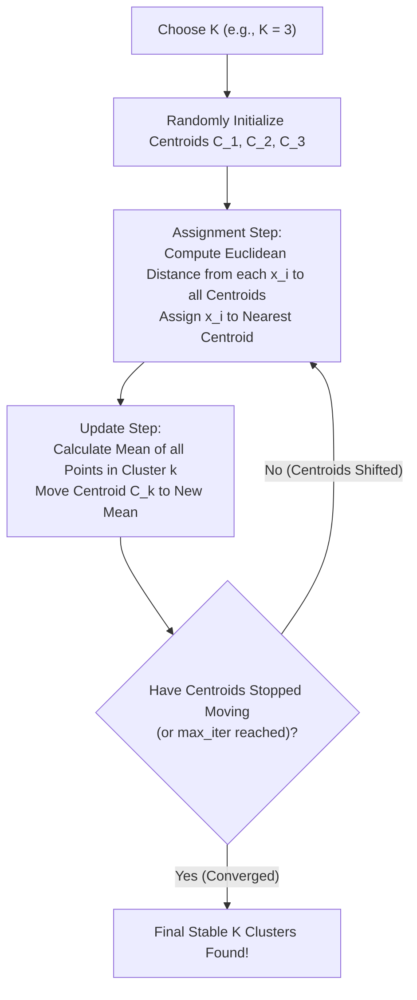

# Lecture 31.03: K-Means Clustering — Centroids, Assignment Aur Update Steps [Hinglish]

---

## 📌 Topic Overview
Comprehensive algorithmic derivation of K-Means clustering. Explains centroid initialization, assignment step via Euclidean distance, update step via cluster means, convergence conditions, and Ma'am's blackboard walkthrough.

---

### 📋 Is Topic Mein Hum Kya Seekhenge?
- Step 1: $K$ (clusters ki sankhya) choose karna aur random centroids $C_1, C_2, C_3$ initialize karna.
- Step 2 (**Assignment Step**): Har data point ko sabse kareebi centroid ke cluster mein assign karna.
- Step 3 (**Update Step**): Centroid ko us cluster ke saare points ka **arithmetic mean (center of mass)** banakar nayi location par shift karna.
- Convergence Rules: Centroids ka hilna band hona ya `max_iter` complete hona.
- Ma'am Ka Blackboard Example: Centroids kaise data points ke beech kheenche chale jaate hain.

---

### 🔍 Har Ek Point Ka Simple & Detailed Explanation
- **K-Means Ka Naam**: '$K$' ka matlab clusters ki sankhya, aur 'Means' ka matlab cluster ke points ka average (centroid).

- **Step 1: Initialize K Centroids**: Sabse pehle hum $K$ centroids ($C_1, C_2, \dots, C_K$) ko data space mein randomly place karte hain.

- **Step 2: Assignment Step (Sabse paas kaun?)**: Har data point $x_i$ ka distance teeno centroids se nikalo: $d(x_i, C_1), d(x_i, C_2), d(x_i, C_3)$. Jis centroid se distance sabse kam hoga, point usi cluster ka part ban jata hai.

- **Step 3: Update Step (Naya Center)**: Har cluster ke andar jitne points assign hue, unka average (mean) nikalo: $C_k^{new} = \frac{1}{N_k}\sum x_i$. Centroid ab is naye mean par shift ho jata hai!

- **Step 4: Repeat Until Convergence**: Assignment aur Update steps ko tab tak repeat kiya jata hai jab tak:

-   - Centroids ka movement band na ho jaye (shift $\approx 0$),

-   - Points ka cluster change hona band ho jaye, ya

-   - Maximum iterations (`max_iter=300`) reach ho jayein.

- **Pure Theory Lecture**: Is lecture mein ma'am ne blackboard par step-by-step points assign karke dikhaye hain, koi code nahi hai.

---

### 📋 K-Means Algorithmic Lifecycle

| Stage | Primary Operation | Mathematical Formula | Purpose |
| :--- | :--- | :--- | :--- |
| **1. Initialization** | Select $K$ initial seeds | $\{C_1, C_2, \dots, C_K\} \subset \mathbb{R}^D$ | Seed starting cluster locations |
| **2. Assignment** | Assign points to nearest centroid | $c_i = \arg\min_{k} \| \mathbf{x}_i - C_k \|^2$ | Partition data into Voronoi cells |
| **3. Update** | Recompute cluster centers | $C_k = \frac{1}{|S_k|} \sum_{i \in S_k} \mathbf{x}_i$ | Move centroids to cluster centers of mass |
| **4. Convergence** | Check displacement | $\| C_k^{(t+1)} - C_k^{(t)} \| < \epsilon$ | Terminate optimization |

---

### 📊 Ma'am's K-Means Iterative Flowchart

---

### 🔢 Mathematical Derivation

Objective function (Inertia / Sum of Squared Errors):

$$
J(\mathbf{C}) = \sum_{k=1}^K \sum_{\mathbf{x}_i \in S_k} \| \mathbf{x}_i - \mathbf{C}_k \|^2
$$

Centroid update coordinate for feature dimension $d$:

$$
C_{kd} = \frac{1}{|S_k|} \sum_{\mathbf{x}_i \in S_k} x_{id}
$$

---

### 📌 Note on Code
Yeh pure conceptual, mathematical, aur blackboard theory lecture hai. Ma'am ne is lecture mein code nahi likha hai, isliye rule ke mutabiq isme koi extra synthetic code add nahi kiya gaya hai.
