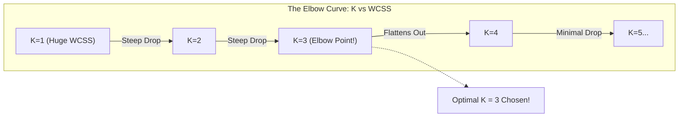

# Lecture 31.04: Elbow Method — WCSS Aur Optimal K Ka Concept [Hinglish]

---

## 📌 Topic Overview
In-depth conceptual breakdown of the Elbow Method for optimal K selection in K-Means. Explores Within-Cluster Sum of Squares (WCSS / Inertia), the rate of inertia decay, and detecting the elbow inflection point.

---

### 📋 Is Topic Mein Hum Kya Seekhenge?
- Unsupervised learning mein sahi $K$ choose karna kyu mushkil hota hai.
- **WCSS (Within-Cluster Sum of Squares)** yaani **Inertia** ka exact formula.
- $K$ badhne par WCSS kyu ghat-ta hai ($K=N$ par $WCSS=0$ ho jata hai).
- **Elbow Curve**: Curve ka 'Kohni' (Elbow) point jahan se graph achanak flat hone lagta hai.
- Optimal $K$ choose karne ka decision rule.

---

### 🔍 Har Ek Point Ka Simple & Detailed Explanation
- **Sahi K Kaise Chunein?**: K-Means mein sabse bada sawaal yeh hota hai ki $K$ kitna rakhein (2, 3, 4 ya 10)? Iske liye hum **Elbow Method** use karte hain.

- **WCSS (Within-Cluster Sum of Squares)**: Isko scikit-learn mein **Inertia** kehte hain. Yeh har cluster ke points ka unke centroid se squared distance ka total sum hota hai. WCSS jitna kam hoga, cluster utna tight aur compact hoga!

- **K Badhne Par WCSS Ka Behavior**:

-   - Agar $K=1$ hai, toh saare points ek hi center se measure honge, isliye WCSS sabse maximum hoga.

-   - Jaise-jaise $K$ badhta hai, points ko apne paas wale naye centers milte hain, isliye WCSS strictly drop hota hai.

-   - Agar $K=N$ kar dein (har point apna khud ka cluster), toh distance zero ho jayega ($WCSS = 0$)! Lekin iska koi practical fayda nahi hai.

- **Elbow Point (Kohni)**: Hum $K$ (X-axis) vs WCSS (Y-axis) ka graph banate hain. Shuruat mein graph bohot tezi se neeche girta hai, aur fir ek point ke baad achanak flat (horizontal) ho jata hai. Jis point par graph 'Elbow' (kohni) jaisa mod leta hai, wahi hamara **Optimal K** hota hai!

- **Pure Theory Lecture**: Is lecture mein ma'am ne WCSS ka graph aur elbow point board par draw karke explain kiya hai, koi code nahi hai.

---

### 📋 WCSS Behavior Across Different K Values

| Number of Clusters ($K$) | WCSS / Inertia Level | Cluster Interpretation | Practical Viability |
| :--- | :--- | :--- | :--- |
| **$K = 1$** | Maximum Possible WCSS | Single giant cluster, zero discrimination | High underfitting |
| **$K = 2, 3$** | Steep, rapid reduction | Meaningful separation of broad groups | Improving rapidly |
| **$K = K^*$ (Elbow)** | **Optimal Inflection Point** | **Balanced cluster tightness and simplicity**| **Best Generalization** |
| **$K > K^*$** | Marginal, slow reduction | Minor improvements at cost of complexity | Diminishing returns |
| **$K = N$** | Exactly $WCSS = 0$ | Every point is its own centroid | Complete Overfitting (Useless) |

---

### 📊 Ma'am's Blackboard Elbow Curve

---

### 🔢 Mathematical Derivation

Within-Cluster Sum of Squares (WCSS / Inertia):

$$
\text{WCSS} = \sum_{k=1}^K \sum_{\mathbf{x}_i \in S_k} \| \mathbf{x}_i - C_k \|^2
$$

Percentage of variance explained by $K$ clusters:

$$
\eta_K = 1 - \frac{\text{WCSS}(K)}{\text{WCSS}(1)}
$$

---

### 📌 Note on Code
Yeh pure conceptual, mathematical, aur blackboard theory lecture hai. Ma'am ne is lecture mein code nahi likha hai, isliye rule ke mutabiq isme koi extra synthetic code add nahi kiya gaya hai.
