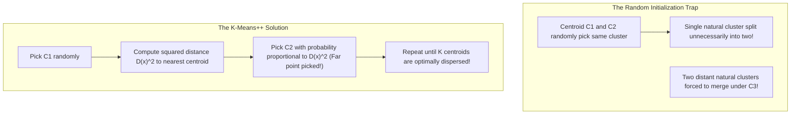

# Lecture 31.06: Random Initialization Trap Aur K-Means++ Algorithm [Hinglish]

---

## 📌 Topic Overview
Detailed examination of the Random Initialization Trap in standard K-Means. Explains why bad seed placement causes convergence to sub-optimal local minima, and how K-Means++ smart probability seeding guarantees optimal centroid dispersion.

---

### 📋 Is Topic Mein Hum Kya Seekhenge?
- **Random Initialization Trap** kya hota hai: Centroids ki galat starting position se model ka kharab cluster banana.
- Ma'am Ka Blackboard Example: Ek hi cluster mein do centroids ka phans jana.
- **K-Means++ Algorithm**: Centroids ko door-door rakhne ke liye probability $D(x)^2$ ka use.
- Scikit-learn default: `init='k-means++'` kyu hamesha prefer kiya jata hai.
- Standard K-Means vs K-Means++ ka comparison.

---

### 🔍 Har Ek Point Ka Simple & Detailed Explanation
- **Random Initialization Trap Kya Hai?**: Standard K-Means mein initial centroids randomly chune jaate hain. Agar kismat kharab ho aur 2 centroids ek hi natural cluster mein shuru ho jayein, toh K-Means unhe wahi phansa leta hai aur doosre clusters ko aapas mein merge kar deta hai! Isko kehte hain **Random Initialization Trap**.

- **Nateeja**: Algorithm ek sub-optimal local minimum par ruk jati hai aur galat clustering result deti hai.

- **Solution: K-Means++**: K-Means++ initial centroids ko randomly nahi, balki smartly door-door place karta hai:

-   1. Pehla centroid $C_1$ randomly chuno.

-   2. Har bache hue point $x$ ke liye uske sabse paas wale centroid se distance $D(x)$ calculate karo.

-   3. Agla centroid select karne ke liye har point ko probability do jo uske squared distance $D(x)^2$ ke proportional ho: $P(x) = \frac{D(x)^2}{\sum D(x)^2}$.

-   4. Jo point existing centroids se jitna door hoga, uske agla centroid banne ke chances utne hi high honge!

-   5. Jab tak $K$ centroids na mil jayein, yeh process repeat karo.

- **Scikit-Learn Default**: Scikit-learn mein `KMeans` ka default parameter `init='k-means++'` hota hai taaki initialization trap kabhi na aaye.

- **Pure Theory Lecture**: Is lecture mein ma'am ne blackboard par trapped centroids ka diagram draw karke samjhaya hai, koi code nahi hai.

---

### 📋 Random Initialization vs K-Means++ Comparison

| Property / Metric | Standard Random Initialization (`init='random'`) | K-Means++ Initialization (`init='k-means++'`) |
| :--- | :--- | :--- |
| **Centroid Selection** | Completely random uniform sampling | Distance-weighted squared probability $D(x)^2$ |
| **Centroid Dispersion** | Centroids can cluster together in same region | Centroids guaranteed to be spread across space |
| **Risk of Local Minima**| High (frequently gets stuck in trap) | Extremely Low (robust convergence) |
| **Iterations to Converge**| High (requires many passes to fix bad seeds) | Low (converges up to 2x faster) |
| **Scikit-Learn Usage** | Legacy option | Default setting in `sklearn.cluster.KMeans` |

---

### 📊 Ma'am's Random Trap vs K-Means++ Seeding

---

### 🔢 Mathematical Derivation

Probability of selecting observation $\mathbf{x}$ as the next centroid:

$$
P(\mathbf{x}) = \frac{D(\mathbf{x})^2}{\sum_{\mathbf{x}' \in \mathcal{D}} D(\mathbf{x}')^2}
$$

where $D(\mathbf{x})$ is the Euclidean distance from $\mathbf{x}$ to the nearest existing centroid:

$$
D(\mathbf{x}) = \min_{k=1, \dots, t} \| \mathbf{x} - C_k \|
$$

---

### 📌 Note on Code
Yeh pure conceptual, mathematical, aur blackboard theory lecture hai. Ma'am ne is lecture mein code nahi likha hai, isliye rule ke mutabiq isme koi extra synthetic code add nahi kiya gaya hai.
