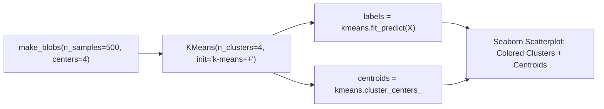

# Lecture 31.07: K-Means Clustering — Scikit-Learn Implementation

---

## 📌 Topic Overview
Practical implementation of K-Means clustering using scikit-learn. Covers synthetic cluster generation with make_blobs, KMeans instantiation, fitting, extracting cluster_centers_, and visualizing colored cluster partitions.

---

### 📋 Key Learning Objectives
- Generating synthetic 2D isotropic Gaussian blobs with make_blobs.
- Importing and configuring KMeans from sklearn.cluster.
- Hyperparameters: n_clusters=4, init='k-means++', max_iter=300, random_state=42.
- Executing fit_predict(X) to obtain cluster labels.
- Extracting and plotting cluster_centers_ with Seaborn/Matplotlib.

---

### 🔍 In-Depth Conceptual Breakdown

- **Data Generation**: `make_blobs(n_samples=500, centers=4, n_features=2, cluster_std=1.0, random_state=42)` use karke 4 distinct clusters banaye gaye.

- **KMeans Model**: `kmeans = KMeans(n_clusters=4, init='k-means++', max_iter=300, random_state=42)` instantiate kiya gaya.

- **Fitting & Prediction**: `labels = kmeans.fit_predict(X)` execute karke har sample ko `0, 1, 2, 3` cluster ID assign hui.

- **Centroids Extraction**: `centroids = kmeans.cluster_centers_` 4 coordinates return karta hai jo har cluster ka mathematical center of mass hain.

- **Visualization**: Seaborn `scatterplot` se points ko unke cluster label ke hisab se color kiya gaya aur centroids ko red markers se plot kiya gaya.

- **Code Lecture**: Is lecture mein ma'am ne notebook run karke sikhaya hai, isliye iska complete code [lecture_31_07.ipynb](lecture_31_07.ipynb) mein available hai.

---

### 📋 KMeans Key Hyperparameters in Scikit-Learn

| Hyperparameter | Default Value | Recommended Setting | Description |
| :--- | :--- | :--- | :--- |
| `n_clusters` | `8` | Domain-specific / Elbow $K$ | The number of clusters and centroids to form |
| `init` | `'k-means++'` | `'k-means++'` | Centroid initialization strategy to avoid traps |
| `n_init` | `'auto'` (10) | `10` or `'auto'` | Number of times K-Means will run with different seeds |
| `max_iter` | `300` | `300` | Maximum iterations for a single run |
| `tol` | `1e-4` | `1e-4` | Relative tolerance with regards to Frobenius norm to declare convergence |

---

### 📊 Scikit-Learn K-Means Execution Flow

---

### 🔢 Mathematical Formulation

Cluster assignment mapping for sample $i$:

$$
y_i = \arg\min_{k \in \{1, \dots, K\}} \| \mathbf{x}_i - \mathbf{C}_k \|^2
$$

---

### 💻 Implementation
The standalone verified code is provided in the synchronized [Jupyter Notebook](lecture_31_07.ipynb).
