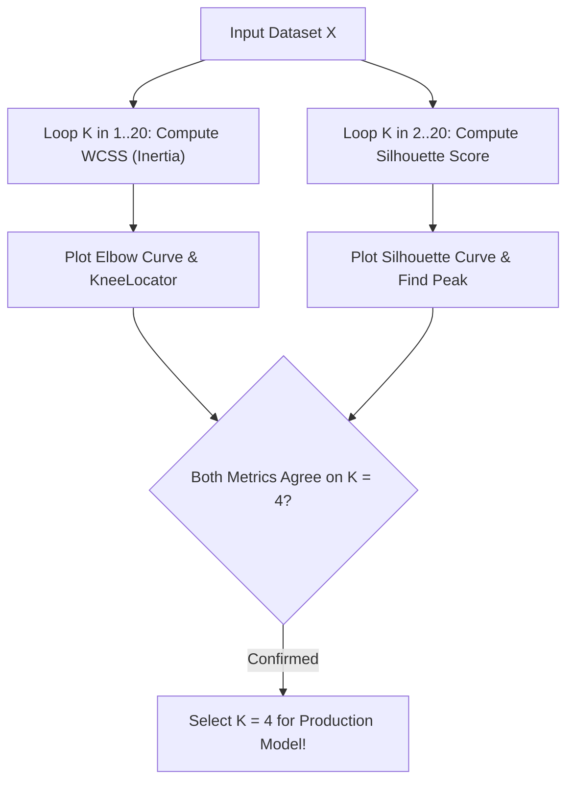

# Lecture 31.08: Choosing K Code — Elbow Method Aur Silhouette Score Implementation [Hinglish]

---

## 📌 Topic Overview
Practical implementation of K-selection techniques in Python. Demonstrates looping over K values, computing inertia_ and silhouette_score, automated knee detection with kneed.KneeLocator, and comparative evaluation.

---

### 📋 Is Topic Mein Hum Kya Seekhenge?
- $K=1$ se $20$ tak loop chalakar `kmeans.inertia_` collect karna.
- Elbow curve plot karke visually inflection point identify karna.
- `kneed.KneeLocator` library se programmatically exact elbow nikalna (`knee.elbow`).
- $K=2$ se $20$ tak `silhouette_score(X, labels)` calculate karna.
- Silhouette curve plot karke maximum score par optimal $K$ confirm karna.

---

### 🔍 Har Ek Point Ka Simple & Detailed Explanation
- **Elbow Method Code**: `wcss = []` list banayi gayi aur loop mein $K=1$ se $20$ tak `kmeans = KMeans(n_clusters=k).fit(X)` chalakar `wcss.append(kmeans.inertia_)` store kiya gaya.

- **Elbow Plotting**: `sns.lineplot(x=range(1, 21), y=wcss, marker='o')` se clean elbow graph draw hua.

- **Automated KneeLocator**: Manual aankhon se dekhne ke bajay python library `kneed` use ki gayi: `knee = KneeLocator(range(1, 21), wcss, curve='convex', direction='decreasing')`, jisse exact `knee.elbow = 4` print hua!

- **Silhouette Score Code**: `from sklearn.metrics import silhouette_score` import kiya gaya. $K=2$ se $20$ tak `ss.append(silhouette_score(X, kmeans.labels_))` calculate kiya gaya.

- **Peak Detection**: Silhouette plot mein $K=4$ par highest peak (~0.79) mili, jo Elbow point ke sath 100% match karta hai!

- **Code Lecture**: Is lecture ka complete runnable notebook [lecture_31_08.ipynb](lecture_31_08.ipynb) mein available hai.

---

### 📋 Elbow vs Silhouette Score Code Execution Comparison

| Step / Aspect | Elbow Method Implementation | Silhouette Score Implementation |
| :--- | :--- | :--- |
| **Import** | Built-in `kmeans.inertia_` | `from sklearn.metrics import silhouette_score` |
| **Valid K Range** | $K \in [1, N]$ (can evaluate $K=1$) | $K \ge 2$ (minimum 2 clusters required!) |
| **Selection Criterion** | Point of maximum curvature (Elbow) | Absolute highest peak value (Global Maximum) |
| **Automation Tool** | `kneed.KneeLocator` | `numpy.argmax(scores) + 2` |
| **Output Metric** | Inertia (unbounded squared distances) | Normalized coefficient $\in [-1.0, +1.0]$ |

---

### 📊 Dual Evaluation Pipeline for Optimal K

---

### 🔢 Mathematical Derivation

Inertia attribute computed by scikit-learn:

$$
\text{inertia\_} = \sum_{i=1}^N \min_{k \in \{1, \dots, K\}} \| \mathbf{x}_i - C_k \|^2
$$

Mean silhouette score across all observations:

$$
S_K = \frac{1}{N} \sum_{i=1}^N s(i)
$$

---

### 💻 Standalone Python Code & Verification
Iss module ka complete runnable code [Jupyter Notebook](lecture_31_08.ipynb) mein available hai.
