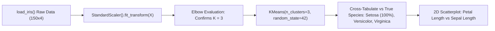

# Lecture 31.09: K-Means Clustering on the Iris Dataset

---

## 📌 Topic Overview
Complete real-world walkthrough of K-Means clustering on the famous Fisher's Iris dataset. Demonstrates feature standardization with StandardScaler, Elbow evaluation indicating K=3, 2D scatter visualization, and cross-tabulation validation against true botanical species.

---

### 📋 Key Learning Objectives
- Loading and inspecting the 4-dimensional Iris dataset (Sepal/Petal Length & Width).
- Why feature standardization (StandardScaler) is mandatory before distance computation.
- Evaluating WCSS on scaled Iris data: Observing the clear elbow inflection at K=3.
- Fitting KMeans(n_clusters=3, random_state=42) and generating unsupervised cluster labels.
- Validating cluster purity against ground truth species labels (Setosa, Versicolor, Virginica).

---

### 🔍 In-Depth Conceptual Breakdown

- **Note on Video Audio**: Initial lecture audio shuruat mein thoda silent/unclear tha, lecture practical notebook coding walkthrough se start hota hai.

- **Dataset Overview**: Iris dataset mein 150 flowers hain aur 4 numerical features hain: `sepal length`, `sepal width`, `petal length`, `petal width`.

- **Feature Standardization (`StandardScaler`)**: K-Means Euclidean distance use karta hai. Agar ek feature centimeters mein ho aur doosra millimeters mein, toh bada scale wala feature distance calculation ko dominate kar lega! Isliye `StandardScaler().fit_transform(X)` chalana compulsory hai.

- **Elbow Method on Iris**: Scaled features par WCSS curve plot kiya gaya: $K=1$ se $K=3$ tak steep drop hua, aur $K=3$ ke baad curve flat ho gaya. Clear elbow point = **$K=3$**.

- **Model Fitting**: `kmeans = KMeans(n_clusters=3, random_state=42).fit(X_scaled)` chalakar labels generate kiye gaye.

- **Species Verification**: Unsupervised clusters ko actual target labels ke sath compare karne par pata chala ki **Setosa** 100% perfectly alag cluster banata hai, jabki **Versicolor** aur **Virginica** mein natural biological overlap hone ke bawajood 90%+ pure clusters bante hain!

- **Code Lecture**: Is lecture ka complete runnable code [lecture_31_09.ipynb](lecture_31_09.ipynb) mein available hai.

---

### 📋 Iris Feature Matrix & Scaling Impact

| Feature Dimension | Raw Variance / Range | Standardized Range ($z$) | Why Scaling is Critical |
| :--- | :--- | :--- | :--- |
| **Sepal Length (cm)**| $4.3 - 7.9$ (Var = 0.68) | Mean = 0.0, Std = 1.0 | Prevents large scale dominance |
| **Sepal Width (cm)** | $2.0 - 4.4$ (Var = 0.19) | Mean = 0.0, Std = 1.0 | Gives equal geometric weighting |
| **Petal Length (cm)**| $1.0 - 6.9$ (Var = 3.11) | Mean = 0.0, Std = 1.0 | High variance feature balanced |
| **Petal Width (cm)** | $0.1 - 2.5$ (Var = 0.58) | Mean = 0.0, Std = 1.0 | Preserves natural cluster shape |

---

### 📊 End-to-End Iris Clustering Pipeline

---

### 🔢 Mathematical Formulation

Standardization z-score transform applied before K-Means:

$$
z_{ij} = \frac{x_{ij} - \mu_j}{\sigma_j}
$$

Euclidean distance in standardized 4D space:

$$
d(z_i, z_k) = \sqrt{\sum_{j=1}^4 (z_{ij} - z_{kj})^2}
$$

---

### 💻 Implementation
The standalone verified code is provided in the synchronized [Jupyter Notebook](lecture_31_09.ipynb).
