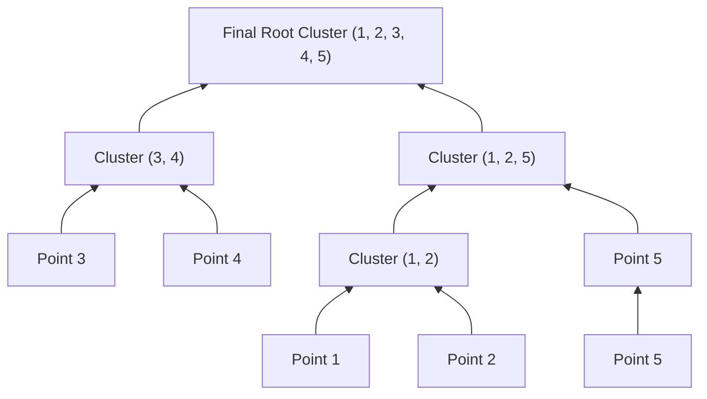

# Lecture 31.10: Hierarchical Clustering — Agglomerative vs Divisive

---

## 📌 Topic Overview
Comprehensive conceptual analysis of Hierarchical Clustering. Contrasts bottom-up Agglomerative clustering against top-down Divisive clustering, and provides mathematical derivations for Single, Complete, Average, and Ward linkage criteria.

---

### 📋 Key Learning Objectives
- Concept of hierarchical tree-based clustering without pre-specifying K.
- Agglomerative Clustering (Bottom-Up): Iteratively merging the two closest clusters.
- Divisive Clustering (Top-Down): Iteratively splitting one master cluster into subclusters.
- Linkage Criteria: Single (min), Complete (max), Average (mean), and Ward (variance minimization).
- Trade-offs: Sensitivity to outliers and computational complexity O(N^2 log N).

---

### 🔍 In-Depth Conceptual Breakdown

- **Hierarchical Clustering Ka Core Idea**: K-Means mein hume shuruat mein hi batana padta tha ki $K=3$ ya $K=4$. Lekin **Hierarchical Clustering** mein hume pehle se $K$ decide nahi karna padta! Yeh poore data ka ek family tree (hierarchy) bana deti hai.

- **Agglomerative (Bottom-Up) Approach (Sabse Popular)**:

-   1. Shuruat mein har ek data point apna khud ka individual cluster hota hai ($N$ points = $N$ clusters).

-   2. Sabse paas wale do clusters ko aapas mein merge kar diya jata hai ($N-1$ clusters bache).

-   3. Yeh merging tab tak chalti rehti hai jab tak end mein ek single giant cluster na ban jaye!

- **Divisive (Top-Down) Approach**: Iska ulta hota hai. Saare points 1 cluster se start hote hain aur recursive splits karke single points tak pahunchte hain.

- **Do Clusters Ke Beech Distance Kaise Nikalein? (Linkage Criteria)**:

-   - **Single Linkage**: Cluster A aur Cluster B ke do sabse paas wale points ka distance: $d_{min}(A, B) = \min d(x, y)$. (Chaining effect ka khatra).

-   - **Complete Linkage**: Do sabse door wale points ka distance: $d_{max}(A, B) = \max d(x, y)$. (Compact, spherical clusters banata hai).

-   - **Average Linkage**: Dono clusters ke saare pairs ka average distance.

-   - **Ward Linkage (Default in Scikit-Learn)**: Do clusters ko merge karne par variance (sum of squared errors) mein kitna izafa hoga: $\Delta \text{Var}$. Jo merge variance ko sabse kam badhaye, usi ko merge kiya jata hai!

- **Pure Theory Lecture**: Is lecture mein ma'am ne blackboard par Agglomerative vs Divisive aur Linkage formulas explain kiye hain, koi code nahi hai.

---

### 📋 Linkage Criteria Comparison Matrix

| Linkage Method | Mathematical Definition | Cluster Shape Tendency | Outlier Sensitivity |
| :--- | :--- | :--- | :--- |
| **Single Linkage** | $d(A, B) = \min_{x \in A, y \in B} d(x, y)$ | Can follow elongated shapes | High (prone to chaining noise) |
| **Complete Linkage**| $d(A, B) = \max_{x \in A, y \in B} d(x, y)$ | Compact, equal diameter spheres | Low (sensitive to outer boundaries) |
| **Average Linkage** | $d(A, B) = \frac{1}{\|A\| \|B\|} \sum d(x, y)$| Balanced variance clusters | Moderate |
| **Ward's Linkage** | $\Delta \text{ESS} = \frac{\|A\| \|B\|}{\|A\| + \|B\|} \| \mu_A - \mu_B \|^2$ | Compact, spherical, variance-optimal | **Lowest (Industry standard default)** |

---

### 📊 Agglomerative (Bottom-Up) Merging Flow

---

### 🔢 Mathematical Formulation

Ward's minimum variance criterion for merging clusters $A$ and $B$:

$$
\Delta I_{AB} = \frac{N_A N_B}{N_A + N_B} \| \mathbf{m}_A - \mathbf{m}_B \|^2
$$

where $\mathbf{m}_A$ and $\mathbf{m}_B$ are the centroid mean vectors of clusters $A$ and $B$.

---

### 📌 Note on Code
This is a pure conceptual, mathematical, and blackboard theory lecture. In accordance with course guidelines, no synthetic code is appended.
