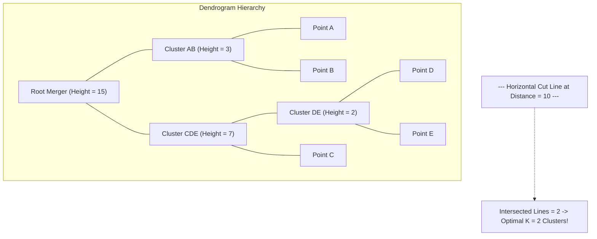

# Lecture 31.11: What is a Dendrogram — Structure & Cutting Thresholds

---

## 📌 Topic Overview
Detailed study of Dendrograms in hierarchical clustering. Explains tree diagram anatomy, height as Euclidean linkage distance, determining optimal K by identifying the longest unbroken vertical branch, and cutting horizontally.

---

### 📋 Key Learning Objectives
- Formal definition of a Dendrogram: Tree-based visual representation of cluster merges.
- Anatomy of the Dendrogram: X-axis (sample indices) and Y-axis (linkage merge distance).
- Determining optimal K: Finding the longest vertical line uncrossed by horizontal splits.
- Setting a horizontal distance threshold to cut the dendrogram into K discrete clusters.
- Interpreting sub-cluster hierarchies and biological taxonomy similarities.

---

### 🔍 In-Depth Conceptual Breakdown

- **Dendrogram Kya Hai?**: Dendrogram ek special tree-like diagram hota hai jo yeh record karta hai ki kaun se do data points kis distance (height) par aapas mein merge huye.

- **Anatomy Of The Plot**:

-   - **X-axis**: Saare individual data points (samples) hote hain.

-   - **Y-axis (Height)**: Euclidean distance ya linkage distance hoti hai. Do branches jitni upar jakar judti hain, unke beech ka distance utna hi zyada tha!

- **Optimal K Kaise Chunein? (The Golden Rule)**:

-   1. Dendrogram mein wo **sabse lambi vertical line** dhoondo jiske beech se koi bhi horizontal merge line pass na ho rahi ho.

-   2. Us vertical line ke beech se ek **Horizontal Cut Line** (threshold distance) kheench do.

-   3. Yeh cut line jitni vertical branches ko kaategi, wahi hamara **Optimal K (Number of Clusters)** hoga!

- **Ma'am Ka Blackboard Example**: Ma'am ne board par 5 samples (A, B, C, D, E) ka dendrogram draw karke dikhaya ki kaise ek horizontal cut lagane par 2 distinct major clusters ban jaate hain.

- **Pure Theory Lecture**: Is lecture mein ma'am ne dendrogram ki anatomy aur cut threshold board par draw karke sikhaya hai, koi code nahi hai.

---

### 📋 Dendrogram Components & Interpretation

| Visual Element | Graphical Meaning | Mathematical Representation |
| :--- | :--- | :--- |
| **Leaves (Bottom)** | Individual raw observations | Singletons $S_i = \{ \mathbf{x}_i \}$ at distance = 0 |
| **Vertical Stems** | Clusters awaiting subsequent merger | Height proportional to linkage distance $d(A, B)$ |
| **Horizontal Bars** | Merger event between two clusters | The exact dissimilarity threshold of the fusion |
| **Cut Line (Threshold)**| Horizontal partition boundary | Divides tree into $K$ disjoint subtrees |

---

### 📊 Ma'am's Blackboard Dendrogram & Cut Threshold

---

### 🔢 Mathematical Formulation

Optimal number of clusters $K$ given distance cut threshold $\theta$:

$$
K(\theta) = \sum_{j \in \text{Active Nodes}} \mathbb{I}\left( \text{height}(j) > \theta \ge \text{height}(\text{children}(j)) \right)
$$

---

### 📌 Note on Code
This is a pure conceptual, mathematical, and blackboard theory lecture. In accordance with course guidelines, no synthetic code is appended.
