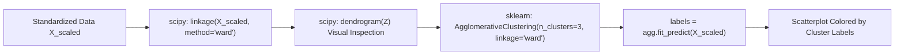

# Lecture 31.12: Hierarchical Clustering (Code) — Scipy & Scikit-Learn

---

## 📌 Topic Overview
Practical implementation of Hierarchical Clustering using scipy and scikit-learn. Demonstrates computing the linkage matrix with scipy.cluster.hierarchy.linkage, plotting dendrograms, and fitting sklearn.cluster.AgglomerativeClustering.

---

### 📋 Key Learning Objectives
- Importing linkage and dendrogram from scipy.cluster.hierarchy.
- Computing Ward's linkage matrix on standardized feature data.
- Plotting and styling the dendrogram with matplotlib figure size.
- Importing AgglomerativeClustering from sklearn.cluster.
- Fitting with n_clusters=3, metric='euclidean', linkage='ward' and visualizing partitions.

---

### 🔍 In-Depth Conceptual Breakdown

- **Scipy Linkage Matrix**: `from scipy.cluster.hierarchy import linkage, dendrogram` use kiya gaya. `linkage(X_scaled, method='ward')` function saare pairwise clusters ke merging sequence aur distance ki table banata hai.

- **Dendrogram Plotting**: `plt.figure(figsize=(12, 6))` banakar `dendrogram(linkage_matrix)` call kiya gaya. Plot mein clearly 2-3 prominent vertical branches nazar aati hain.

- **AgglomerativeClustering in Scikit-Learn**: `from sklearn.cluster import AgglomerativeClustering` use kiya gaya.

- **Model Setup**: `agg = AgglomerativeClustering(n_clusters=3, metric='euclidean', linkage='ward')` instantiate kiya gaya.

- **Fit & Predict**: `labels = agg.fit_predict(X_scaled)` se har point ko cluster label mila.

- **Visualization**: `sns.scatterplot(x=X_scaled[:, 0], y=X_scaled[:, 2], c=labels)` se 3 distinct clusters beautifully visualize huye.

- **Code Lecture**: Is lecture ka complete runnable notebook [lecture_31_12.ipynb](lecture_31_12.ipynb) mein available hai.

---

### 📋 Scipy vs Scikit-Learn Hierarchical Functions

| Task / Objective | Library Tool | Primary Output |
| :--- | :--- | :--- |
| **Compute Merge Tree** | `scipy.cluster.hierarchy.linkage` | $(N-1) \times 4$ Linkage Matrix |
| **Visualize Tree** | `scipy.cluster.hierarchy.dendrogram` | Dendrogram Matplotlib Tree Plot |
| **Cluster Partitioning** | `sklearn.cluster.AgglomerativeClustering` | Cluster Label Array $\hat{y} \in \{0, \dots, K-1\}$ |

---

### 📊 Scipy + Sklearn Hierarchical Code Pipeline

---

### 🔢 Mathematical Formulation

Agglomerative cluster label assignment:

$$
c_i = \text{AgglomerativeClustering}(K=3, \text{ward}).\text{fit\_predict}(\mathbf{X})_i
$$

---

### 💻 Implementation
The standalone verified code is provided in the synchronized [Jupyter Notebook](lecture_31_12.ipynb).
