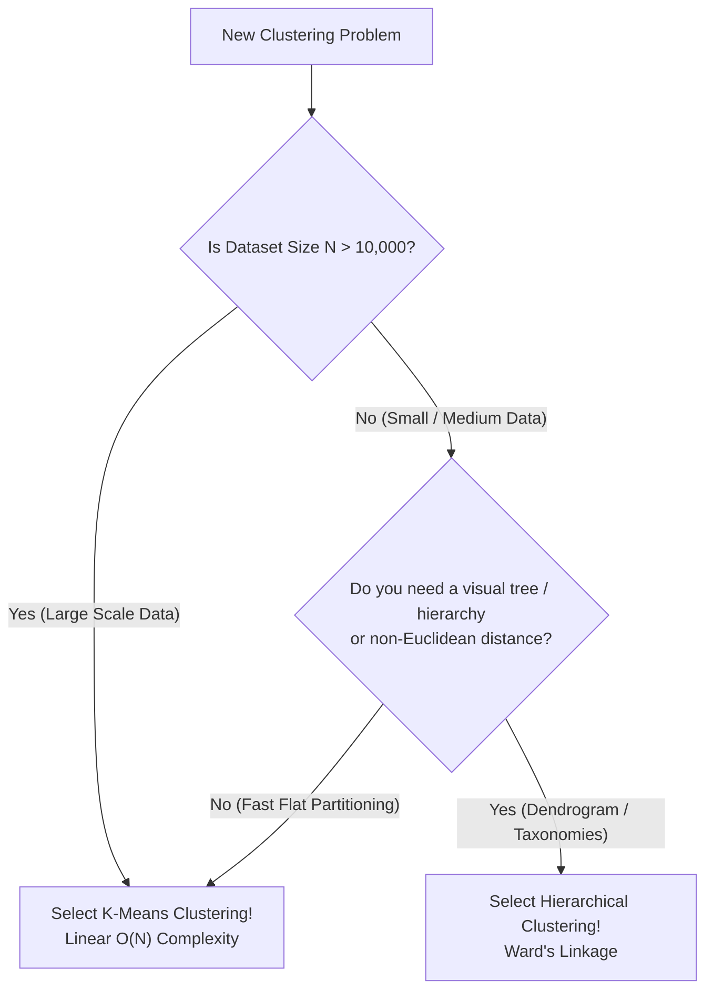

# Lecture 31.13: K-Means vs Hierarchical Clustering Ka Complete Comparison [Hinglish]

---

## 📌 Topic Overview
Direct architectural and operational comparison between K-Means and Hierarchical Clustering. Analyzes time and space complexity, scalability limits, sensitivity to outliers, cluster shape flexibility, and production selection criteria.

---

### 📋 Is Topic Mein Hum Kya Seekhenge?
- Time Complexity ka farak: K-Means linear $\mathcal{O}(N)$ vs Hierarchical quadratic/cubic $\mathcal{O}(N^2)$ ya $\mathcal{O}(N^3)$.
- Scalability: K-Means lakhon samples ($N=10^6$) par fast chalta hai, jabki Hierarchical 10,000 samples ke baad memory crash kar deta hai.
- $K$ choose karna: K-Means mein pehle se $K$ chahiye, Hierarchical mein dendrogram dekh kar baad mein cut lagate hain.
- Distance metrics: K-Means center mean nikalne ki wajah se Euclidean tak seemit hai, Hierarchical kisi bhi distance metric ke sath chal sakta hai.
- Industry Decision Rule: Bada data $\rightarrow$ K-Means; Chota data + hierarchy $\rightarrow$ Hierarchical.

---

### 🔍 Har Ek Point Ka Simple & Detailed Explanation
- **Comparison Ka Context**: Ma'am ne dono algorithms ko side-by-side compare karke unke practical trade-offs explain kiye hain.

- **Point 1: Number of Clusters ($K$)**:

-   - **K-Means**: Algorithm chalane se PEHLE hume $K$ specify karna hi padega.

-   - **Hierarchical**: Pehle poora dendrogram banta hai, fir hum apni marzi se kisi bhi threshold par cut karke baad mein $K$ decide kar sakte hain.

- **Point 2: Time & Space Complexity (Bada Farak!)**:

-   - **K-Means**: $\mathcal{O}(N \cdot K \cdot I)$. Yeh data size $N$ ke sath linearly grow karta hai. Millions of data points par super fast execute hota hai.

-   - **Hierarchical**: $\mathcal{O}(N^2 \log N)$ ya $\mathcal{O}(N^3)$. Har pair ka distance matrix store karne ke liye $\mathcal{O}(N^2)$ RAM chahiye hoti hai. Agar $N = 50,000$ ho jaye, toh computer memory exhaust ho jayegi!

- **Point 3: Distance Metric Flexibility**:

-   - **K-Means**: Centroids ka mean (average) nikalta hai, isliye primarily **Euclidean Distance** par hi work karta hai.

-   - **Hierarchical**: Kisi bhi custom distance metric (Manhattan, Cosine, Correlation) ke sath kaam kar sakta hai.

- **Point 4: Sensitivity to Noise & Outliers**:

-   - **K-Means**: Outliers centroids ko apni taraf kheench lete hain, jisse cluster centers shift ho jaate hain.

-   - **Hierarchical**: Ward linkage robust hai, lekin Single linkage outliers ki wajah se lambi chains bana deta hai.

- **Pure Theory Lecture**: Is lecture mein ma'am ne blackboard par comparison points explain kiye hain, koi code nahi hai.

---

### 📋 Ma'am's Head-to-Head Comparison Table

| Feature / Dimension | K-Means Clustering | Hierarchical Clustering |
| :--- | :--- | :--- |
| **Clustering Paradigm** | Partitioning (Flat clustering) | Hierarchy of nested clusters (Dendrogram) |
| **Number of Clusters ($K$)** | Must specify $K$ in advance | Do NOT need $K$ in advance (can cut dendrogram later) |
| **Time Complexity** | $\mathcal{O}(N \cdot K \cdot I \cdot D)$ (Fast linear speed) | $\mathcal{O}(N^2 \log N)$ or $\mathcal{O}(N^3)$ (Slow quadratic/cubic) |
| **Space Complexity** | $\mathcal{O}(N \cdot D + K \cdot D)$ (Memory light) | $\mathcal{O}(N^2)$ (Heavy distance matrix storage) |
| **Maximum Feasible $N$** | Millions of observations ($N > 1,000,000$) | Small datasets ($N < 10,000$) |
| **Distance Flexibility** | Primarily Euclidean (due to arithmetic mean) | Highly flexible (Manhattan, Cosine, Correlation) |
| **Output Representation** | Discrete cluster IDs and Centroid coordinates | Full hierarchical tree diagram (Dendrogram) |

---

### 📊 Decision Matrix: K-Means vs Hierarchical Selection

---

### 🔢 Mathematical Derivation

Time complexity ratio between Hierarchical and K-Means:

$$
\text{Ratio} = \frac{\mathcal{O}(N^2 \log N)}{\mathcal{O}(N \cdot K \cdot I)} = \mathcal{O}\left( \frac{N \log N}{K \cdot I} \right)
$$

For $N = 100,000$, Hierarchical is over $1,000\times$ slower and requires over 40 GB of RAM for the distance matrix!

---

### 📌 Note on Code
Yeh pure conceptual, mathematical, aur blackboard theory lecture hai. Ma'am ne is lecture mein code nahi likha hai, isliye rule ke mutabiq isme koi extra synthetic code add nahi kiya gaya hai.
