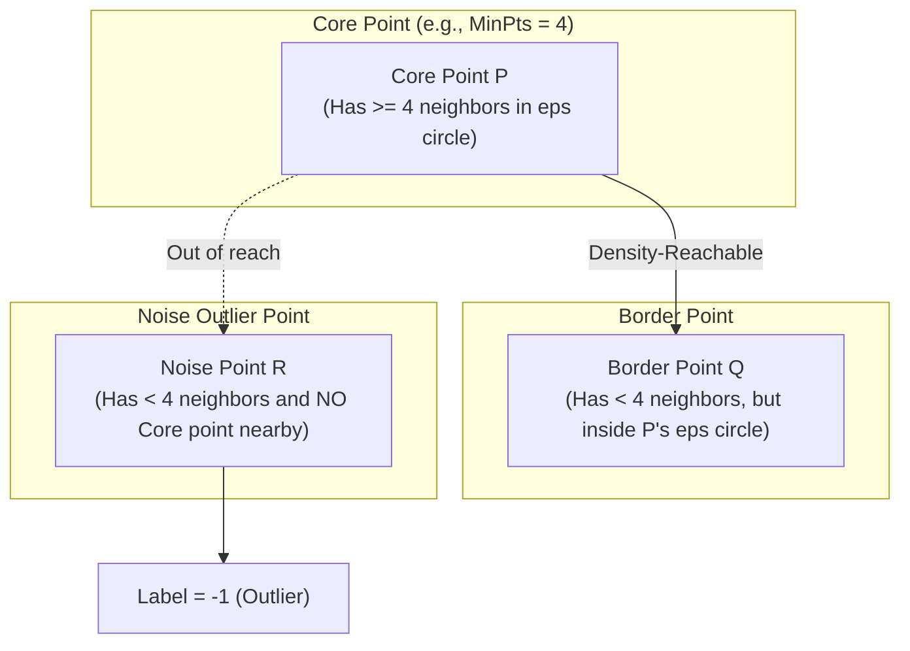

# Lecture 31.14: DBSCAN Clustering — Density-Based Spatial Clustering

---

## 📌 Topic Overview
Comprehensive conceptual derivation of DBSCAN (Density-Based Spatial Clustering of Applications with Noise). Covers why density-based clustering solves arbitrary non-convex geometries, hyperparameters Epsilon (eps) and MinPts, Core points, Border points, Noise outliers (-1), and density reachability.

---

### 📋 Key Learning Objectives
- Why K-Means fails on non-convex, non-spherical, arbitrary cluster geometries.
- DBSCAN Core Parameters: Epsilon (neighborhood radius) and MinPts (minimum density).
- Point Taxonomy: Core Points, Border Points, and Noise Outliers (-1).
- Concepts of Density-Reachability and Density-Connectivity.
- Key Advantage: Automatically discovering number of clusters and filtering noise.

---

### 🔍 In-Depth Conceptual Breakdown

- **DBSCAN Kyu Aaya?**: K-Means hamesha circular/spherical clusters dhoondhta hai aur har outlier point ko kisi na kisi cluster mein jabardasti ghusa deta hai. **DBSCAN** density (ghana-pan) par kaam karta hai — yeh kisi bhi arbitrary shape (rings, moons, snakes) ke clusters dhoondh leta hai aur outliers ko alag fek deta hai!

- **2 Core Parameters**:

-   1. $\epsilon$ (**Epsilon**): Kisi point ke charo taraf ka radius (circle ka daayra).

-   2. **MinPts** (`min_samples`): Ek dense cluster banane ke liye $\epsilon$-neighborhood ke andar kam se kam kitne points hone chahiye.

- **Points Ki 3 Categories (Ma'am Ka Blackboard Diagram)**:

-   1. **Core Point (Mukhya Point)**: Agar kisi point ke $\epsilon$-radius circle ke andar $\ge \text{MinPts}$ points maujood hain, toh wo **Core Point** kehlaata hai.

-   2. **Border Point (Kinare Ka Point)**: Agar kisi point ke circle mein $\text{MinPts}$ se kam points hain, LEKIN wo kisi Core Point ke daayre mein aata hai, toh wo **Border Point** hota hai.

-   3. **Noise / Outlier Point**: Wo point jo na toh Core Point hai aur na hi kisi Core Point ke pados mein aata hai. Isko DBSCAN label **`-1`** deta hai!

- **Cluster Formation (Density-Connectivity)**: Do Core Points agar ek doosre ke $\epsilon$ radius mein hain, toh unke clusters merge ho jaate hain. Is tarah point-to-point chain bante hue arbitrary shape ka lamba cluster ban jata hai.

- **Pure Theory Lecture**: Is lecture mein ma'am ne blackboard par Core, Border aur Noise points ke circles draw karke explain kiya hai, koi code nahi hai.

---

### 📋 DBSCAN Point Taxonomy Matrix

| Point Category | Mathematical Condition | Neighborhood Density | Cluster Assignment |
| :--- | :--- | :--- | :--- |
| **Core Point** | $|N_\epsilon(p)| \ge \text{MinPts}$ | Dense inner region | Seed of a cluster (expands cluster) |
| **Border Point** | $|N_\epsilon(p)| < \text{MinPts}$ and $p \in N_\epsilon(\text{Core})$ | Marginal boundary density | Assigned to the neighboring Core cluster |
| **Noise Outlier** | $|N_\epsilon(p)| < \text{MinPts}$ and $p \notin N_\epsilon(\text{Core})$ | Isolated sparse region | Assigned label **`-1`** (Filtered out) |

---

### 📊 Ma'am's Blackboard Core, Border & Noise Circles

---

### 🔢 Mathematical Formulation

Epsilon-neighborhood definition for point $p$:

$$
N_\epsilon(p) = \{ q \in \mathcal{D} \mid d(p, q) \le \epsilon \}
$$

Condition for Core Point:

$$
|N_\epsilon(p)| \ge \text{MinPts}
$$

Density-Reachability condition: Point $p$ is directly density-reachable from point $q$ if:

$$
p \in N_\epsilon(q) \quad \text{and} \quad |N_\epsilon(q)| \ge \text{MinPts}
$$

---

### 📌 Note on Code
This is a pure conceptual, mathematical, and blackboard theory lecture. In accordance with course guidelines, no synthetic code is appended.
