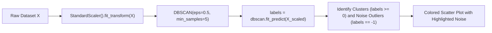

# Lecture 31.15: DBSCAN Clustering Code — Scikit-Learn Implementation Aur Noise Detection [Hinglish]

---

## 📌 Topic Overview
Practical implementation of DBSCAN in scikit-learn. Demonstrates feature standardization with StandardScaler, configuring eps and min_samples, inspecting cluster labels, counting noise outliers (-1), and scatter plot visualization.

---

### 📋 Is Topic Mein Hum Kya Seekhenge?
- `sklearn.cluster` se `DBSCAN` import karna.
- `StandardScaler` se features scale karna ($\epsilon$ radius ke liye scaling bohot zaroori hai).
- Hyperparameters set karna: `eps=0.5` aur `min_samples=5`.
- `dbscan.fit_predict(X_scaled)` se cluster labels nikalna.
- Noise points (`label == -1`) ko filter karke scatter plot par alag color se highlight karna.

---

### 🔍 Har Ek Point Ka Simple & Detailed Explanation
- **Importing Tools**: `from sklearn.cluster import DBSCAN` aur `from sklearn.preprocessing import StandardScaler` use kiya gaya.

- **Scaling is Mandatory**: DBSCAN mein $\epsilon$ ek fixed geometrical distance hota hai. Agar features scaled nahi honge, toh unscaled column radius ko distort kar dega!

- **DBSCAN Setup**: `dbscan = DBSCAN(eps=0.5, min_samples=5)` instantiate kiya gaya.

- **Fitting & Labels**: `labels = dbscan.fit_predict(X_scaled)` execute kiya gaya. Jo points cluster ke part bane unhe `0, 1, 2` mila, aur jo outliers the unhe **`-1`** mila.

- **Noise Analysis**: `n_noise = list(labels).count(-1)` se total noise points count kiye gaye.

- **Visualization**: Seaborn scatterplot par clusters ko colorful aur noise points (-1) ko distinct black/grey markers ke sath plot kiya gaya.

- **Code Lecture**: Is lecture ka complete runnable notebook [lecture_31_15.ipynb](lecture_31_15.ipynb) mein available hai.

---

### 📋 DBSCAN Hyperparameters in Scikit-Learn

| Hyperparameter | Default Value | Tuning Rule of Thumb | Impact on Clustering |
| :--- | :--- | :--- | :--- |
| `eps` | `0.5` | K-distance elbow plot / domain distance | Too small: most points become noise; Too large: clusters merge into one |
| `min_samples` | `5` | Generally $2 \times D$ (where $D$ = features) | Higher value filters more noise and demands denser regions |
| `metric` | `'euclidean'` | `'euclidean'`, `'manhattan'`, `'cosine'` | Distance metric to calculate neighborhood radius |

---

### 📊 Scikit-Learn DBSCAN Execution Workflow

---

### 🔢 Mathematical Derivation

Cluster count and noise identification formula in Python:

$$
K = |\{ c \in \text{set}(\text{labels}) \mid c \neq -1 \}|, \quad N_{\text{noise}} = \sum_{i=1}^N \mathbb{I}(\text{labels}_i = -1)
$$

---

### 💻 Standalone Python Code & Verification
Iss module ka complete runnable code [Jupyter Notebook](lecture_31_15.ipynb) mein available hai.
