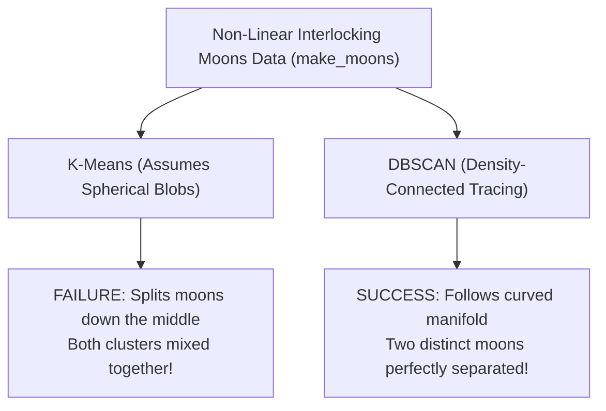

# Lecture 31.16: K-Means vs DBSCAN Non-Linear Data — Moons Aur Circles Par Comparison [Hinglish]

---

## 📌 Topic Overview
Direct practical benchmark comparing K-Means and DBSCAN on complex non-linear geometries: interlocking half-moons (make_moons) and concentric circles (make_circles). Demonstrates K-Means centroid failure vs DBSCAN density tracing triumph.

---

### 📋 Is Topic Mein Hum Kya Seekhenge?
- `make_moons` se aapas mein phanse huye do adhe-chaand (interlocking half-moons) banana.
- **K-Means Ka Failure**: K-Means spherical clusters assume karta hai, isliye moons ko beech se kaat deta hai!
- **DBSCAN Ki Jeet**: DBSCAN density trace karke dono moons ko 100% perfectly alag-alag pehchan leta hai.
- DBSCAN ke `eps=0.2` aur `min_samples=5` parameter tuning ka visual demo.
- Production Guide: Kab K-Means use karein aur kab DBSCAN.

---

### 🔍 Har Ek Point Ka Simple & Detailed Explanation
- **The Classic Non-Linear Test**: Real life mein data hamesha spherical gendon (blobs) jaisa nahi hota. Kai baar data spirals, concentric circles, ya interlocking moons jaisa hota hai.

- **Data Generation**: `X, y = make_moons(n_samples=500, noise=0.08, random_state=42)` banaya gaya.

- **K-Means Ka Test (Failure!)**: `KMeans(n_clusters=2).fit_predict(X)` chalaya gaya. K-Means ne centroid distance dekha aur dono moons ko beech se kaat kar aadha-aadha divide kar diya! Yeh completely galat result hai.

- **DBSCAN Ka Test (Success!)**: `DBSCAN(eps=0.2, min_samples=5).fit_predict(X)` chalaya gaya. Chuki ek moon ke points aapas mein densely connected hain, DBSCAN ne curve ke sath-sath density trace ki aur dono moons ko do perfectly separated clusters mein identify kar liya!

- **Final Verdict Table**:

-   - **K-Means**: Best for simple, convex, spherical blobs where $K$ is known and data is large.

-   - **Hierarchical**: Best for small datasets where tree taxonomy / dendrogram is required.

-   - **DBSCAN**: Best for complex shapes, non-linear manifolds, unknown $K$, and datasets with noise/outliers.

- **Code Lecture**: Is lecture ka complete runnable notebook [lecture_31_16.ipynb](lecture_31_16.ipynb) mein available hai.

---

### 📋 Ultimate Clustering Algorithms Showdown

| Evaluation Dimension | K-Means Clustering | Hierarchical Clustering | DBSCAN Clustering |
| :--- | :--- | :--- | :--- |
| **Cluster Geometry** | Spherical, Convex Blobs only | Convex / Linkage-dependent | **Any Arbitrary Non-Linear Shape** |
| **Outlier Handling** | Pulls centroids (Poor) | Varies by linkage | **Natively detects & isolates noise (-1)** |
| **Need to Specify K?**| **Yes (Mandatory)** | No (Cut dendrogram later) | **No (Discovers K automatically)** |
| **Execution Speed** | **Fastest: $\mathcal{O}(N \cdot K)$** | Slowest: $\mathcal{O}(N^2 \log N)$ | Fast: $\mathcal{O}(N \log N)$ with KD-Tree |
| **Worst-case Data** | Non-linear shapes (Moons/Rings)| Datasets with $>10,000$ points | Varying density clusters |

---

### 📊 K-Means Failure vs DBSCAN Triumph on Moons

---

### 🔢 Mathematical Derivation

Density-connectivity definition between observations $p$ and $q$:

$$
p \sim_{\text{density}} q \iff \exists o_1, o_2, \dots, o_m \in \mathcal{D} \quad \text{s.t.} \quad o_1 = p, \; o_m = q, \; \forall i, \; o_{i+1} \in N_\epsilon(o_i) \land |N_\epsilon(o_i)| \ge \text{MinPts}
$$

---

### 💻 Standalone Python Code & Verification
Iss module ka complete runnable code [Jupyter Notebook](lecture_31_16.ipynb) mein available hai.
