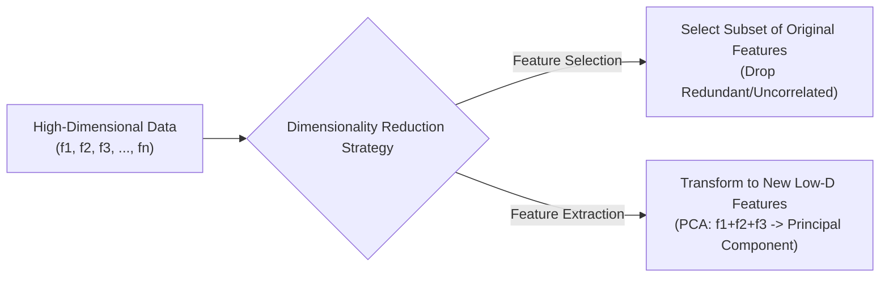
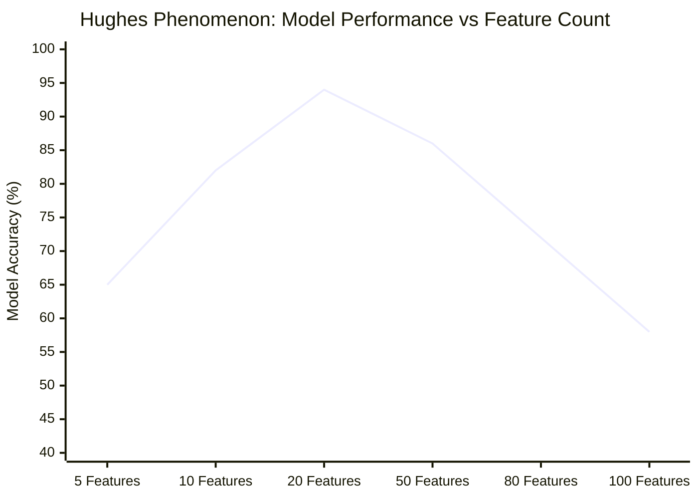

# Module 32.01: Dimensionality Reduction & The Curse of Dimensionality

## 1. Overview & Conceptual Intuition

In machine learning and data science, **dimensionality** refers directly to the number of input features present in a dataset ($f_1, f_2, \dots, f_n$). When datasets contain hundreds or thousands of features (e.g., $n = 200, 500, 1000$ in genomics, customer analytics, or natural language embeddings), machine learning algorithms encounter fundamental geometric and mathematical breakdowns collectively known as the **Curse of Dimensionality**.

**Dimensionality Reduction** is the principled process of reducing the number of input features while retaining as much meaningful information, statistical variance, and underlying structure of the original data as possible.

---

## 2. The Curse of Dimensionality

As dimensions grow, four critical failure modes emerge that degrade model performance and computation:

### A. Data Sparsity (Exponential Space Growth)
As the number of dimensions increases, the volume of the feature space increases exponentially ($O(k^d)$).
- **1D Space**: A simple line segment requires a few data points to achieve adequate point density.
- **2D Space**: A plane requires significantly more points ($N^2$) to cover the area.
- **3D Space**: A cube requires vastly more points ($N^3$) to populate the volume.
- **High-D Space ($d = 50, 100$)**: The volume of the hypercube expands exponentially. The available data points become isolated specks in an enormous empty vacuum. **Majority of the space is empty**, creating severe data sparsity where points are situated far apart in the hyper-corners.

### B. Distance Becomes Meaningless
Many foundational machine learning models (such as **K-Means Clustering**, **KNN**, and **DBSCAN**) rely entirely on spatial distance metrics like Euclidean distance:

$$d(p, q) = \sqrt{\sum_{i=1}^d (p_i - q_i)^2}$$

In high-dimensional space, the ratio of distances between the nearest neighbor and the farthest neighbor approaches 1:

$$\lim_{d \to \infty} \frac{\text{dist}_{\max} - \text{dist}_{\min}}{\text{dist}_{\min}} = 0$$

All pairwise distances become virtually indistinguishable. Consequently, proximity-based clustering and nearest-neighbor classification lose discriminative capability.

### C. Exponentially Expensive Computation
Calculating pairwise Euclidean distance matrices requires $O(N^2 \cdot d)$ operations. Inversion of covariance matrices requires $O(d^3)$ time complexity. High feature counts strain system RAM, GPU memory, and CPU cache hierarchies.

### D. Degradation of Model Performance (Hughes Phenomenon / Peaking Effect)
Adding features initially boosts performance as relevant signal enters the model. However, beyond a dataset-dependent optimal threshold, additional dimensions introduce noise, multicollinearity, and overfitting, causing performance metrics to decline precipitously.

---

## 3. Blackboard Summary: Ma'am's Core Breakdown

| Aspect | Detail & Blackboard Mapping | Real-World Impact |
| :--- | :--- | :--- |
| **Dimension Definition** | $\text{Dimension} = \text{Features } (f_1, f_2, \dots, f_n)$ | Large $n$ triggers Curse of Dimensionality |
| **Data Sparsity** | $\dim \uparrow \implies \text{Volume increases exponentially}$ | Points isolated in hyper-space corners |
| **Distance Metric Degradation** | Distance becomes meaningless for **Clustering** & **KNN** | Pairwise distances equalize |
| **Computation Cost** | $O(N^2 d)$ distance computation, $O(d^3)$ matrix inversions | Hardware memory bottlenecks |
| **Model Degradation** | $5f \to 10f \to 20f \uparrow \uparrow \uparrow \implies 50f \to 80f \to 100f \downarrow \downarrow \downarrow$ | Peaking effect / Hughes phenomenon |

---

## 4. Solutions to the Curse of Dimensionality

### 1. Feature Selection
Identifying and retaining only the most critical, informative features while discarding redundant or irrelevant ones.
- **Example**: In loan approval datasets, `customer_id` has zero predictive relationship with loan default risk and must be dropped.
- **Evaluation**: Utilizing a **Pearson Correlation Matrix** and heatmap to evaluate feature-target correlation and remove multicollinear feature pairs.

### 2. Feature Transformation / Extraction (Dimensionality Reduction)
Projecting high-dimensional data onto a lower-dimensional manifold by constructing new composite features that combine the variance of multiple original features ($f_1 + f_2 + f_3 \to \text{PC}$).
- **The Nimbu Paani Premix Analogy**: Preparing homemade lemonade requires measuring sugar and salt separately for every glass. A commercial beverage manufacturer (like Haldiram's) analyzes population taste preferences and formulates a single combined "premix" powder with a fixed ratio (e.g., $1:4$ salt-to-sugar). While individual extreme preferences (e.g., someone demanding $1:25$) are lost (~5-10% information loss), the premix successfully satisfies 90-95% of consumers while replacing 2 distinct measurement steps with 1 unified process.

### 3. High-Dimension Robust Algorithms
When dimensionality reduction cannot be applied directly, algorithms less susceptible to distance distortion can be used:
- **Naive Bayes**: Relies on conditional independence assumptions rather than spatial distance calculations.
- **Regularized Linear Models**: Ridge Regression ($L_2$) and Lasso Regression ($L_1$) shrink or zero out noisy weights.

### 4. Data Visualization
Human perception is constrained to 2D and 3D coordinate systems. Dimensionality reduction compresses 50D or 100D data into 2D or 3D scatter plots to visually verify cluster separation and class boundary geometry.