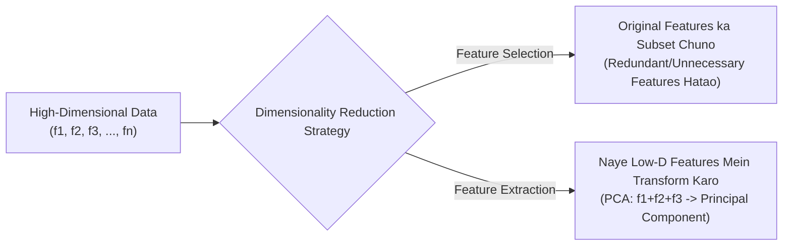
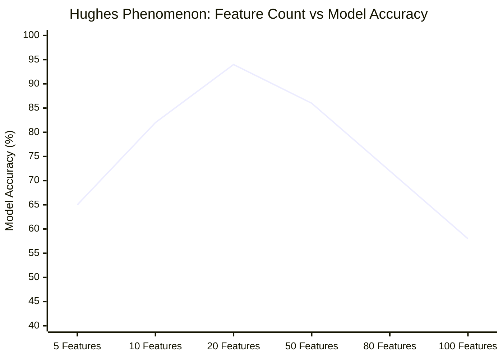

# Module 32.01: Dimensionality Reduction & The Curse of Dimensionality (Hinglish)

## 1. Overview & Conceptual Intuition

Machine Learning mein **dimensionality** ka direct matlab hota hai humare dataset ke andar maujood input features ki sankhya ($f_1, f_2, \dots, f_n$). Jab humare dataset ke andar bahut saari features ho jaati hain (jaise genomics, text processing ya customer analytics mein $n = 200, 500, 1000$ features), toh machine learning models ko train karte waqt kai gambhir mathematical aur geometric problems aati hain jise **Curse of Dimensionality** kaha jaata hai.

**Dimensionality Reduction** ek aisi technique hai jisme hum apne features ke count ko reduce karte hain, lekin original data ki core information, statistical variance aur underlying structure ko zyadatar preserve (surakshit) rakhte hain.

---

## 2. The Curse of Dimensionality: 4 Badi Problems

Jaise-jaise data ke andar dimensions badhte hain, 4 main problems create hoti hain:

### A. Data Sparsity (Exponential Space Growth)
Jaise dimensions grow karte hain, space ka volume exponentially ($O(k^d)$) badhta hai:
- **1D Space**: Ek single line par data points ko fill karna aasan hota hai, kam points se poori line cover ho jaati hai.
- **2D Space**: Area ($N^2$) ko cover karne ke liye zyada samples chahiye.
- **3D Space**: Volume ($N^3$) ko bharne ke liye aur bhi zyada points chahiye.
- **High-D Space ($d = 50, 100$)**: Space exponentially itna bada ho jaata hai ki humara dataset uske mukable bilkul chhota pad jaata hai. **Majority of the space empty (khali) reh jaati hai** aur data points ek-dusre se bahut dur-dur kone mein chale jaate hain. Isko **Data Sparsity** kehte hain.

### B. Distance Becomes Meaningless (Duri Be-asar Ho Jaana)
Bahut saari machine learning algorithms jaise **K-Means Clustering**, **KNN**, aur **DBSCAN** distance (jaise Euclidean distance) par work karti hain:

$$d(p, q) = \sqrt{\sum_{i=1}^d (p_i - q_i)^2}$$

High-dimensional space mein sabse paas wale point aur sabse dur wale point ka distance ratio lagbhag 1 ho jaata hai:

$$\lim_{d \to \infty} \frac{\text{dist}_{\max} - \text{dist}_{\min}}{\text{dist}_{\min}} = 0$$

Saare data points ek dusre se lagbhag barabar duri par lagne lagte hain. Is wajah se distance-based clustering aur classification fail hone lagti hai.

### C. Expensive Computation (Bhari Computational Kharch)
High-dimensional data par har pair ke beech distance calculate karna $O(N^2 \cdot d)$ time leta hai aur covariance matrix inversion $O(d^3)$ complexity leta hai. Isse system RAM aur CPU/GPU crash ho sakte hain.

### D. Model Performance Degradation (Hughes Phenomenon / Peaking Effect)
Initial phase mein jab hum useful features add karte hain ($5 \to 10 \to 20$ features), toh model ki accuracy improve hoti hai. Lekin ek specific threshold ke baad extra features sirf meaningless noise aur overfitting add karte hain, jisse model performance achanak girne lagti hai ($50 \to 80 \to 100$ features par accuracy drop ho jaati hai).

---

## 3. Blackboard Summary: Ma'am Ka Explanation

| Topic | Blackboard Par Kya Likha Tha | Practical Meaning |
| :--- | :--- | :--- |
| **Dimension Definition** | $\text{dimension} = \text{features } (f_1, f_2, \dots, f_n)$ | Large $n$ hone par Curse of Dimensionality aati hai |
| **Data Sparsity** | $\dim \uparrow \implies \text{exponentially space grow karta hai}$ | Space khali rehta hai, points door-door hote hain |
| **Distance Meaningless** | Distance becomes meaningless: `- clustering`, `- KNN` | Euclidean distance discriminate nahi kar pata |
| **Expensive Computation** | Computation expensive ho jaati hai | High memory & CPU runtime |
| **Model Degradation** | $5f \to 10f \to 20f \uparrow \uparrow \uparrow \implies 50f \to 80f \to 100f \downarrow \downarrow \downarrow$ | Peaking effect / Hughes phenomenon |

---

## 4. Curse of Dimensionality Ke Solutions

### 1. Feature Selection
Sirf important features ko select karna aur redundant (faltu) features ko drop kar dena.
- **Example**: Loan approval data mein `customer_id` ka loan approve hone ya na hone se koi rishta nahi hai, isliye ise drop kar diya jaata hai.
- **Method**: **Pearson Correlation Matrix** aur heatmap se check karte hain ki kaun sa feature output target ke sath strong relation de raha hai.

### 2. Feature Transformation / Extraction (Dimensionality Reduction)
Multiple features ko combine karke naye meaningful composite dimensions banana ($f_1 + f_2 + f_3 \to \text{PC}$).
- **Nimbu Paani Premix Example**: Ghar par nimbu paani banane ke liye salt aur sugar alag-alag measure karna padta hai. Haldiram's market mein ek "premix" launch karta hai jisme salt aur sugar ka optimal ratio ($1:4$) pehle se mix hota hai. Halankir 5-10% log jinko alag taste chahiye tha unka preference lose ho sakta hai, par 90% logo ka kaam ek single premix se bina do alag boxes use kiye ho jaata hai. Yehi kaam **PCA** karta hai.

### 3. High-Dimension Robust Algorithms
Agar dimensionality reduction possible na ho, toh aisi algorithms use ki ja sakti hain jo high dimensions ko handle karne mein strong hain:
- **Naive Bayes**: Distance par depend nahi karti, conditional probability par chalti hai.
- **Linear Models with Regularization**: Ridge ($L_2$) aur Lasso ($L_1$) weights ko shrink karke irrelevant dimensions ko suppress kar dete hain.

### 4. Data Visualization
Insan sirf 2D ya 3D dekh sakte hain. 50D ya 100D data ko 2D ya 3D mein project karke plots ke zariye visualize karna dimensionality reduction ka bada faayda hai.