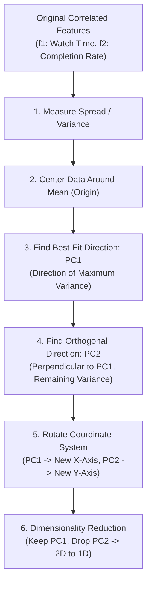

# Module 32.02: What is PCA - Intuition & Principles

## 1. Overview & The Core Intuition

**PCA (Principal Component Analysis)** is the most widely adopted unsupervised linear feature extraction technique in machine learning. Its primary objective is to find orthogonal directions (principal components) along which the data exhibits maximum variance, enabling the projection of high-dimensional data onto lower dimensions while minimizing information loss.

---

## 2. Real-World Analogy: Netflix User Engagement

Suppose you work as a machine learning engineer at Netflix, analyzing subscriber viewing behaviors. The dataset tracks 3 distinct features:
1. **$f_1$ (Number of shows watched per week)**: Weekly streaming frequency.
2. **$f_2$ (Average watch time in minutes)**: Daily duration spent watching shows.
3. **$f_3$ (Percentage completion rate of episodes)**: How thoroughly episodes are completed.

### The Compression Insight:
All three features intuitively capture the same underlying latent factor: **"User Engagement"**. 
- A subscriber with high watch time typically has high episode completion and high weekly frequency.
- Instead of passing 3 separate correlated features to downstream models, PCA compresses these 3 dimensions into a single composite metric: **User Engagement Index (PC1)**.

---

## 3. The Requirement of Correlated Data

PCA fundamentally exploits **correlation** among features. 

| Feature Pair | Correlation Type | Suitability for PCA | Why? |
| :--- | :--- | :--- | :--- |
| **Watch Time vs Completion Rate** | Strong Positive ($r > 0$) |  **Excellent** | Features share redundant variance; can be merged into a single vector. |
| **Watch Time vs Payment Mode (UPI/Card)** | Zero Correlation ($r \approx 0$) |  **Poor** | Dimensions are orthogonal; compressing them loses distinct, unshared signal. |

**Pearson Correlation Coefficient ($r$)**:

$$r = \frac{\sum (x_i - \bar{x})(y_i - \bar{y})}{\sqrt{\sum (x_i - \bar{x})^2 \sum (y_i - \bar{y})^2}}$$

---

## 4. Geometric Principles: How PCA Works Step-by-Step

### Principle 1: Spread of Data $\equiv$ Variance $\equiv$ Information
- The **spread** of data along any axis measures its variance.
- If data points are widely dispersed along feature $f_1$ (large spread) but tightly clustered along $f_2$ (narrow spread), $f_1$ carries significantly more discriminative information.
- The composite principal component will allocate a larger weight ratio to the feature with higher spread.

### Principle 2: Centering the Data (Mean Shift to Origin)
Before computing projections, PCA centers the dataset by subtracting the feature means ($\bar{x}_1, \bar{x}_2$):

$$x_{i, \text{centered}} = x_i - \bar{x}$$

- This shifts the center of gravity of the data points exactly to the origin $(0, 0)$.
- Crucially, **centering preserves all relative distances, cluster separations, and variance geometry** among sample points.

### Principle 3: Finding the Best-Fit Line (PC1)
PCA fits a straight line passing through the new origin $(0, 0)$ such that:
1. It maximizes the spread (variance) of the projected data points.
2. It minimizes the perpendicular distance from the original data points to the line.

**Mathematical Vector Definitions**:
- **Eigenvector ($\vec{u}$)**: A unit vector ($\|\vec{u}\| = 1$) pointing in the exact directional orientation of the best-fit line.
- **Eigenvalue ($\lambda$)**: A scalar measuring the total variance (information) captured along that line.
- **Slope of PC1**: Reflects the linear combination ratio of the original features. For instance, if the slope is $0.25 = \frac{1}{4}$, the component blends $1 \text{ part } f_2 \text{ (salt)} + 4 \text{ parts } f_1 \text{ (sugar)}$.

### Principle 4: The Orthogonal Second Principal Component (PC2)
To capture the remaining uncaptured variance, PCA constructs a second line ($PC2$) that is **strictly perpendicular (orthogonal)** to $PC1$ at the origin:
- If $PC1$ captures $80\%$ of total data variance ($\lambda_1 = 0.80$), $PC2$ captures the remaining $20\%$ ($\lambda_2 = 0.20$).
- $PC1$ and $PC2$ are completely uncorrelated ($\text{Cov}(PC1, PC2) = 0$).

### Principle 5: Axis Rotation & Dimensionality Reduction
Finally, PCA rotates the coordinate frame:
- $PC1$ becomes the new **X-axis**.
- $PC2$ becomes the new **Y-axis**.
- Points projected along the $PC1$ axis show wide dispersion (high variance). Points along $PC2$ show minimal variance.
- By dropping the $PC2$ axis entirely, we reduce the dataset from 2D to 1D while retaining 80-90% of the statistical information!

---

## 5. Blackboard Mapping & Comparison Table

| Step | Blackboard Concept | Mathematical Representation | Intuition |
| :--- | :--- | :--- | :--- |
| **1** | **Spread of Data** | $\text{Var}(X) = \frac{1}{n}\sum (x_i - \bar{x})^2$ | Spread along axis = Information |
| **2** | **Center the Data** | $X_{\text{centered}} = X - \mu$ | Shifts mean to origin $(0,0)$ |
| **3** | **Best Fit Line** | Direction $\vec{u}$, $\|\vec{u}\| = 1$ | Maximizes projected variance |
| **4** | **Orthogonal Component** | $PC1 \perp PC2$ | Captures residual 10-20% variance |
| **5** | **Axis Rotation** | $X \to [PC1, PC2]$ | $PC1$ = new X-axis, $PC2$ = new Y-axis |
| **6** | **Drop Low Variance** | $\text{Var}(PC1) \gg \text{Var}(PC2) \implies \text{Drop } PC2$ | Compresses 2D to 1D feature |