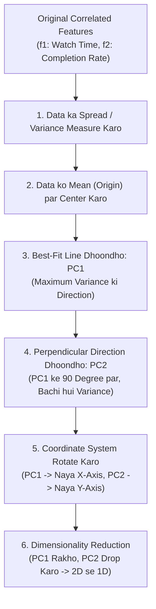

# Module 32.02: What is PCA - Intuition & Principles (Hinglish)

## 1. Overview & Core Intuition

**PCA (Principal Component Analysis)** Machine Learning mein sabse zyada use hone wali unsupervised linear feature extraction technique hai. Iska main maqsad hota hai aisi directions (principal components) dhoondhna jahan par data ka **maximum variance (spread)** ho, taaki hum high-dimensional data ko kam dimensions mein convert kar sakein bina zyada information khoye.

---

## 2. Real-World Analogy: Netflix User Engagement

Maan lijiye aap Netflix ke liye kaam kar rahe hain aur aapke paas users ke 3 features ka data hai:
1. **$f_1$ (Number of shows watched per week)**: Ek week mein kitne shows dekhe.
2. **$f_2$ (Average watch time in minutes)**: Rozana kitne minute stream kiya.
3. **$f_3$ (Percentage completion rate of episodes)**: Episodes kitna percentage complete kiye.

### Compression Ka Intuition:
Yeh teenon features logically ek hi cheez bata rahe hain: **"User Engagement"** (User platform par kitna active hai).
- Jiska watch time high hoga, uska completion rate bhi high hoga aur weekly shows bhi zyada honge.
- In 3 alag-alag correlated features ko machine learning model mein daalne ke bajaye, PCA in teenon ko combine karke ek single composite feature bana deta hai: **User Engagement (PC1)**.

---

## 3. Correlated Data Ki Zaroorat

PCA sirf tab zabardast kaam karta hai jab features ke beech mein **correlation** ho.

| Feature Pair | Correlation Type | PCA ke liye Kaisa Hai? | Kyun? |
| :--- | :--- | :--- | :--- |
| **Watch Time vs Completion Rate** | Strong Positive ($r > 0$) |  **Best** | Dono ek dusre ke sath badhte hain, common information share karte hain. |
| **Watch Time vs Payment Mode (UPI/Debit Card)** | Zero Correlation ($r \approx 0$) |  **Kharab** | Payment mode ka watch time se koi relation nahi hai; combine karne par loss hoga. |

**Pearson Correlation Formula**:

$$r = \frac{\sum (x_i - \bar{x})(y_i - \bar{y})}{\sqrt{\sum (x_i - \bar{x})^2 \sum (y_i - \bar{y})^2}}$$

---

## 4. PCA Ka Step-by-Step Geometric Process

### Step 1: Data Ka Spread $\equiv$ Variance $\equiv$ Information
- Kisi bhi axis par data kitna faila hua hai, usko **spread** ya **variance** kehte hain.
- Jitna zyada spread hoga, utni zyada information woh feature carry karta hai.
- Agar feature $f_1$ par spread zyada hai aur $f_2$ par kam hai, toh naye principal component mein $f_1$ ka ratio/importance zyada hoga.

### Step 2: Centering the Data (Mean Ko Origin Par Shift Karna)
Projections nikaalne se pehle, hum data ke saare points se unka mean ($\bar{x}_1, \bar{x}_2$) subtract kar dete hain:

$$x_{i, \text{centered}} = x_i - \bar{x}$$

- Isse humara poora data shift hokar origin $(0, 0)$ par aa jaata hai.
- **Important Note**: Mean ko origin par laane ke baad bhi data ki basic geometry, samples ke aapsi distances aur relative positioning bilkul preserve rehti hai.

### Step 3: Best-Fit Line Dhoondhna (PC1)
Hum origin $(0, 0)$ se pass hone wali aisi best-fit line draw karte hain jo data ko sabse acche se represent kare:
- **Eigenvector ($\vec{u}$)**: Ek unit vector ($\|\vec{u}\| = 1$) jo is line ki **direction** batata hai.
- **Eigenvalue ($\lambda$)**: Ek value jo batati hai ki is line ne kitni **variance (information)** capture ki (jaise 80% ya 90%).
- **Line Ka Slope**: Yeh batata hai ki dono original features ka kitna-kitna ratio use hua hai (jaise slope $0.25 = \frac{1}{4}$ ka matlab $1$ part salt aur $4$ parts sugar combine hue hain).

### Step 4: Perpendicular Line Draw Karna (PC2)
Bachi hui variance ko capture karne ke liye hum $PC1$ ke perpendicular ($90^\circ$ angle par) ek second line draw karte hain jise **$PC2$ (Principal Component 2)** kehte hain:
- Agar $PC1$ ne $80\%$ variance capture kiya tha, toh $PC2$ bachi hui $20\%$ variance capture karega.
- $PC1$ aur $PC2$ aapas mein bilkul uncorrelated hote hain ($\text{Cov}(PC1, PC2) = 0$).

### Step 5: Axes Ko Rotate Karna & Dimensionality Reduction
Aakhir mein coordinate axes ko rotate kar diya jaata hai:
- $PC1$ line humara naya **X-axis** ban jaati hai.
- $PC2$ line humara naya **Y-axis** ban jaati hai.
- Jab points ko $PC1$ par project karte hain, toh data points dur-dur spread hote hain (high variance). Jabki $PC2$ par points pass-pass bunch hote hain (low variance).
- Agar hume 2D se 1D mein data convert karna hai, toh hum $PC2$ ko drop kar dete hain aur sirf **$PC1$** ko apne machine learning model mein use karte hain!

---

## 5. Blackboard Summary & Comparison Table

| Step | Blackboard Concept | Mathematical Representation | Intuition |
| :--- | :--- | :--- | :--- |
| **1** | **Spread of Data** | $\text{Var}(X) = \frac{1}{n}\sum (x_i - \bar{x})^2$ | Axis par spread = Information |
| **2** | **Center the Data** | $X_{\text{centered}} = X - \mu$ | Mean ko origin $(0,0)$ par laata hai |
| **3** | **Best Fit Line** | Direction $\vec{u}$, $\|\vec{u}\| = 1$ | Projected variance maximize karti hai |
| **4** | **Perpendicular Component** | $PC1 \perp PC2$ | Bachi hui 10-20% variance capture karta hai |
| **5** | **Axis Rotation** | $X \to [PC1, PC2]$ | $PC1$ = naya X-axis, $PC2$ = naya Y-axis |
| **6** | **Drop Low Variance** | $\text{Var}(PC1) \gg \text{Var}(PC2) \implies \text{Drop } PC2$ | 2D se 1D mein feature reduce ho gaya |