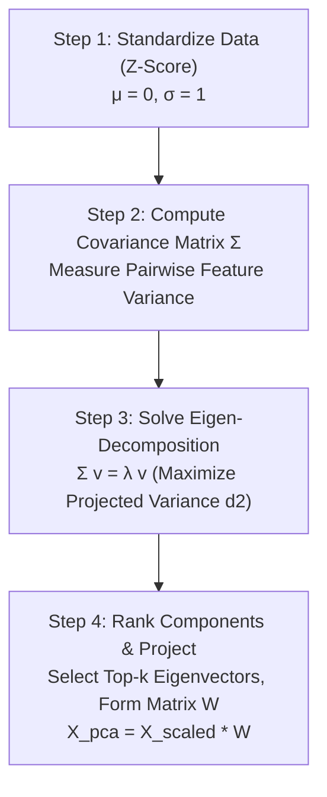

# Module 32.03: PCA Step-by-Step Mathematical Algorithm

## 1. Overview & Algorithmic Pipeline

Principal Component Analysis transforms a dataset of $n$ observations across $d$ dimensions into a new coordinate system of orthogonal axes ordered by the variance they explain. The complete mathematical workflow consists of 4 sequential phases:



---

## 2. Step 1: Standardization (Z-Score Normalization)

Before applying PCA, features measured in different units (e.g., watch time in minutes vs completion rate in percentage) must be standardized. Otherwise, features with larger numerical magnitudes dominate the covariance calculation artificially.

$$z_{ij} = \frac{x_{ij} - \mu_j}{\sigma_j}$$

Where:
- $\mu_j = \frac{1}{n} \sum_{i=1}^n x_{ij}$ is the mean of feature $j$.
- $\sigma_j = \sqrt{\frac{1}{n} \sum_{i=1}^n (x_{ij} - \mu_j)^2}$ is the standard deviation of feature $j$.

**Post-condition**:
- Mean of every feature becomes $\mu = 0$.
- Variance and standard deviation become $\sigma^2 = \sigma = 1$.

---

## 3. Step 2: Compute the Covariance Matrix ($\Sigma$)

The covariance matrix measures the degree of linear association between all pairs of features. For two standardized features $X$ and $Y$:

$$\text{Cov}(X, Y) = \frac{1}{n} \sum_{i=1}^n (x_i - \bar{x})(y_i - \bar{y})$$

For standardized data where $\bar{x} = \bar{y} = 0$:

$$\text{Cov}(X, Y) = \frac{1}{n} \sum_{i=1}^n x_i y_i$$

### Structure of the Covariance Matrix:
For a 2D dataset with features $X$ and $Y$, the covariance matrix $\Sigma$ is a symmetric $2 \times 2$ square matrix:

$$\Sigma = \begin{bmatrix} \text{Cov}(X, X) & \text{Cov}(X, Y) \\ \text{Cov}(Y, X) & \text{Var}(Y) \end{bmatrix} = \begin{bmatrix} \text{Var}(X) & \text{Cov}(X, Y) \\ \text{Cov}(X, Y) & \text{Var}(Y) \end{bmatrix}$$

- **Diagonal Entries**: $\text{Var}(X)$ and $\text{Var}(Y)$ represent the individual feature variances.
- **Off-Diagonal Entries**: $\text{Cov}(X, Y) = \text{Cov}(Y, X)$ indicate how the features co-vary together.

In matrix notation for standardized matrix $X \in \mathbb{R}^{n \times d}$:

$$\Sigma = \frac{1}{n} X^T X$$

---

## 4. Step 3: Best-Fit Line & Geometric Optimization

To determine the optimal direction of the principal component line passing through the origin $(0, 0)$, we examine any data point $P$:

```
          Y
          ^               P (x_i, y_i)
          |              *
          |             /|
          |   d_hyp   /  |
          |         /    | d_1 (Perpendicular Error)
          |       /      |
          |     /        |
          |   /          v
          |  *-----------P'-----------> PC1 line
          | O     d_2
          +-----------------------------------> X
```

### The Pythagorean Geometric Equivalence
Let:
- $O = (0, 0)$ be the centered origin.
- $P$ be an arbitrary sample point with coordinates $(x_i, y_i)$.
- $P'$ be the perpendicular projection of $P$ onto candidate line $PC1$.
- $d_1 = \text{dist}(P, P')$ be the perpendicular distance (reconstruction error).
- $d_2 = \text{dist}(O, P')$ be the projected distance from the origin along the line.
- $d_{\text{hyp}} = \text{dist}(O, P)$ be the Euclidean distance from origin to $P$.

Since $\triangle O P' P$ forms a right-angled triangle with hypotenuse $d_{\text{hyp}}$:

$$d_1^2 + d_2^2 = d_{\text{hyp}}^2$$

**The Critical Optimization Insight**:
- For any sample point $P$, its original coordinates are fixed, meaning $d_{\text{hyp}}^2 = x_i^2 + y_i^2 = \text{constant}$.
- Because the sum is fixed, **minimizing the perpendicular error $d_1$ across all points is mathematically identical to maximizing the projected distance $d_2$ from the origin across all points!**

$$\min \sum_{i=1}^n d_{1, i}^2 \iff \max \sum_{i=1}^n d_{2, i}^2$$

In PCA, maximizing the sum of squared projected distances $\sum d_2^2$ directly computes the **variance of the projected points**, which can be solved analytically via linear algebra.

---

## 5. Step 4: Eigen-Decomposition ($\Sigma \mathbf{v} = \lambda \mathbf{v}$)

Maximizing the projected variance leads directly to the fundamental matrix eigenvalue equation:

$$\Sigma \mathbf{v} = \lambda \mathbf{v}$$

| Symbol | Mathematical Entity | Role in PCA |
| :--- | :--- | :--- |
| **$\Sigma$** | $d \times d$ Covariance Matrix | Captures all pairwise feature variances and covariances |
| **$\mathbf{v}$** | Eigenvector (Unit Vector, $\|\mathbf{v}\| = 1$) | Defines the **spatial direction** of the Principal Component |
| **$\lambda$** | Eigenvalue (Scalar) | Represents the **magnitude of variance** captured along direction $\mathbf{v}$ |

### Finding Eigenvalues & Eigenvectors:
1. **Characteristic Equation**:
$$\det(\Sigma - \lambda I) = 0$$
   Solving this polynomial of degree $d$ yields $d$ roots: $\lambda_1 \ge \lambda_2 \ge \dots \ge \lambda_d$.
2. **Eigenvector Calculation**:
   Substitute each $\lambda_k$ back into $(\Sigma - \lambda_k I)\mathbf{v}_k = 0$ and normalize to unit length $\|\mathbf{v}_k\| = 1$.

---

## 6. Step 5: Ranking Components & Feature Projection

### Explained Variance Ratio:
The proportion of total information captured by component $k$ is given by:

$$\text{Explained Variance Ratio}_k = \frac{\lambda_k}{\sum_{j=1}^d \lambda_j}$$

- If $\lambda_1 = 3.6$ and $\lambda_2 = 0.4$ in a 2D problem:
$$\text{Ratio}(PC1) = \frac{3.6}{3.6 + 0.4} = \frac{3.6}{4.0} = 90\%$$
$$\text{Ratio}(PC2) = \frac{0.4}{4.0} = 10\%$$

### Projection to Lower Dimensions:
1. Select the top $k$ eigenvectors corresponding to the largest eigenvalues to form the projection matrix $W \in \mathbb{R}^{d \times k}$:
$$W = \begin{bmatrix} \mathbf{v}_1 & \mathbf{v}_2 & \dots & \mathbf{v}_k \end{bmatrix}$$
2. Transform the original standardized dataset $X_{\text{scaled}} \in \mathbb{R}^{n \times d}$ into the reduced representation $X_{\text{pca}} \in \mathbb{R}^{n \times k}$:
$$X_{\text{pca}} = X_{\text{scaled}} \cdot W$$
3. Drop all remaining eigenvectors ($k+1$ to $d$) whose variance contribution is negligible.