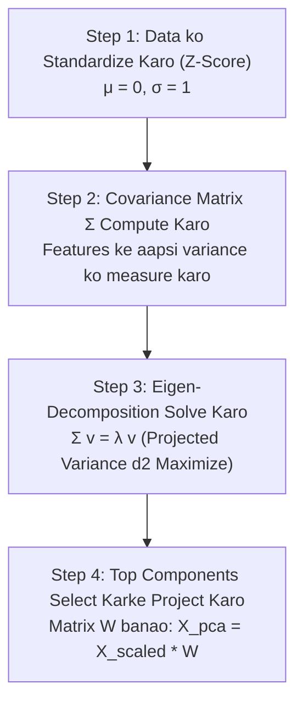

# Module 32.03: PCA Step-by-Step Mathematical Algorithm (Hinglish)

## 1. Overview & Step-by-Step Mathematical Flow

Principal Component Analysis ek dataset ke $d$ dimensions ko naye orthogonal axes mein transform karta hai, jisme har axis ko uske dwara capture kiye gaye variance ke hisab se order kiya jaata hai. PCA ka complete mathematical process 4 main steps mein divide hota hai:



---

## 2. Step 1: Standardization (Z-Score Normalization)

PCA apply karne se pehle, har feature ko standardize karna compulsory hota hai kyunki alag-alag features ke scale alag ho sakte hain (jaise watch time minutes mein hai aur completion rate percentage mein). Agar scale nahi karenge, toh bada number wala feature artificially dominate kar lega.

$$z_{ij} = \frac{x_{ij} - \mu_j}{\sigma_j}$$

Yahan:
- $\mu_j$ feature $j$ ka mean (average) hai.
- $\sigma_j$ feature $j$ ka standard deviation hai.

**Result**:
- Har feature ka mean $\mu = 0$ ban jaata hai.
- Har feature ka standard deviation $\sigma = 1$ ban jaata hai.

---

## 3. Step 2: Covariance Matrix ($\Sigma$) Calculate Karna

Covariance matrix batati hai ki do features aapas mein kitna linearly vary kar rahe hain. Do standardized features $X$ aur $Y$ ke beech covariance:

$$\text{Cov}(X, Y) = \frac{1}{n} \sum_{i=1}^n (x_i - \bar{x})(y_i - \bar{y})$$

Standardized data ke liye $\bar{x} = \bar{y} = 0$ hota hai, isliye:

$$\text{Cov}(X, Y) = \frac{1}{n} \sum_{i=1}^n x_i y_i$$

### Covariance Matrix Ka Structure:
2D dataset ke liye covariance matrix $\Sigma$ ek $2 \times 2$ symmetric square matrix hoti hai:

$$\Sigma = \begin{bmatrix} \text{Var}(X) & \text{Cov}(X, Y) \\ \text{Cov}(Y, X) & \text{Var}(Y) \end{bmatrix}$$

- **Diagonal values**: $\text{Var}(X)$ aur $\text{Var}(Y)$ individual features ka variance dikhate hain.
- **Off-diagonal values**: $\text{Cov}(X, Y) = \text{Cov}(Y, X)$ dono features ke aapsi relation ko dikhate hain.

Matrix notation mein:

$$\Sigma = \frac{1}{n} X^T X$$

---

## 4. Step 3: Best-Fit Line Dhoondhna (Pythagoras Theorem Ka Magic)

Origin $(0, 0)$ se pass hone wali best-fit line kaise nikalti hai? Ma'am ne board par right-angled triangle draw karke samjhaya tha:

```
          Y
          ^               P (Sample Point: x_i, y_i)
          |              *
          |             /|
          |   d_hyp   /  |
          |         /    | d_1 (Perpendicular Duri / Error)
          |       /      |
          |     /        |
          |   /          v
          |  *-----------P'-----------> PC1 line
          | O     d_2 (Origin se Projection ka distance)
          +-----------------------------------> X
```

### Pythagoras Theorem Ka Equivalence:
- $O = (0, 0)$ centered origin hai.
- $P = (x_i, y_i)$ sample point hai.
- $P'$ point $P$ ka candidate line par perpendicular projection hai.
- $d_1 = \text{dist}(P, P')$ perpendicular error hai jise hum kam se kam (minimize) karna chahte hain.
- $d_2 = \text{dist}(O, P')$ origin se projection tak ki duri hai.
- $d_{\text{hyp}} = \text{dist}(O, P)$ origin se sample point ka original distance hai.

Right-angled triangle $\triangle O P' P$ mein Pythagoras theorem lagayein:

$$d_1^2 + d_2^2 = d_{\text{hyp}}^2$$

**Substantive Intuition**:
- Kisi bhi sample point $P$ ke liye origin se uska distance $d_{\text{hyp}}$ **fixed (constant)** hota hai kyunki point ke coordinates fix hain.
- Jab sum constant hai, toh **$d_1$ ko minimize karna mathematical roop se $d_2$ ko maximize karne ke barabar hai!**

$$\min \sum_{i=1}^n d_{1, i}^2 \iff \max \sum_{i=1}^n d_{2, i}^2$$

PCA mein origin se projection ke squared distance ($\sum d_2^2$) ko maximize karna algebraically bahut aasan hota hai kyunki yeh seedhe projected points ka variance de deta hai!

---

## 5. Step 4: Eigen-Decomposition ($\Sigma \mathbf{v} = \lambda \mathbf{v}$)

Projected variance ko maximize karne se matrix eigenvalue equation nikal kar aati hai:

$$\Sigma \mathbf{v} = \lambda \mathbf{v}$$

| Symbol | Kya Hai | PCA Mein Iska Role |
| :--- | :--- | :--- |
| **$\Sigma$** | Covariance Matrix ($d \times d$) | Saare features ke variance aur covariance ka data |
| **$\mathbf{v}$** | Eigenvector (Unit Vector, $\|\mathbf{v}\| = 1$) | Principal Component ki **spatial direction** |
| **$\lambda$** | Eigenvalue (Scalar Number) | Us direction mein capture hui **variance ki quantity** |

1. **Characteristic Equation**:
$$\det(\Sigma - \lambda I) = 0$$
   Isko solve karke eigenvalues milti hain: $\lambda_1 \ge \lambda_2 \ge \dots \ge \lambda_d$.
2. **Eigenvector Calculation**:
   Har $\lambda_k$ ko $(\Sigma - \lambda_k I)\mathbf{v}_k = 0$ mein put karke unit length vector $\|\mathbf{v}_k\| = 1$ nikalte hain.

---

## 6. Step 5: Ranking & Feature Projection

### Explained Variance Ratio:
Har component kitna percent data represent kar raha hai:

$$\text{Explained Variance Ratio}_k = \frac{\lambda_k}{\sum_{j=1}^d \lambda_j}$$

- Agar $\lambda_1 = 3.6$ aur $\lambda_2 = 0.4$ hai:
$$\text{PC1 Ratio} = \frac{3.6}{4.0} = 90\%$$
$$\text{PC2 Ratio} = \frac{0.4}{4.0} = 10\%$$

### Projection Formula:
1. Top $k$ eigenvectors ko select karke projection matrix $W \in \mathbb{R}^{d \times k}$ banate hain:
$$W = \begin{bmatrix} \mathbf{v}_1 & \mathbf{v}_2 & \dots & \mathbf{v}_k \end{bmatrix}$$
2. Original scaled data ko $W$ se multiply karke reduced data paate hain:
$$X_{\text{pca}} = X_{\text{scaled}} \cdot W$$
3. Low-variance wale components ko drop kar dete hain!