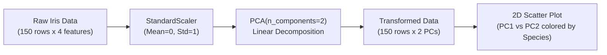

# Module 32.04: PCA Implementation on Iris Dataset (Code Walkthrough)

## 1. Overview & Practical Objectives

In this hands-on module, we implement **Principal Component Analysis** on the classic Fisher's Iris dataset using Scikit-Learn. 

### Why Use PCA on Iris?
- **Original Space**: 4 numerical dimensions (Sepal Length, Sepal Width, Petal Length, Petal Width).
- **The Challenge**: A 4D dataset cannot be directly plotted or perceived on standard 2D human screens.
- **The Goal**: Compress the 4 features into 2 Principal Components ($PC1$ and $PC2$) to achieve clean 2D visualization while retaining $>95\%$ of the total statistical variance.



---

## 2. Code Implementation Step-by-Step

### Step 1: Library Imports & Dataset Loading
```python
import pandas as pd
import matplotlib.pyplot as plt
from sklearn.datasets import load_iris
from sklearn.preprocessing import StandardScaler
from sklearn.decomposition import PCA

# Load Iris dataset
iris = load_iris()
X = pd.DataFrame(iris.data, columns=iris.feature_names)
y = iris.target

print(f"Original shape: {X.shape}") # (150, 4)
X.head()
```

### Step 2: Feature Standardization
Because features like petal length and sepal width have differing numerical spreads, standardization ensures equal initial importance:
```python
scaler = StandardScaler()
X_scaled = scaler.fit_transform(X)

print(f"Scaled shape: {X_scaled.shape}") # (150, 4)
```

### Step 3: Fitting PCA & Dimensionality Reduction
We instantiate `PCA(n_components=2)` and fit-transform the standardized feature matrix:
```python
# Instantiate PCA for 2 components
pca = PCA(n_components=2)
X_pca = pca.fit_transform(X_scaled)

print(f"Reduced shape: {X_pca.shape}") # (150, 2)
```

### Step 4: Analyzing Explained Variance Ratio
```python
print("Explained variance ratio:", pca.explained_variance_ratio_)
# Output: [0.72962445, 0.22850762]
```
- **$PC1$ explains $72.96\%$** of the total variance across all 4 features.
- **$PC2$ explains $22.85\%$** of the residual variance.
- **Cumulative Variance**: $72.96\% + 22.85\% = 95.81\%$! 
- We successfully eliminated half the features ($4 \to 2$) while preserving almost $96\%$ of the original information.

### Step 5: Examining Eigenvectors (Principal Axes Loadings)
```python
print("Principal axes (eigenvectors):")
print(pca.components_)
# Output: shape (2, 4)
```
Each row in `pca.components_` represents the linear combination weights applied to the 4 original standardized features:
$$\text{PC1} = w_{11} \cdot \text{SepalLength} + w_{12} \cdot \text{SepalWidth} + w_{13} \cdot \text{PetalLength} + w_{14} \cdot \text{PetalWidth}$$

### Step 6: Visualizing the 2D Transformed Space
```python
plt.figure(figsize=(8, 6))
scatter = plt.scatter(X_pca[:, 0], X_pca[:, 1], c=y, cmap='viridis', edgecolor='k', s=50)

plt.xlabel("PC1 (72.96% Variance)")
plt.ylabel("PC2 (22.85% Variance)")
plt.title("PCA for Iris Dataset (4D -> 2D Projection)")
plt.colorbar(scatter, label="Target Species")
plt.grid(True, linestyle="--", alpha=0.5)
plt.show()
```

---

## 3. Results & Analytical Observations

1. **Clear Class Separability**: Even though PCA is an **unsupervised** algorithm (it had no access to label $y$), the 2D projection reveals that *Setosa* (class 0) forms a completely isolated, well-separated cluster on the left, while *Versicolor* and *Virginica* form adjacent, moderately separated clusters.
2. **Spread Asymmetry**: The data exhibits much wider spread horizontally along the $PC1$ axis compared to the vertical $PC2$ axis, visually validating why $PC1$ accounts for over $72\%$ of variance.
3. **Notebook Reference**: The interactive Jupyter notebook for this module is located at [`pca.ipynb`](file:///c:/Users/Shivam%20Keshari/OneDrive/Desktop/AI-ML/lecture_32/Notes_32.04/pca.ipynb).