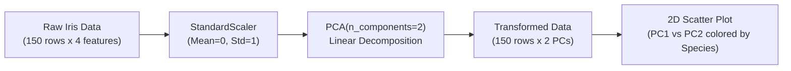

# Module 32.04: PCA Implementation on Iris Dataset (Code Walkthrough - Hinglish)

## 1. Overview & Practical Objectives

Is hands-on module mein hum Fisher ke famous Iris dataset par Scikit-Learn ke zariye **Principal Component Analysis (PCA)** implement karenge.

### Iris Dataset Par PCA Kyun?
- **Original Data Space**: 4 numerical features hain (Sepal Length, Sepal Width, Petal Length, Petal Width).
- **Challenge**: 4 dimensions ko human screen par 2D scatter plot se visualize nahi kiya ja sakta.
- **Goal**: 4 features ko compress karke 2 Principal Components ($PC1$ aur $PC2$) banana, taaki hum 2D plot par cluster structure dekh sakein aur original data ki $>95\%$ variance bhi bachi rahe.



---

## 2. Step-by-Step Code Walkthrough

### Step 1: Libraries Import Karna & Data Load Karna
```python
import pandas as pd
import matplotlib.pyplot as plt
from sklearn.datasets import load_iris
from sklearn.preprocessing import StandardScaler
from sklearn.decomposition import PCA

# Iris dataset load karo
iris = load_iris()
X = pd.DataFrame(iris.data, columns=iris.feature_names)
y = iris.target

print(f"Original shape: {X.shape}") # (150 rows, 4 columns)
X.head()
```

### Step 2: Features Ko Standardize Karna
Alag-alag units aur magnitudes ke features ko ek scale par laane ke liye `StandardScaler` use karte hain:
```python
scaler = StandardScaler()
X_scaled = scaler.fit_transform(X)

print(f"Scaled shape: {X_scaled.shape}") # (150, 4)
```

### Step 3: PCA Fit-Transform Karna
`PCA(n_components=2)` initialize karke scaled data ko 2 dimensions mein transform karte hain:
```python
# 2 components ke liye PCA object
pca = PCA(n_components=2)
X_pca = pca.fit_transform(X_scaled)

print(f"Reduced shape: {X_pca.shape}") # (150, 2)
```

### Step 4: Explained Variance Ratio Check Karna
```python
print("Explained variance ratio:", pca.explained_variance_ratio_)
# Output: [0.72962445, 0.22850762]
```
- **$PC1$ akela $72.96\%$** total variance capture karta hai.
- **$PC2$ bachi hui $22.85\%$** variance capture karta hai.
- **Cumulative Variance**: $72.96\% + 22.85\% = 95.81\%$!
- Humne 4 features ko reduce karke sirf 2 features kar diya, lekin fir bhi lagbhag **$96\%$ information** poori tarah surakshit bachi rahi!

### Step 5: Eigenvectors (Components Loading) Dekhna
```python
print("Principal axes (eigenvectors):")
print(pca.components_)
# Shape: (2, 4)
```
Har row ek principal component ka linear combination equation batati hai:
$$\text{PC1} = w_1 \cdot \text{SepalLength} + w_2 \cdot \text{SepalWidth} + w_3 \cdot \text{PetalLength} + w_4 \cdot \text{PetalWidth}$$

### Step 6: 2D Scatter Plot Plot Karna
```python
plt.figure(figsize=(8, 6))
scatter = plt.scatter(X_pca[:, 0], X_pca[:, 1], c=y, cmap='viridis', edgecolor='k', s=50)

plt.xlabel("PC1 (72.96% Variance)")
plt.ylabel("PC2 (22.85% Variance)")
plt.title("PCA for Iris Dataset (4D -> 2D Projection)")
plt.colorbar(scatter, label="Target Species")
plt.grid(True, linestyle="--", alpha=0.5)
plt.show()
```

---

## 3. Results Aur Observations

1. **Clear Class Separation**: Halanki PCA ek **unsupervised** technique hai (isne flower species target `y` ko training mein bilkul nahi dekha), fir bhi 2D plot par *Setosa* (class 0) baaki dono species se bilkul alag cluster banati hai, aur *Versicolor* aur *Virginica* bhi kaafi acche se separate ho jaate hain.
2. **Spread Ka Difference**: X-axis ($PC1$) par data ka spread Y-axis ($PC2$) ke mukable kaafi zyada lamba hai, jo clearly confirm karta hai ki $PC1$ ne $72.9\%$ variance capture ki hai.
3. **Notebook Link**: Is module ka executable official Jupyter notebook yahan available hai: [`pca.ipynb`](file:///c:/Users/Shivam%20Keshari/OneDrive/Desktop/AI-ML/lecture_32/Notes_32.04/pca.ipynb).