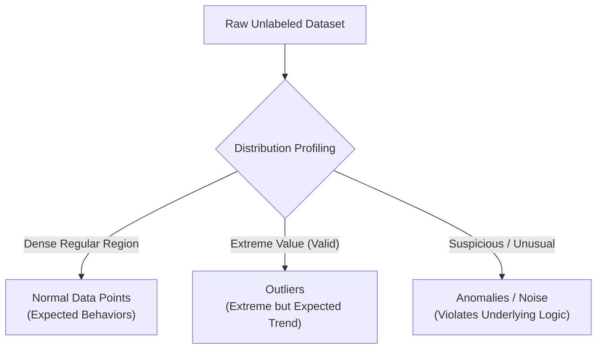

# Module 32.05: What is Anomaly Detection - Outliers vs. Anomalies

## 1. Overview & Core Definition

In unsupervised machine learning, **Anomaly Detection** (also referred to as outlier detection or noise detection) is the task of identifying data points, events, or patterns that deviate significantly from the expected behavior or distribution of the majority of the data.

Unlike supervised classification where labeled examples of positive and negative classes exist, anomaly detection is typically conducted on **unlabeled data**, where abnormal events are rare ($< 1-5\%$), unknown in advance, and structurally distinct from normal clusters.



---

## 2. Crucial Distinction: Outlier vs. Anomaly

While the terms are often used interchangeably in casual discourse, they represent distinct mathematical and practical concepts:

```
Score
  ^
100|          * (Anomaly: 2 hrs, 100 score)      * (Outlier: 12 hrs, 100 score)
   |          [Suspicious / Unusual]              [Extreme but Logically Sound]
 80|               x    x   x
   |            x    x   x    x
   |          x   x   x   x
   |       x   x   x
   +-------+------------------+-------------------+----------------------------> Study Hours
           2                  6                   12
```

### The Student Study Hours Analogy (from Ma'am's Blackboard):
- **Normal Distribution**: Most students study between $2$ to $6$ hours daily and achieve test scores ranging from $50$ to $80$ marks. A natural positive correlation exists between study hours and exam scores.
- **Outlier (Extreme Data Point)**: A student studies $12$ hours a day and scores $100/100$. This data point is quantitatively extreme (situated far out on the distribution tail), but it is **logically consistent** with the underlying positive trend ($12 \text{ hours} \implies \text{High Score}$). It is an outlier, not necessarily a defect.
- **Anomaly (Suspicious / Unusual Data Point)**: A student studies for only $2$ hours a day, yet scores $100/100$. This observation violently violates the expected relationship and is highly **suspicious** (indicating potential exam malpractice, cheating, or data recording error). This is a true **Anomaly**.

---

## 3. Real-World Application Domains

| Industry Domain | Real-World Application | Normal Pattern | Anomaly Indicator |
| :--- | :--- | :--- | :--- |
| **Banking & Finance** | Credit Card Fraud Detection | User spends ₹10,000 to ₹50,000 monthly in local region | Sudden instantaneous ₹10,00,000 transaction from overseas triggers automated verification call |
| **Manufacturing & QC** | Production Line Quality Control | Standard physical dimensions and tolerances of light bulbs / drugs | Micro-cracks, contaminated batches, or deformed structural molds flagged before shipping |
| **Healthcare** | Medical Diagnostics | Normal physiological vitals (heart rate, blood panels) | Rare genetic abnormalities, malignant cell growths, or sudden cardiac telemetry drops |
| **Cybersecurity** | Network Intrusion & DDoS | 5-20 web API requests per minute per IP | 1,000,000 API requests per minute from a single IP address indicates botnet DDoS attack |
| **Social Media** | Bot Account Detection | User posts 1-2 times daily, writes thoughtful comments | Account posts 50 comments per minute with identical text across disparate threads |

---

## 4. Primary Unsupervised Anomaly Detection Algorithms

1. **DBSCAN (Density-Based Spatial Clustering of Applications with Noise)**:
   - Identifies non-linear dense clusters.
   - Designates points situated in sparse regions outside $\epsilon$-neighborhoods as noise (`label = -1`).
2. **Isolation Forest**:
   - Leverages ensemble decision trees with random splits.
   - Anomalies require fewer recursive partitions to isolate near the root of trees (low path length).
3. **Local Outlier Factor (LOF)**:
   - Measures local point density relative to the density of $k$-nearest neighbors.
   - Detects subtle "local" anomalies situated near clusters of varying densities.
