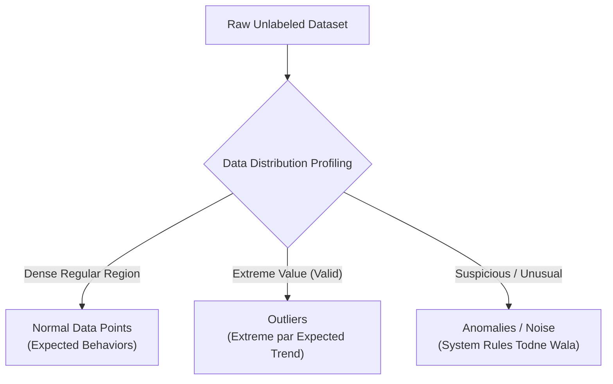

# Module 32.05: What is Anomaly Detection - Outliers vs. Anomalies (Hinglish)

## 1. Overview & Core Definition

Unsupervised Machine Learning mein **Anomaly Detection** (jise Outlier Detection ya Noise Detection bhi kaha jaata hai) ka kaam hota hai aise data points ya events ko dhoondhna jo baaki majority data ke normal behavior ya pattern se bilkul alag hote hain.

Supervised classification mein humare paas pehle se labels hote hain, par Anomaly Detection zyadatar **unlabeled data** par lagaya jaata hai, kyunki real life mein fraud, system breakdown ya rare bimariyan bohot rare ($< 1-5\%$) hoti hain aur pehle se unka koi label nahi hota.



---

## 2. Sabse Bada Confusion: Outlier vs Anomaly

Log aksar Outlier aur Anomaly ko ek hi samajh lete hain, par inme ek bohot zaroori antar hota hai:

```
Score
  ^
100|          * (Anomaly: 2 ghante padha, 100 score)   * (Outlier: 12 ghante padha, 100 score)
   |          [Suspicious / Ghalat lagne wala]         [Extreme par Logical]
 80|               x    x   x
   |            x    x   x    x
   |          x   x   x   x
   |       x   x   x
   +-------+------------------+-------------------+----------------------------> Study Hours
           2                  6                   12
```

### Student Study Hours Ka Example (Ma'am ke Blackboard se):
- **Normal Distribution**: Zyadatar students rozana $2$ se $6$ ghante padhte hain aur unka score $50$ se $80$ marks ke beech aata hai. Ek natural positive correlation hota hai: padhai badhegi toh marks badhenge.
- **Outlier (Extreme Data Point)**: Ek student rozana $12$ ghante padhta hai aur $100/100$ score karta hai. Yeh data point extreme zaroor hai (distribution ke end par hai), par **logically bilkul sahi hai** ($12 \text{ ghante padhai} \implies \text{Full Marks}$). Yeh ek **Outlier** hai, koi gadbad nahi hai.
- **Anomaly (Suspicious / Asadharan Data Point)**: Ek student roz sirf $2$ ghante padha aur usne bhi $100/100$ marks le aaye! Yeh observation normal trend ko break karti hai aur bohot **suspicious** (shakki) hai (jaise exam mein cheating hui ho ya data entry mein galti ho gayi ho). Isko hum kehte hain **Anomaly**.

---

## 3. Real-World Application Domains

| Industry | Real-World Application | Normal Pattern | Anomaly Indicator |
| :--- | :--- | :--- | :--- |
| **Banking & Finance** | Credit Card Fraud Detection | User har mahine ₹10,000 se ₹50,000 ka normal kharch karta hai | Achanak ek raat ko ₹10,00,000 ka transaction ho jaana (Bank turant verification call karta hai) |
| **Manufacturing & QC** | Factory Quality Control | Light bulb ya medicine ka standard size aur weight | Deformed bulb, contaminated medicine batch ya machine ka crack hona |
| **Healthcare** | Medical Diagnostics | Normal heart rate, blood pressure, ECG pattern | Rare genetic disorder ya biopsy scan mein malignant tumor ka achanak milna |
| **Cybersecurity** | Network Intrusion & DDoS | Ek normal user har minute 5-20 web requests bhejta hai | Ek single IP se 1 minute mein 10,00,000 API requests aana (Botnet DDoS attack) |
| **Social Media** | Bot Account Detection | Insaan din mein 1-2 post karta hai aur time lekar comment likhta hai | Fake account jo 1 minute mein 50 spam comments alag-alag posts par paste kar raha hai |

---

## 4. Teen Main Unsupervised Anomaly Detection Algorithms

1. **DBSCAN (Density-Based Spatial Clustering)**:
   - Data ke dense clusters pehchanta hai.
   - Jo points kisi cluster mein fit nahi hote aur sparse jagah par hote hain, unhe Noise (`label = -1`) mark karta hai.
2. **Isolation Forest**:
   - Random decision trees ka use karta hai.
   - Outliers sparse area mein hote hain, isliye bohot kam splits (cuts) mein jaldi isolate ho jaate hain.
3. **Local Outlier Factor (LOF)**:
   - Apne aas-paas ke $k$ neighbors ke mukable point ki local density check karta hai.
   - Alag-alag density wale clusters ke paas baithe subtle "local" outliers ko pakad leta hai.
