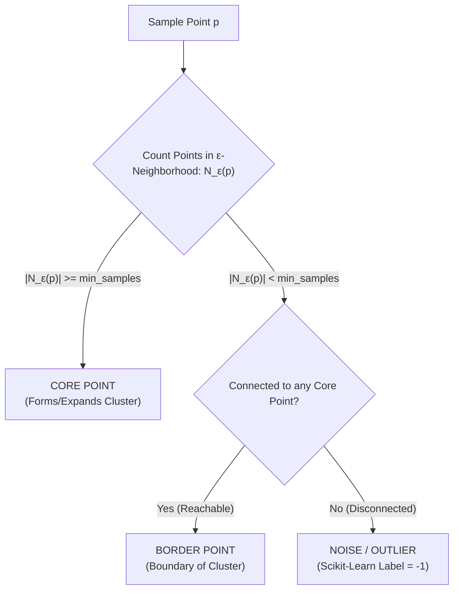

# Module 32.06: DBSCAN for Anomaly Detection

## 1. Overview & Architectural Motivation

**DBSCAN (Density-Based Spatial Clustering of Applications with Noise)** is fundamentally distinct from centroid-based clustering algorithms like K-Means. While K-Means assumes spherical clusters and forcibly assigns every single data point to some cluster, DBSCAN groups data based on spatial point density and natively handles arbitrary shapes while isolating sparse observations as **noise (outliers)**.



---

## 2. Core Hyperparameters & Point Categories

DBSCAN operates on two primary hyperparameters:
1. **$\epsilon$ (Epsilon)**: The radius defining the local neighborhood sphere centered at any point $p$.
2. **$\text{min\_samples}$**: The minimum threshold of points that must reside within the $\epsilon$-neighborhood for $p$ to be considered a dense region.

### The Formal Point Classifications:
- **Core Point**: A point $p$ where $|N_\epsilon(p)| \ge \text{min\_samples}$ (including $p$ itself).
- **Border Point**: A point $q$ where $|N_\epsilon(q)| < \text{min\_samples}$, but $q$ lies within the $\epsilon$-neighborhood of at least one Core Point.
- **Noise / Anomaly Point**: A point $r$ where:
  1. $|N_\epsilon(r)| < \text{min\_samples}$ (sparse neighborhood).
  2. $r$ is completely **disconnected** from all Core Points (not density-reachable from any cluster).

```
          Y
          ^
          |            (Core Points: Dense Cluster)
          |           *   *   *
          |         *   *   *   *
          |           *   *   *               o (Noise Point: Label -1)
          |                                  [Sparse, Disconnected]
          |
          +----------------------------------------------------------> X
```

---

## 3. Why DBSCAN Excels at Anomaly Detection vs. K-Means

| Architectural Dimension | K-Means Clustering | DBSCAN Clustering |
| :--- | :--- | :--- |
| **Outlier Handling** |  **Forced Assignment**: Every outlier is forcibly allocated to the nearest cluster, skewing the centroid coordinates. |  **Explicit Noise Label**: Outliers are tagged with an explicit label of `-1` without corrupting valid clusters. |
| **Cluster Geometry** | Assumes convex, spherical clusters; fails on crescents, rings, or interleaving structures. | Finds clusters of **arbitrary, non-linear shapes** while cleanly weeding out boundary noise. |
| **Sensitivity to Outliers** | High: A single extreme anomaly shifts the cluster centroid significantly. | Zero: Outliers have no mathematical influence on the density calculation of core clusters. |
| **Cluster Count ($k$)** | Requires pre-specifying $k$ in advance. | Automatically discovers the natural number of dense clusters present in the data. |

---

## 4. Key Takeaways from Ma'am's Blackboard Discussion

- In real-world data, multiple outliers can sometimes sit relatively close to one another (e.g., two fraud transactions with similar timestamps).
- If two outliers fall within each other's $\epsilon$-neighborhood, but **neither is connected to a core point** and their count remains $< \text{min\_samples}$, DBSCAN still correctly classifies both as noise (`-1`).
- DBSCAN is particularly effective when noise points are globally distant from dense clusters and the background density is uniformly low.
