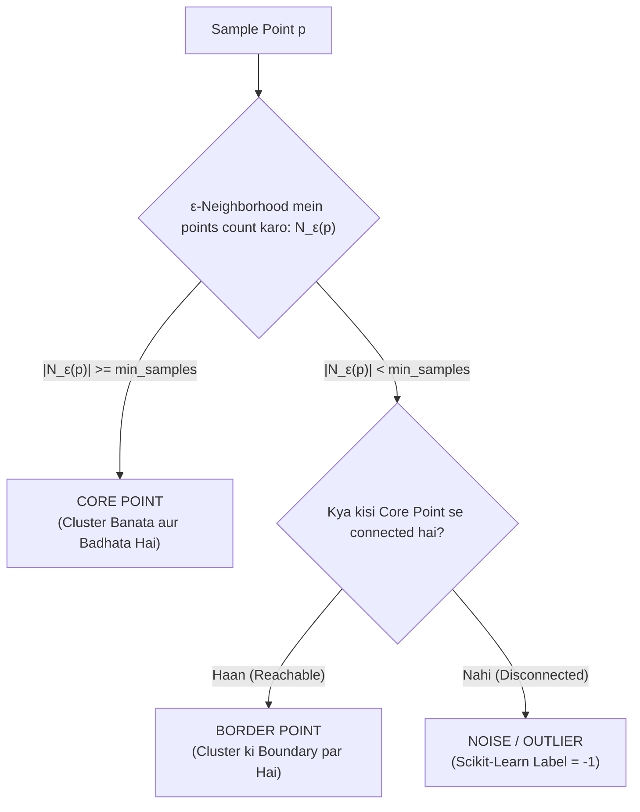

# Module 32.06: DBSCAN for Anomaly Detection (Hinglish)

## 1. Overview & Architectural Motivation

**DBSCAN (Density-Based Spatial Clustering of Applications with Noise)** centroid-based algorithms (jaise K-Means) se bilkul alag dhang se kaam karti hai. K-Means har point ko zabardasti kisi na kisi cluster mein assign kar deta hai chahe woh point kitna bhi dur ya ajeeb kyun na ho. Iske ulat, DBSCAN points ki local density (ghana-pan) dekhta hai aur sparse (khali) jagah mein baithe points ko alag se **Noise (Outlier)** mark kar deta hai.



---

## 2. Core Hyperparameters & Point Categories

DBSCAN do primary hyperparameters par chalta hai:
1. **$\epsilon$ (Epsilon)**: Har point ke chaaro taraf banne wale circle ya sphere ka radius.
2. **$\text{min\_samples}$**: Epsilon ke andar kam se kam kitne points hone chahiye taaki us jagah ko dense maana ja sake.

### Points Ki 3 Categories:
- **Core Point**: Aisa point jiske $\epsilon$-neighborhood mein $\ge \text{min\_samples}$ points hote hain (khud us point ko mila kar).
- **Border Point**: Aisa point jiske $\epsilon$-neighborhood mein points $< \text{min\_samples}$ hain, lekin woh kisi Core Point ke neighborhood ke andar fall karta hai.
- **Noise / Anomaly Point**: Aisa point jisme do conditions fulfill hoti hain:
  1. Uske $\epsilon$-neighborhood mein points $< \text{min\_samples}$ hain.
  2. Woh **kisi bhi Core Point se connected nahi hai** (poori tarah disconnected hai).

```
          Y
          ^
          |            (Core Points: Dense Cluster)
          |           *   *   *
          |         *   *   *   *
          |           *   *   *               o (Noise Point: Label -1)
          |                                  [Sparse aur Disconnected]
          |
          +----------------------------------------------------------> X
```

---

## 3. Anomaly Detection Mein DBSCAN vs K-Means Ka Antar

| Factor | K-Means Clustering | DBSCAN Clustering |
| :--- | :--- | :--- |
| **Outlier Handling** |  **Zabardasti Assignment**: Har outlier ko zabardasti cluster mein ghusaya jaata hai, jisse centroid shift ho jaata hai. |  **Direct Noise Label**: Outliers ko bina cluster ko disturb kiye seedhe label `-1` de diya jaata hai. |
| **Cluster Ki Shape** | Sirf spherical (gol) clusters dhoondh sakta hai; non-linear shapes par fail hota hai. | Kisi bhi aakar (crescents, rings, moons) ke **non-linear clusters** ko accurately cluster karta hai. |
| **Outliers Ka Asar** | High: Ek single extreme outlier poore cluster center ko kharab kar deta hai. | Zero: Outliers ka core density calculation par koi asar nahi hota. |
| **Clusters Ki Ginti ($k$)** | Pehle se batana padta hai ki kitne clusters chahiye. | Data ke natural flow ko dekh kar clusters automatically dhoondhta hai. |

---

## 4. Ma'am Ke Blackboard Se Important Real-World Points

- Agar data mein do outliers aapas mein paas-paas baithe hon, tab bhi agar unka neighborhood count $\text{min\_samples}$ se kam hai aur woh kisi core point se connected nahi hain, toh DBSCAN dono ko **noise (`-1`)** hi mark karega.
- Jab outliers clusters se globally dur hote hain aur background space khali hoti hai, tab DBSCAN sabse powerful aur reliable results deta hai.
