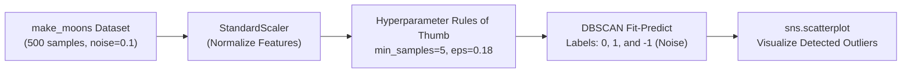

# Module 32.07: DBSCAN for Anomaly Detection Implementation (Code Walkthrough)

## 1. Overview & Practical Objectives

In this hands-on module, we implement **DBSCAN** for anomaly and noise detection on a synthetic non-linear dataset (`make_moons`) using Scikit-Learn.

### Why DBSCAN on Non-Linear Data?
Traditional distance methods like K-Means fail on non-convex geometric structures (such as interlocking crescent moons). DBSCAN traverses the dense contours of each crescent independently, assigning cluster labels `0` and `1` while isolating anomalous background points with label `-1`.



---

## 2. Practical Rules of Thumb for Hyperparameter Tuning

Selecting $\epsilon$ and $\text{min\_samples}$ from scratch can be challenging for machine learning practitioners. Ma'am outlined several practical rules of thumb:

### Rule 1: Sizing `min_samples`
$$\text{min\_samples} \approx 2 \times \text{number of features}$$
- For our 2D dataset ($d = 2$), a sensible starting value is $2 \times 2 = 4$ or $5$.
- **Setting too high** (e.g., $100$ on $500$ points) forces almost all valid points to be classified as noise.
- **Setting too low** (e.g., $1$) causes isolated noise points to form their own trivial 1-point clusters.

### Rule 2: Tuning $\epsilon$ (Epsilon Neighborhood Radius)
- **Low Dimensions ($d < 10$ features)**: Start within the range $\epsilon \in [0.5, 1.0]$, then iteratively decrease.
- **Medium Dimensions ($10 \le d \le 20$)**: Range $\epsilon \in [1.0, 2.0]$.
- **High Dimensions ($d > 20$)**: Requires larger $\epsilon$ due to data sparsity.

---

## 3. Step-by-Step Code Walkthrough

### Step 1: Library Imports & Dataset Generation
```python
import seaborn as sns
from sklearn.preprocessing import StandardScaler
from sklearn.cluster import DBSCAN
from sklearn.datasets import make_moons

# Generate synthetic two-moon dataset with deliberate noise
X, y = make_moons(
    n_samples=500,
    noise=0.1,
    random_state=42
)
```

### Step 2: Feature Standardization
```python
scaler = StandardScaler()
X_scaled = scaler.fit_transform(X)

print(f"Dataset shape: {X_scaled.shape}") # (500, 2)
```

### Step 3: Initial Scatter Plot (Raw Scaled Data)
```python
sns.scatterplot(x=X_scaled[:, 0], y=X_scaled[:, 1])
```
The raw scatter plot reveals two interlocking crescent shapes, accompanied by scattered anomalous points drifting in the peripheral background.

### Step 4: Configuring and Fitting DBSCAN
Following our tuning progression:
- When $\epsilon = 0.5$, DBSCAN groups the entire dataset into a single massive cluster.
- When $\epsilon = 0.22$, the two moons emerge, but some edge noise remains attached.
- When fine-tuned to $\epsilon = 0.18$ and $\text{min\_samples} = 5$:
```python
# Instantiate DBSCAN with tuned hyperparameters
dbscan = DBSCAN(
    eps=0.18,
    min_samples=5
)

# Fit and generate cluster / noise labels
labels = dbscan.fit_predict(X_scaled)
```

### Step 5: Visualizing Detected Clusters & Outliers
```python
# Visualize clustered moons with noise points highlighted
sns.scatterplot(x=X_scaled[:, 0], y=X_scaled[:, 1], c=labels, palette="tab10")
```

---

## 4. Key Observations & Results

1. **Explicit Outlier Labeling**: Data points residing in sparse areas far from the dense crescent bodies receive `label = -1`.
2. **Cluster Preservation**: The two non-linear crescent bodies are accurately segregated into cluster `0` and cluster `1` without any centroid deformation.
3. **Notebook Reference**: The verified Jupyter notebook for this module is available at [`clustering_DBSCAN.ipynb`](file:///c:/Users/Shivam%20Keshari/OneDrive/Desktop/AI-ML/lecture_32/Notes_32.07/clustering_DBSCAN.ipynb).