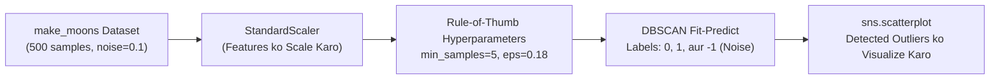

# Module 32.07: DBSCAN for Anomaly Detection Implementation (Code Walkthrough - Hinglish)

## 1. Overview & Practical Objectives

Is hands-on module mein hum Scikit-Learn ka use karke non-linear dataset (`make_moons`) par **DBSCAN** ke zariye anomaly aur noise detection implement karenge.

### Non-Linear Data Par DBSCAN Kyun?
K-Means algorithm aisi moon-shaped (aadhe chand ke aakar) geometries par buri tarah fail ho jaati hai kyunki woh data ko spheres mein baantti hai. DBSCAN dono moons ke dense curves ko smoothly follow karta hai aur cluster `0` aur `1` banata hai, jabki beech mein bhatke hue anomalous points ko alag se label `-1` de deta hai.



---

## 2. Hyperparameter Tuning Ke Practical Rules of Thumb

Beginners ke liye $\epsilon$ aur $\text{min\_samples}$ choose karna thoda confusing hota hai. Ma'am ne lecture mein kuch practical rules of thumb bataye hain:

### Rule 1: `min_samples` Kaise Chunein?
$$\text{min\_samples} \approx 2 \times \text{number of features}$$
- 2D data ($2$ features) ke liye $2 \times 2 = 4$ ya $5$ ek perfect starting point hai.
- **Bohot badi value** (jaise 500 samples par 100) rakhne se lagbhag saare points noise ban jaayenge.
- **Bohot chhoti value** (jaise 1) rakhne se single isolated noise point bhi apna alag valid cluster bana lega.

### Rule 2: $\epsilon$ (Epsilon Neighborhood Radius) Kaise Chunein?
- **Low Dimensions ($< 10$ features)**: Shuruat $\epsilon \in [0.5, 1.0]$ se karein, fir dhire-dhire kam karte jaayein.
- **Medium Dimensions ($10-20$ features)**: $\epsilon \in [1.0, 2.0]$ ke range mein rakhein.
- **High Dimensions ($> 20$ features)**: Data sparsity ki wajah se bada $\epsilon$ chahiye hota hai.

---

## 3. Step-by-Step Code Walkthrough

### Step 1: Libraries Import Karna & Data Generate Karna
```python
import seaborn as sns
from sklearn.preprocessing import StandardScaler
from sklearn.cluster import DBSCAN
from sklearn.datasets import make_moons

# 500 samples aur 0.1 noise ke sath make_moons dataset generate karo
X, y = make_moons(
    n_samples=500,
    noise=0.1,
    random_state=42
)
```

### Step 2: Standardization
```python
scaler = StandardScaler()
X_scaled = scaler.fit_transform(X)

print(f"Shape: {X_scaled.shape}") # (500 rows, 2 columns)
```

### Step 3: Raw Data Ko Scatter Plot Se Dekhna
```python
# Unclustered data ko plot karo
sns.scatterplot(x=X_scaled[:, 0], y=X_scaled[:, 1])
```
Plot mein do moon shapes dikhti hain aur kuch noise points alag-alag kone mein scattered dikhte hain.

### Step 4: DBSCAN Model Ko Tune Karke Fit Karna
- Agar $\epsilon = 0.5$ rakhein, toh poora data ek hi bada cluster ban jaata hai.
- Agar $\epsilon = 0.22$ karein, toh dono moons alag hote hain par kuch boundary noise points cluster mein hi jud jaate hain.
- Final fine-tuned parameters $\epsilon = 0.18$ aur $\text{min\_samples} = 5$:
```python
# Tuned hyperparameters ke sath DBSCAN initialize karo
dbscan = DBSCAN(
    eps=0.18,
    min_samples=5
)

# Fit-predict se cluster aur noise labels nikalo
labels = dbscan.fit_predict(X_scaled)
```

### Step 5: Clustered Results Ko Visualize Karna
```python
# Clusters aur noise points ko plot karo
sns.scatterplot(x=X_scaled[:, 0], y=X_scaled[:, 1], c=labels, palette="tab10")
```

---

## 4. Key Results & Observations

1. **Clear Outlier Detection**: Moons ke bahar sparse area mein gire points ko DBSCAN ne automatically label `-1` assign kiya.
2. **Moons Ka Preservation**: Dono non-linear crescents cleanly cluster `0` aur cluster `1` mein divide ho gaye.
3. **Notebook Link**: Is module ka verified Jupyter notebook yahan available hai: [`clustering_DBSCAN.ipynb`](file:///c:/Users/Shivam%20Keshari/OneDrive/Desktop/AI-ML/lecture_32/Notes_32.07/clustering_DBSCAN.ipynb).