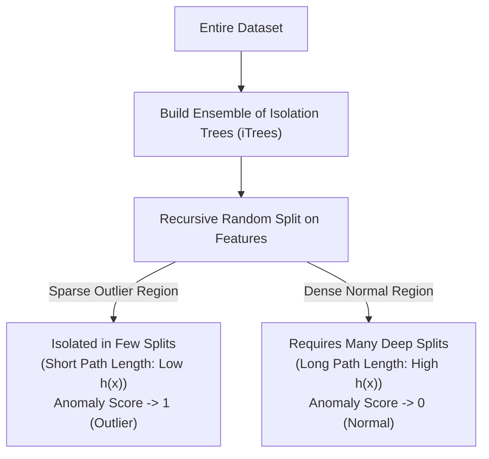
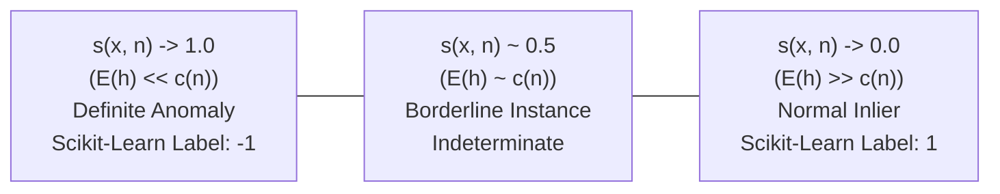

# Module 32.08: Isolation Forest for Anomaly Detection

## 1. Overview & Architectural Motivation

**Isolation Forest (iForest)** is an ensemble tree-based algorithm designed specifically for unsupervised anomaly detection. Unlike conventional clustering techniques (like K-Means or DBSCAN) that profile normal data points and designate unclustered points as outliers, Isolation Forest **explicitly isolates anomalies**.

### The Core Axiom:
Anomalies possess two quantitative characteristics:
1. **They are few**: Anomalies constitute a very small fraction of the total dataset ($< 1-5\%$).
2. **They are different**: Their feature values deviate markedly from normal instances, placing them in sparse regions of the feature space.



---

## 2. The Mechanism of Isolation Trees (iTrees)

An **Isolation Tree (iTree)** is a proper binary tree constructed through recursive random partitioning:
1. **Random Feature Selection**: A feature $q$ is chosen uniformly at random from the input features.
2. **Random Split Value**: A split threshold $p$ is chosen uniformly at random between the minimum and maximum values of feature $q$ in the current node ($p \in [\min(q), \max(q)]$).
3. **Recursive Partitioning**: The dataset is split into two child nodes based on whether $x_q < p$.
4. **Termination Condition**: Partitioning continues recursively until either:
   - The tree reaches a maximum specified depth.
   - The node contains only a single sample point ($|X| = 1$, leaf node reached).
   - All sample points in the node have identical feature values.

### Why Outliers Isolate Faster Than Inliers:
- **Outliers**: Because anomalies exist far out in sparse regions, a single random orthogonal split line easily cuts them off from the rest of the data. They land in terminal leaf nodes near the root of the tree with very small **path length $h(x)$**.
- **Normal Inliers**: Because inliers are tightly packed inside dense clusters, isolating a single inlier requires dozens of successive random cuts. Inliers traverse deep into the tree, resulting in a large **path length $h(x)$**.

```
Feature 2
   ^
   |        (Dense Inliers: Requires Many Splits)
   |        *  *  *  *
   |        *  *  *  *  *   ------------------- (Split 1: Isolates Outlier Instantly!)
   |        *  *  *  *
   |                                           * (Outlier: Isolated in 1 Split)
   +----------------------------------------------------------> Feature 1
```

---

## 3. Mathematical Formulation of the Anomaly Score

To quantify the degree of anomalousness across an ensemble of $t$ isolation trees, we compute the **Anomaly Score $s(x, n)$**:

$$\text{Anomaly Score}(x) = 2^{-\frac{E(h(x))}{c(n)}}$$

### Component Definitions:

| Symbol | Mathematical Entity | Role |
| :--- | :--- | :--- |
| **$x$** | Single sample point | The observation being evaluated |
| **$n$** | Integer | Total number of data samples |
| **$h(x)$** | Integer | **Path Length**: Number of edges traversed from root to leaf node in an iTree |
| **$E(h(x))$** | Scalar Float | **Average Path Length** of point $x$ across all trees in the forest |
| **$c(n)$** | Normalizing Constant | **Average path length of unsuccessful searches in a Binary Search Tree (BST)** over $n$ points |

### The BST Normalizing Factor $c(n)$:
Because an Isolation Tree shares the exact mathematical structure of a Binary Search Tree, the expected path length of a dataset containing $n$ samples is derived as:

$$c(n) = 2 \left( \ln(n - 1) + \gamma \right) - \frac{2(n - 1)}{n}$$

Where $\gamma \approx 0.5772156649$ is the **Euler-Mascheroni constant**.

---

## 4. Interpretation of Anomaly Scores & Decision Thresholds

The score $s(x, n) \in [0, 1]$ directly reflects anomalousness:



1. **When $E(h(x)) \to 0$ (Isolated near root)**:
$$\frac{E(h(x))}{c(n)} \to 0 \implies s(x, n) \to 2^{-0} = 1$$
   - The point isolates extremely fast across almost all trees.
   - **Verdict**: Definite Anomaly / Outlier $\implies$ **Scikit-Learn Label = `-1`**.
2. **When $E(h(x)) \to n - 1$ (Deep in leaves)**:
$$\frac{E(h(x))}{c(n)} \to \text{large} \implies s(x, n) \to 2^{-\infty} \approx 0$$
   - The point requires deep recursive partitioning.
   - **Verdict**: Normal Inlier $\implies$ **Scikit-Learn Label = `1`**.
3. **When $E(h(x)) \approx c(n)$ (Average path length equals BST expectation)**:
$$s(x, n) \approx 2^{-1} = 0.5$$
   - The point does not exhibit distinct isolation characteristics.
   - If all instances in a dataset yield $s \approx 0.5$, the dataset contains no statistically noticeable anomalies.

---

## 5. Architectural Advantages Over Distance-Based Methods

1. **No Pairwise Distance Matrix**: Unlike KNN or DBSCAN which require $O(N^2 d)$ distance operations, Isolation Forest relies entirely on random scalar splits.
2. **Sub-Linear & Linear Scalability**: Construction complexity is $O(t \cdot \psi \log \psi)$, where $t$ is the number of trees and $\psi$ is the subsampling size (typically $256$).
3. **Resilience to the Curse of Dimensionality**: Functions exceptionally well on high-dimensional tabular datasets (e.g., 20 to 100 features) where Euclidean distances degrade.