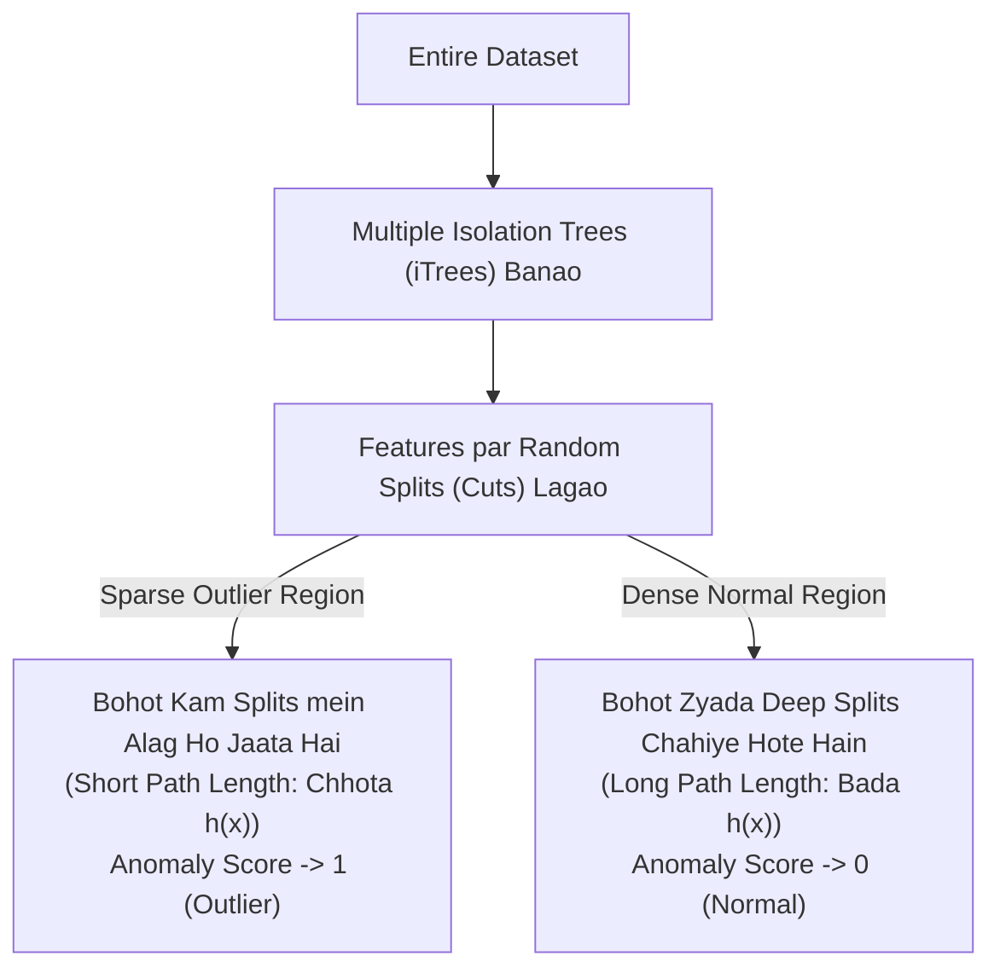
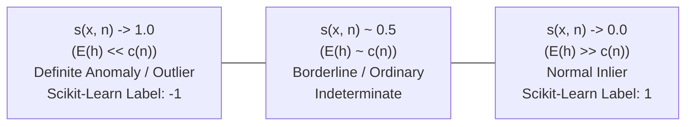

# Module 32.08: Isolation Forest for Anomaly Detection (Hinglish)

## 1. Overview & Core Philosophy

**Isolation Forest (iForest)** unsupervised anomaly detection ke liye ek bohot powerful ensemble tree-based algorithm hai. Baaki algorithms (jaise K-Means ya DBSCAN) pehle normal data ka pattern samajhne ki koshish karti hain aur fir jo bacha use outlier bolti hain. Lekin Isolation Forest **seedhe anomalies ko isolate (alag) karne** par kaam karta hai.

### Isolation Forest Ka Basic Rule:
Anomalies do tarah se pehchani jaati hain:
1. **Ginti mein kam (Few)**: Poore data mein sirf $1-5\%$ hi anomalies hoti hain.
2. **Features mein bilkul alag (Different)**: Yeh normal dense cluster se dur khali (sparse) jagah par maujood hoti hain.



---

## 2. Isolation Trees (iTrees) Kaise Kaam Karti Hain?

Ek **Isolation Tree** ek binary decision tree hoti hai jisme splits randomly lagaye jaate hain:
1. **Random Feature Selection**: Randomly koi bhi ek feature $q$ select kiya jaata hai.
2. **Random Split Value**: Us feature ki minimum aur maximum value ke beech randomly ek split point $p$ choose kiya jaata hai.
3. **Partition**: Data do hisson mein divide ho jaata hai ($x_q < p$).
4. **Stopping Condition**: Yeh cutting tab tak chalti rehti hai jab tak node mein sirf **ek single sample** na reh jaaye (leaf node ban jaaye).

### Outlier Jaldi Kyun Isolate Hote Hain?
- **Outlier**: Kyunki outlier bilkul dur akela khada hai, isliye pehle ya doosre random cut (split) lagte hi woh baaki data se alag ho jaata hai. Isliye outlier ke liye **path length $h(x)$** (root se leaf tak ki duri) bohot **chhoti** hoti hai.
- **Normal Inlier**: Normal points ek dense bheed (cluster) mein hote hain. Ek single point ko alag karne ke liye ped ko bohot gehra (deep) split karna padta hai. Isliye inliers ke liye **path length $h(x)$** bohot **badi** hoti hai.

```
Feature 2
   ^
   |        (Dense Inliers: Bohot saare cuts chahiye)
   |        *  *  *  *
   |        *  *  *  *  *   ------------------- (Split 1: Outlier seedhe alag ho gaya!)
   |        *  *  *  *
   |                                           * (Outlier: 1 cut mein isolate ho gaya)
   +----------------------------------------------------------> Feature 1
```

---

## 3. Anomaly Score Ka Mathematical Formula

Multiple trees mein point $x$ ke average path length ko measure karke hum **Anomaly Score $s(x, n)$** nikaalte hain:

$$\text{Anomaly Score}(x) = 2^{-\frac{E(h(x))}{c(n)}}$$

### Formula Ke Components:

| Symbol | Kya Hai | Role |
| :--- | :--- | :--- |
| **$x$** | Single data sample | Jis point ka outlier score nikaal rahe hain |
| **$n$** | Data size | Dataset mein total samples ka count |
| **$h(x)$** | Integer | **Path Length**: Tree ke root se leaf tak kitne edges cross kiye |
| **$E(h(x))$** | Float | Saare isolation trees mein point $x$ ka **Average Path Length** |
| **$c(n)$** | Normalizing Factor | $n$ nodes wale Binary Search Tree (BST) ka average path length |

### Normalizing Constant $c(n)$ Ka Formula:
Isolation Tree ka mathematical structure Binary Search Tree jaisa hota hai, isliye expected path length:

$$c(n) = 2 \left( \ln(n - 1) + \gamma \right) - \frac{2(n - 1)}{n}$$

Yahan $\gamma \approx 0.5772156649$ **Euler-Mascheroni constant** hai.

---

## 4. Anomaly Score Ka Interpretation & Output Labels

Score hamesha $0$ aur $1$ ke beech rehta hai:



1. **Jab $E(h(x))$ bohot chhota ho ($E(h) \to 0$)**:
$$\frac{E(h(x))}{c(n)} \to 0 \implies s(x, n) \to 2^{-0} = 1$$
   - Point har tree mein turant isolate ho raha hai.
   - **Verdict**: Pakka Outlier / Anomaly $\implies$ **Scikit-Learn Label = `-1`**.
2. **Jab $E(h(x))$ bohot bada ho ($E(h) \to n - 1$)**:
$$\frac{E(h(x))}{c(n)} \to \text{large} \implies s(x, n) \to 2^{-\infty} \approx 0$$
   - Point ko isolate karne ke liye bohot gehre cuts lagane pade.
   - **Verdict**: Normal Inlier $\implies$ **Scikit-Learn Label = `1`**.
3. **Jab $E(h(x)) \approx c(n)$**:
$$s(x, n) \approx 2^{-1} = 0.5$$
   - Point bilkul average depth par hai; data mein koi clear anomaly nahi hai.

---

## 5. Isolation Forest Ke Bada Fayde

1. **Koi Distance Matrix Nahi Chahiye**: KNN ya DBSCAN ki tarah har point ka dusre point se distance ($O(N^2 d)$) calculate nahi karna padta.
2. **Super Fast Execution**: Model linear time $O(t \cdot \psi \log \psi)$ mein train ho jaata hai.
3. **High Dimensions Mein Best**: 20 se 100 features wale tabular datasets par bhi yeh bilkul accurate kaam karta hai jahan Euclidean distance fail ho jaata hai.