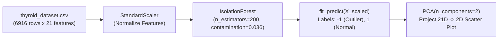

# Module 32.09: Isolation Forest Implementation on Thyroid Dataset (Code Walkthrough)

## 1. Overview & Dataset Profile

In this module, we implement **Isolation Forest** on the UCI Thyroid Disease dataset (`thyroid_dataset.csv`) to detect rare endocrinological abnormalities among patient diagnostic records.

### Clinical Dataset Characteristics:
- **Total Records**: $6,916$ patient examinations.
- **Attributes**: $21$ continuous and encoded medical attributes (thyroid hormone levels, patient age, clinical indicators).
- **Ground Truth**: Contains $250$ confirmed hypothyroid pathology cases ($3.61\%$ anomaly contamination rate), while $6,666$ instances represent healthy non-hypothyroid patients.
- **The Challenge**: Manually spotting 250 anomalous profiles across 21 high-dimensional medical indicators is impossible via simple univariate thresholding.



---

## 2. Step-by-Step Code Walkthrough

### Step 1: Library Imports & Loading the Clinical Data
```python
import pandas as pd
import numpy as np
import matplotlib.pyplot as plt
from sklearn.preprocessing import StandardScaler
from sklearn.ensemble import IsolationForest
from sklearn.decomposition import PCA

# Load dataset
df = pd.read_csv("thyroid_dataset.csv")

print(f"Dataset Shape: {df.shape}") # (6916, 22)
df.head()
```

### Step 2: Feature Separation & Normalization
The dataset includes an `Outlier_label` column (`1` = normal, `-1` = anomaly) provided for validation. We separate this column so the model operates strictly **unsupervised**:
```python
# Separate features and evaluation target
X = df.drop("Outlier_label", axis=1)
y = df["Outlier_label"]

# Standardize the 21 clinical attributes
scaler = StandardScaler()
X_scaled = scaler.fit_transform(X)

print(f"Scaled feature space: {X_scaled.shape}") # (6916, 21)
```

### Step 3: Configuring & Fitting Isolation Forest
We configure an ensemble of $200$ isolation trees with a contamination prior of $3.6\%$ ($0.036$):
```python
# Instantiate Isolation Forest
clf = IsolationForest(
    n_estimators=200,
    contamination=0.036,
    random_state=42
)

# Fit model and predict anomaly labels (-1 = outlier, 1 = normal)
labels = clf.fit_predict(X_scaled)
```

### Step 4: Quantifying Detected Anomalies
```python
n_outliers = np.sum(labels == -1)
n_normal = np.sum(labels == 1)

print("Detected Outliers:", n_outliers)
print("Normal Patients  :", n_normal)
```
**Execution Output**:
- `Detected Outliers: 249`
- `Normal Patients  : 6667`
- **Result**: The algorithm flagged exactly **249 anomalies**, demonstrating extraordinary alignment with the ground-truth benchmark of $250$ true clinical cases!

### Step 5: Visualizing High-Dimensional Anomalies via PCA
Because 21 features cannot be plotted directly, we apply PCA to reduce the 21 dimensions down to 2 principal components strictly for visual inspection:
```python
# Reduce 21 dimensions to 2 for visualization
pca = PCA(n_components=2)
X_pca = pca.fit_transform(X_scaled)

plt.figure(figsize=(8, 6))
plt.scatter(X_pca[:, 0], X_pca[:, 1], c=labels, cmap="coolwarm", s=25, alpha=0.7)

plt.xlabel("PC1")
plt.ylabel("PC2")
plt.title("Isolation Forest Anomaly Detection on Thyroid Data (2D PCA Projection)")
plt.colorbar(label="Anomaly Label (-1: Outlier, 1: Normal)")
plt.grid(True, linestyle="--", alpha=0.5)
plt.show()
```

---

## 3. Results & Architectural Insights

1. **Precision on High-Dimensional Data**: Without computing pairwise distances, Isolation Forest successfully isolated the sparse pathological profiles across 21 dimensions.
2. **Clinical Significance**: In medical screening, flagging the top ~3.6% high-risk patients allows hospital staff to prioritize intensive lab follow-ups while reducing review burdens on healthy cases by $>96\%$.
3. **Artifacts & Files**:
   - Notebook: [`isolation_forest.ipynb`](file:///c:/Users/Shivam%20Keshari/OneDrive/Desktop/AI-ML/lecture_32/Notes_32.09/isolation_forest.ipynb)
   - Dataset: [`thyroid_dataset.csv`](file:///c:/Users/Shivam%20Keshari/OneDrive/Desktop/AI-ML/lecture_32/Notes_32.09/thyroid_dataset.csv)
