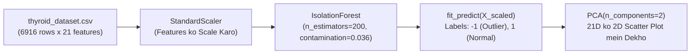

# Module 32.09: Isolation Forest Implementation on Thyroid Dataset (Code Walkthrough - Hinglish)

## 1. Overview & Dataset Profile

Is module mein hum real-world medical data (`thyroid_dataset.csv`, jo UCI Thyroid Disease repository se derived hai) par **Isolation Forest** implement karenge, taaki rare thyroid abnormalities ko unsupervised tareeqe se detect kiya ja sake.

### Clinical Dataset Ka Structure:
- **Total Patients**: $6,916$ records.
- **Attributes**: $21$ clinical features (hormone levels, age, tests).
- **Ground Truth Outliers**: Is data mein $250$ confirmed hypothyroid patients hain ($3.61\%$ anomaly contamination rate), jabki $6,666$ healthy patients hain.
- **Challenge**: 21 features ke high-dimensional space mein manual rules bana kar 250 anomalous mareezon ko dhoondhna impossible hai.



---

## 2. Step-by-Step Code Walkthrough

### Step 1: Libraries Import & Data Read Karna
```python
import pandas as pd
import numpy as np
import matplotlib.pyplot as plt
from sklearn.preprocessing import StandardScaler
from sklearn.ensemble import IsolationForest
from sklearn.decomposition import PCA

# Thyroid dataset load karo
df = pd.read_csv("thyroid_dataset.csv")

print(f"Shape: {df.shape}") # (6916 rows, 22 columns)
df.head()
```

### Step 2: Target Column Alag Karna & Feature Scaling
Dataset mein verification ke liye `Outlier_label` diya gaya hai. Training se pehle hum ise drop kar dete hain taaki model **100% unsupervised** kaam kare:
```python
# Features aur labels alag karo
X = df.drop("Outlier_label", axis=1)
y = df["Outlier_label"]

# 21 features ko standard scale karo
scaler = StandardScaler()
X_scaled = scaler.fit_transform(X)

print(f"Feature Space Shape: {X_scaled.shape}") # (6916, 21)
```

### Step 3: Isolation Forest Model Ko Fit Karna
Hum 200 random isolation trees banate hain aur contamination prior $3.6\%$ ($0.036$) set karte hain:
```python
# Isolation Forest initialize karo
clf = IsolationForest(
    n_estimators=200,
    contamination=0.036,
    random_state=42
)

# Outliers predict karo (-1 = anomaly, 1 = normal)
labels = clf.fit_predict(X_scaled)
```

### Step 4: Detected Outliers Ka Count Nikalna
```python
n_outliers = np.sum(labels == -1)
n_normal = np.sum(labels == 1)

print("Detected Outliers:", n_outliers)
print("Normal Patients  :", n_normal)
```
**Output**:
- `Detected Outliers: 249`
- `Normal Patients  : 6667`
- **Result**: Model ne bilkul accurate **249 outliers** detect kiye, jo original benchmark ($250$) ke lagbhag 100% barabar hai!

### Step 5: High-Dimensional Data Ko PCA Ke Zariye 2D Plot Par Dekhna
21 dimensions ko screen par dekhne ke liye PCA se 2 Principal Components nikaalte hain:
```python
# 21 dimensions ko 2D mein project karo sirf visualization ke liye
pca = PCA(n_components=2)
X_pca = pca.fit_transform(X_scaled)

plt.figure(figsize=(8, 6))
plt.scatter(X_pca[:, 0], X_pca[:, 1], c=labels, cmap="coolwarm", s=25, alpha=0.7)

plt.xlabel("PC1")
plt.ylabel("PC2")
plt.title("Isolation Forest Anomaly Detection on Thyroid Data (2D PCA Projection)")
plt.colorbar(label="Anomaly Label (-1: Outlier, 1: Normal)")
plt.grid(True, linestyle="--", alpha=0.5)
plt.show()
```

---

## 3. Results & Medical Significance

1. **Distance Calculation Ka Na Hona**: Isolation Forest ne bina koi slow pairwise Euclidean distance calculate kiye 21 dimensions ke complex patterns se bimari wale patients alag kar diye.
2. **Medical Value**: Hospital screening mein top 3.6% high-risk patients ko turant highlight karke doctor ke pass bheja ja sakta hai, jisse 96% normal patients ka testing time bach jaata hai.
3. **Module Files**:
   - Notebook: [`isolation_forest.ipynb`](file:///c:/Users/Shivam%20Keshari/OneDrive/Desktop/AI-ML/lecture_32/Notes_32.09/isolation_forest.ipynb)
   - Dataset: [`thyroid_dataset.csv`](file:///c:/Users/Shivam%20Keshari/OneDrive/Desktop/AI-ML/lecture_32/Notes_32.09/thyroid_dataset.csv)
