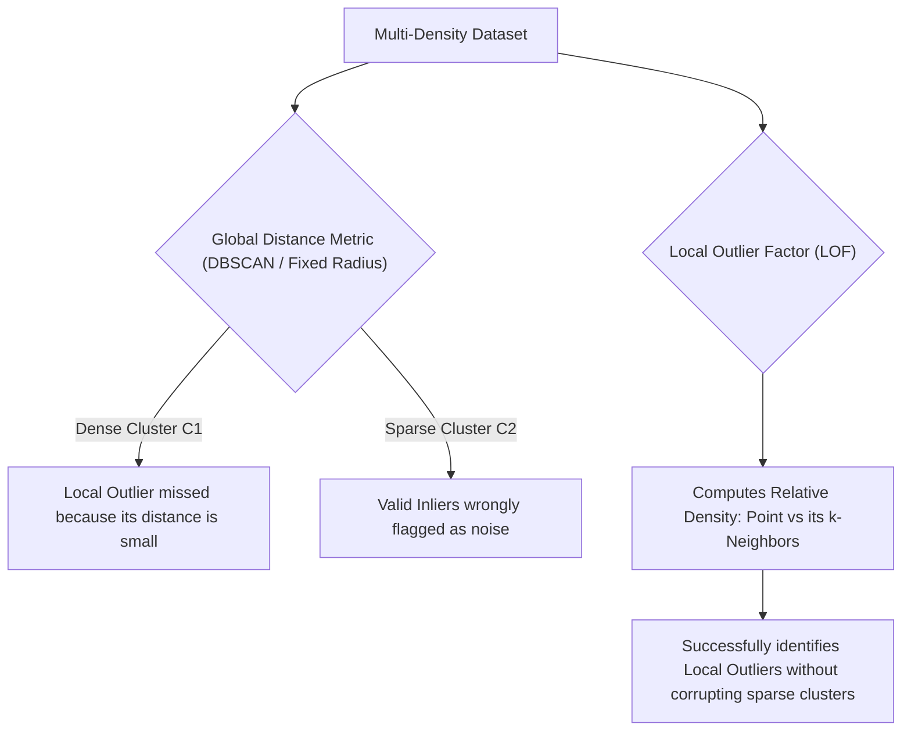
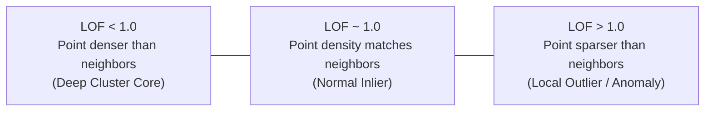

# Module 32.10: Local Outlier Factor (LOF) for Anomaly Detection

## 1. Overview & The Problem with Global Outliers

Traditional anomaly detection algorithms (such as DBSCAN with a single global $\epsilon$ or basic distance thresholding) evaluate points against a global density standard. However, real-world datasets frequently exhibit **multi-density clusters**—regions where one cluster is extremely dense while another legitimate cluster is naturally sparse.



---

## 2. Global vs. Local Outlier Distinction

```
Feature 2
   ^
   |        (Cluster 1: Very Dense)                 (Cluster 2: Sparse)
   |           * * *                                  *       *
   |          * * * *      o (Local Outlier)
   |           * * *                                *     *       *
   |
   |   o (Global Outlier)
   +-------------------------------------------------------------------> Feature 1
```

- **Global Outlier**: A data point situated far away from **all** clusters in the feature space (easily caught by DBSCAN, K-Means, or Isolation Forest).
- **Local Outlier**: A data point located in proximity to a dense cluster, but with a local density significantly lower than that of the cluster members. 
  - In absolute Euclidean terms, this point's distance from Cluster 1 may be smaller than the distance between normal points inside Cluster 2!
  - A global threshold fails: if the threshold is tight, Cluster 2 is falsely destroyed as noise; if loose, the local outlier near Cluster 1 is missed.
  - **LOF solves this by evaluating density relative to the local neighborhood.**

---

## 3. Mathematical Formulation of LOF

The LOF algorithm proceeds through four sequential mathematical computations:

### Step 1: Choosing $k$ (Neighborhood Size)
We specify hyperparameter $k$ (the number of nearest neighbors, e.g., $k = 20$). For any point $p$, $N_k(p)$ represents the set of its $k$-nearest neighbors.

### Step 2: $k$-Distance of Point $p$ ($d_k(p)$)
The Euclidean distance $d(p, o)$ between $p$ and its $k$-th nearest neighbor $o$.

### Step 3: Reachability Distance
The reachability distance of point $p$ with respect to neighbor $o$ is defined as:

$$\text{reach-dist}_k(p, o) = \max \left( d_k(o), d(p, o) \right)$$

- If point $p$ is sufficiently far from $o$, the reachability distance is simply their actual Euclidean distance $d(p, o)$.
- If $p$ and $o$ are very close, the distance is lower-bounded by $d_k(o)$ to stabilize statistical fluctuations in dense regions.

### Step 4: Local Reachability Density (LRD)
The local reachability density of point $p$ is the inverse of the average reachability distance over its $k$-nearest neighbors:

$$\text{lrd}_k(p) = \frac{|N_k(p)|}{\sum_{o \in N_k(p)} \text{reach-dist}_k(p, o)}$$

- High $\text{lrd}_k(p)$ indicates that point $p$ is surrounded by densely packed neighbors.
- Low $\text{lrd}_k(p)$ indicates that point $p$ resides in an isolated, sparse neighborhood.

### Step 5: Local Outlier Factor (LOF Calculation)
The LOF score compares the local reachability density of point $p$ with the average local reachability density of its neighbors:

$$\text{LOF}_k(p) = \frac{\sum_{o \in N_k(p)} \frac{\text{lrd}_k(o)}{\text{lrd}_k(p)}}{|N_k(p)|} = \frac{\frac{1}{|N_k(p)|} \sum_{o \in N_k(p)} \text{lrd}_k(o)}{\text{lrd}_k(p)}$$

$$\text{LOF} = \frac{\text{Average Density of Neighbors}}{\text{Density of Point } p}$$

---

## 4. LOF Score Interpretation & Decision Criteria



| LOF Score Range | Density Comparison | Classification | Scikit-Learn Label |
| :--- | :--- | :--- | :--- |
| **$\text{LOF} \approx 1$** | $\text{lrd}(p) \approx \text{lrd}(\text{neighbors})$ | **Normal Inlier**: Homogeneous density region | `1` |
| **$\text{LOF} < 1$** | $\text{lrd}(p) > \text{lrd}(\text{neighbors})$ | **Core Inlier**: Deep inside a high-density cluster core | `1` |
| **$\text{LOF} > 1$** | $\text{lrd}(p) < \text{lrd}(\text{neighbors})$ | **Local Outlier / Anomaly**: Point is isolated compared to its cluster | `-1` |
| **$\text{LOF} \gg 1$** | $\text{lrd}(p) \ll \text{lrd}(\text{neighbors})$ | **Strong Outlier**: Extreme anomaly | `-1` |

---

## 5. Architectural Comparison: LOF vs. Isolation Forest vs. DBSCAN

| Feature | DBSCAN | Isolation Forest | Local Outlier Factor (LOF) |
| :--- | :--- | :--- | :--- |
| **Underlying Concept** | Global density connectivity | Tree-based random isolation depth | Relative $k$-nearest neighbor density ratio |
| **Local Outlier Sensitivity** |  Fails across multi-density clusters |  Moderate (tree splits can slice across densities) |  **Superior**: Specifically engineered for variable densities |
| **Computational Complexity** | $O(N^2)$ (distance matrix) | $O(t \cdot \psi \log \psi)$ (linear/sub-linear) | $O(N^2)$ ($k$-NN search) |
| **Best Used When** | Spatial clustering + noise removal | High-dimensional tabular datasets ($d > 20$) | Variable-density clusters in low-to-medium dimensions |