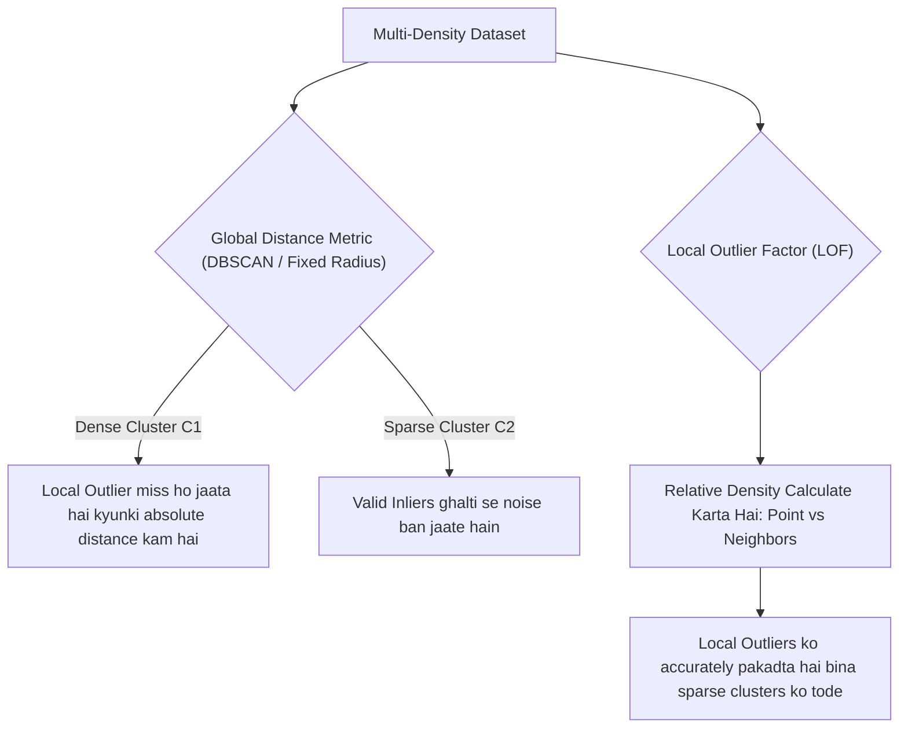
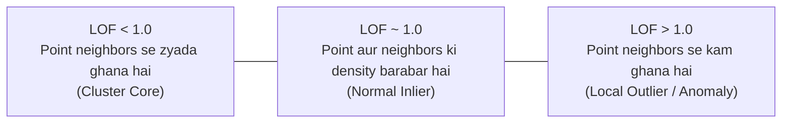

# Module 32.10: Local Outlier Factor (LOF) for Anomaly Detection (Hinglish)

## 1. Overview & Global Outlier Detection Ki Kamzori

Purani anomaly detection techniques (jaise DBSCAN ya fixed distance threshold) poore data ko ek hi global paimane (standard) se naapti hain. Lekin real life ke datasets mein aksar **multi-density clusters** hote hain—matlab ek cluster bohot ghana (dense) hota hai jabki doosra valid cluster thoda phaila hua (sparse) hota hai.



---

## 2. Global vs. Local Outlier Ka Asli Antar

```
Feature 2
   ^
   |        (Cluster 1: Bohot Ghana)                 (Cluster 2: Thoda Phaila Hua)
   |           * * *                                  *       *
   |          * * * *      o (Local Outlier)
   |           * * *                                *     *       *
   |
   |   o (Global Outlier)
   +-------------------------------------------------------------------> Feature 1
```

- **Global Outlier**: Aisa point jo data ke **saare clusters** se bohot dur akele kone mein baitha hai (ise DBSCAN aur Isolation Forest aasaani se pakad lete hain).
- **Local Outlier**: Aisa point jo kisi dense cluster ke thoda paas hai, lekin us cluster ke bheed ke mukable thoda alag aur kam dense area mein hai.
  - Agar hum iska distance dekhein, toh iska Cluster 1 se distance Cluster 2 ke normal points ke aapsi distance se bhi **chhota** ho sakta hai!
  - Global method fail ho jaata hai: agar threshold tight rakhein toh Cluster 2 poora noise ban jaayega, aur loose rakhein toh yeh point normal maan liya jaayega.
  - **LOF is problem ko point ki local density ko uske neighbors se compare karke solve karta hai.**

---

## 3. LOF Ka Mathematical Process

LOF algorithm 4 sequential mathematical calculations karta hai:

### Step 1: $k$ (Neighbors Ka Count) Chuna
Hum $k$ hyperparameter decide karte hain (jaise $k = 20$). Har point $p$ ke liye uske $k$-nearest neighbors $N_k(p)$ nikale jaate hain.

### Step 2: Point $p$ Ka $k$-Distance ($d_k(p)$)
Point $p$ se uske $k$-th sabse paas wale neighbor $o$ tak ka Euclidean distance.

### Step 3: Reachability Distance
Point $p$ ka neighbor $o$ ke respect mein reachability distance:

$$\text{reach-dist}_k(p, o) = \max \left( d_k(o), d(p, o) \right)$$

- Agar point $p$ dur hai, toh seedhe actual Euclidean distance $d(p, o)$ use hota hai.
- Agar paas hai, toh $d_k(o)$ lower bound ki tarah use hota hai taaki dense region mein stability bani rahe.

### Step 4: Local Reachability Density (LRD)
Point $p$ ki local density uske neighbors ke average reachability distance ka inverse (ulta) hoti hai:

$$\text{lrd}_k(p) = \frac{|N_k(p)|}{\sum_{o \in N_k(p)} \text{reach-dist}_k(p, o)}$$

- High $\text{lrd}_k(p)$ ka matlab point ke aas-paas bheed (high density) hai.
- Low $\text{lrd}_k(p)$ ka matlab point akele sparse jagah par hai.

### Step 5: Local Outlier Factor (LOF Calculation)
Point $p$ ke LRD ko uske neighbors ke average LRD se divide kiya jaata hai:

$$\text{LOF}_k(p) = \frac{\sum_{o \in N_k(p)} \frac{\text{lrd}_k(o)}{\text{lrd}_k(p)}}{|N_k(p)|} = \frac{\text{Neighbors Ki Average Density}}{\text{Point } p \text{ Ki Density}}$$

---

## 4. LOF Score Ka Interpretation & Rules



| LOF Score Range | Density Ka Comparison | Result | Scikit-Learn Label |
| :--- | :--- | :--- | :--- |
| **$\text{LOF} \approx 1$** | $\text{lrd}(p) \approx \text{lrd}(\text{neighbors})$ | **Normal Inlier**: Ek jaisi density wala normal point | `1` |
| **$\text{LOF} < 1$** | $\text{lrd}(p) > \text{lrd}(\text{neighbors})$ | **Core Inlier**: Ghana cluster ke bilkul center mein hai | `1` |
| **$\text{LOF} > 1$** | $\text{lrd}(p) < \text{lrd}(\text{neighbors})$ | **Local Outlier / Anomaly**: Point apne cluster se thoda alag/sparse hai | `-1` |
| **$\text{LOF} \gg 1$** | $\text{lrd}(p) \ll \text{lrd}(\text{neighbors})$ | **Strong Outlier**: Extreme anomaly | `-1` |

---

## 5. Architectural Comparison: LOF vs. Isolation Forest vs. DBSCAN

| Feature | DBSCAN | Isolation Forest | Local Outlier Factor (LOF) |
| :--- | :--- | :--- | :--- |
| **Basic Logic** | Global density connectivity | Decision tree ke cuts ki depth | $k$-nearest neighbors ki relative density |
| **Local Outliers** |  Alag-alag density wale data par fail hota hai |  Moderate capability |  **Best**: Local relative density ke liye hi bana hai |
| **Complexity** | $O(N^2)$ (distance matrix) | $O(t \cdot \psi \log \psi)$ (super fast linear) | $O(N^2)$ ($k$-NN search) |
| **Best Use Case** | Spatial clustering + noise separation | High-dimensional tabular datasets ($d > 20$) | Variable density wale 2D se 15D datasets |